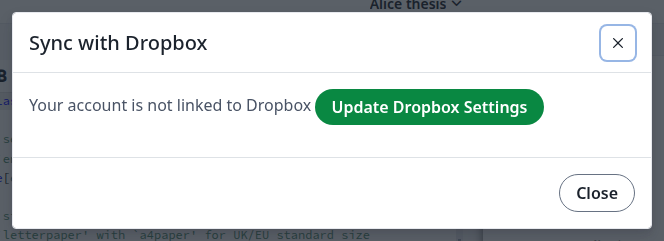

Синхронизируйте все свои проекты с папкой в Dropbox. Изменения передаются в обе стороны в фоновом режиме, за одним исключением: то, что вы набираете в редакторе, попадает в Dropbox через несколько минут после того, как вы покинете проект, или когда вы нажмёте **sync this project now**.

<Info>

Если вы не видите параметра Dropbox в **Account settings** или в редакторе, попросите администратора включить [синхронизацию с Dropbox](/ru/on-premises/configuration/overleaf-toolkit/integrations/dropbox-synchronisation).

</Info>

## Привязка учётной записи Dropbox {#link-your-dropbox-account}

Это делается один раз.

<Steps>
<Step title="Откройте настройки учётной записи">
Нажмите **Account**, затем **Account settings**. В разделе **Project synchronisation** найдите **Dropbox** и нажмите **Link**.

<Frame caption="Dropbox в настройках учётной записи">
  
</Frame>
</Step>

<Step title="Авторизуйтесь в Dropbox">
Откроется Dropbox. Войдите, если потребуется, затем авторизуйте приложение.
</Step>

<Step title="Проверьте привязку">
Вы вернётесь в настройки учётной записи. Зелёное сообщение сообщит, что ваша учётная запись Dropbox привязана, а на кнопке теперь написано **Unlink**. Под Dropbox отображается статус, показывающий, что ваши проекты отправляются.

<Frame caption="Ваша учётная запись Dropbox привязана">
  
</Frame>

Когда все проекты будут доставлены, статус сменится на **Overleaf and Dropbox have processed all updates**.

<Frame caption="Всё синхронизировано">
  
</Frame>
</Step>
</Steps>

Если ваша учётная запись ещё не привязана, карточка **Dropbox** в редакторе сначала попросит её привязать. Нажмите **Update Dropbox Settings**: настройки учётной записи откроются в новой вкладке. Привяжите там учётную запись, затем обновите страницу редактора, как подсказывает диалоговое окно.

<Frame caption="Подсказка, если учётная запись не привязана">
  
</Frame>

Если вы не разрешите доступ в Dropbox, то вернётесь в настройки учётной записи без сообщения, а на кнопке по-прежнему будет **Link**.

### Если у вас есть проекты с одинаковыми именами {#if-you-have-projects-with-the-same-name}

Привязать учётную запись нельзя, пока у двух ваших проектов одинаковое имя. Сообщение называет их. Архивные проекты и проекты в корзине тоже учитываются.

<Frame caption="Два проекта с одинаковым именем">
  
</Frame>

Переименуйте один из них и снова нажмите **Link**.

## Поиск проектов в Dropbox {#find-your-projects-in-dropbox}

Каждый ваш проект представляет собой папку в `Apps/<app name>/` в вашем Dropbox со всеми его файлами. Имя приложения выбрал ваш администратор. Синхронизируется каждый проект, в том числе те, которые вы создадите позже: выбрать только некоторые нельзя.

Чтобы увидеть папку проекта, откройте проект. На левой панели нажмите **Integrations**, затем **Dropbox**.

<Frame caption="Панель Integrations">
  
</Frame>

Диалоговое окно называет папку и содержит ссылку на неё в Dropbox.

<Frame caption="Папка этого проекта">
  
</Frame>

Новый проект с тем же именем, что и уже существующий, получает папку с номером, например `Field notes (1)`. Диалоговое окно показывает, какая папка принадлежит ему.

<Frame caption="Папка с номером">
  
</Frame>

## Изменения, которые вы вносите в Overleaf {#changes-you-make-in-overleaf}

Ничего нажимать не нужно.

* **Новые файлы, переименования, перемещения и удаления** сразу попадают в Dropbox. Новая папка появляется там вместе со своим первым файлом.
* **Переименование проекта** переименовывает его папку.
* **Правки, которые вы набираете в редакторе**, не попадают в Dropbox, пока проект открыт, и нажатие **Recompile** их не отправляет. Они отправляются примерно через три минуты после того, как все покинут проект. Чтобы отправить их раньше, см. [Принудительная синхронизация](#force-a-sync).
* **Удаление проекта** оставляет его папку в Dropbox. Удалите папку сами, если она больше не нужна.

## Изменения, которые вы вносите в Dropbox {#changes-you-make-in-dropbox}

Здесь тоже ничего нажимать не нужно. Dropbox сообщает Overleaf об изменении, и обычно оно появляется через несколько секунд, в том числе в открытом редакторе, без перезагрузки.

* **Новые файлы, правки, переименования и удаления** в папке проекта применяются к проекту. Как и новые папки.
* **Новая папка на верхнем уровне папки приложения** становится новым проектом.
* **Файлы, которые Overleaf не синхронизирует**, например `.DS_Store` или `.aux`, остаются только в Dropbox.

История проекта помечает такие изменения как <strong>(via Dropbox)</strong>.

### Если файл открыт в редакторе {#if-the-file-is-open-in-the-editor}

Файл меняется у вас на глазах, и диалоговое окно сообщает об этом. Нажмите **OK**.

<Frame caption="Открытый файл изменился в Dropbox">
  
</Frame>

Версия из Dropbox заменяет то, что вы набрали, но ещё не отправили. Ваш текст не теряется: он остаётся в истории проекта.

<Frame caption="Заменённый текст в истории">
  
</Frame>

### Переименование или удаление папки проекта {#rename-or-delete-a-project-folder}

Переименовывайте проект в Overleaf, а не в Dropbox. Для Overleaf папка, переименованная в Dropbox, считается удалённой папкой и новой папкой: вы получите новый проект с новым именем, а старый проект останется.

Если вы удалите папку проекта в Dropbox, проект останется в списке проектов вместе с файлами и историей. Когда вы откроете его в следующий раз, диалоговое окно сообщит об этом один раз. Нажмите **OK**.

<Frame caption="Папка этого проекта исчезла из Dropbox">
  
</Frame>

Проект продолжает синхронизироваться. Чтобы снова поместить его в Dropbox целиком, нажмите **sync this project now**.

### Пока проект находится в архиве или в корзине {#while-a-project-is-archived-or-in-the-trash}

Изменения, которые вы вносите в его папку в Dropbox, не применяются, и восстановление проекта их не подтягивает. После этого Overleaf перестаёт отправлять изменённые вами файлы, поэтому стороны расходятся. Сохраните такой файл в Dropbox ещё раз: версия из Dropbox заменит версию в Overleaf.

## Принудительная синхронизация {#force-a-sync}

У каждого проекта своя ссылка. Используйте её, если хотите, чтобы правки попали в Dropbox сразу, не покидая проект.

<Steps>
<Step title="Откройте диалог синхронизации">
Откройте проект. На левой панели нажмите **Integrations**, затем **Dropbox**.
</Step>

<Step title="Нажмите sync this project now">
Ссылка находится в конце <strong>Changes not appearing in Dropbox?</strong>
</Step>

<Step title="Проверьте результат">
Синее сообщение сообщает, что началась ручная синхронизация, а статус показывает **Sending and receiving updates**. Когда синхронизация завершится, он снова сменится на **Overleaf and Dropbox have processed all updates**.

<Frame caption="Идёт ручная синхронизация">
  
</Frame>
</Step>
</Steps>

Ссылка отправляет весь проект в Dropbox, включая правки, которые ещё находятся в редакторе. Она также считывает ожидающие изменения в Dropbox для всех ваших проектов. Если ваш сайт не может получать [уведомления от Dropbox](/ru/on-premises/configuration/overleaf-toolkit/integrations/dropbox-synchronisation#webhook), изменения из Dropbox поступают только этим способом.

Это можно делать раз в минуту для каждого проекта. Если раньше, красное сообщение попросит подождать.

<Frame caption="Подождите минуту до следующей">
  
</Frame>

## Отвязка учётной записи Dropbox {#unlink-your-dropbox-account}

<Steps>
<Step title="Нажмите Unlink">
В **Account settings**, в разделе **Dropbox**, нажмите **Unlink**.
</Step>

<Step title="Подтвердите">
Нажмите **Unlink** в диалоговом окне.

<Frame caption="Отвязка учётной записи">
  
</Frame>
</Step>

<Step title="Проверьте результат">
На кнопке снова написано **Link**, а карточка **Dropbox** в редакторе сообщает, что учётная запись не привязана. Больше ничего не синхронизируется ни в одну сторону. Ваши проекты и папки в Dropbox сохраняют свои файлы.
</Step>
</Steps>

### Повторная привязка позже {#link-again-later}

Нажмите **Link**. Ваши проекты снова отправляются в Dropbox:

* Каждый файл заменяет файл с тем же именем в Dropbox. То, что вы изменили в этих файлах в Dropbox, пока учётная запись была отвязана, перезаписывается, поэтому сначала перенесите такие изменения в проект.
* Файл, который есть только в Dropbox, остаётся там и попадает в проект, когда вы в следующий раз его измените.
* Проект, который вы переименовали, пока учётная запись была отвязана, получает новую папку. Старая папка остаётся.

### Если Overleaf отвязывает вашу учётную запись {#if-overleaf-unlinks-your-account}

Overleaf отвязывает вашу учётную запись, когда Dropbox больше не принимает привязку. В списке проектов указана причина, пока вы снова не привяжете учётную запись.

<Frame caption="Ваша учётная запись отвязана">
  
</Frame>

О причинах см. Q\&A на странице [синхронизации с Dropbox](/ru/on-premises/configuration/overleaf-toolkit/integrations/dropbox-synchronisation).

<Info>

О том, что получают соавторы в общем проекте, см. [Как работает синхронизация](/ru/on-premises/configuration/overleaf-toolkit/integrations/dropbox-synchronisation#как-работает-синхронизация).

</Info>
