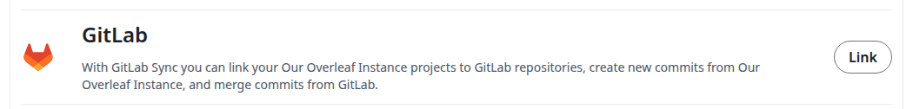
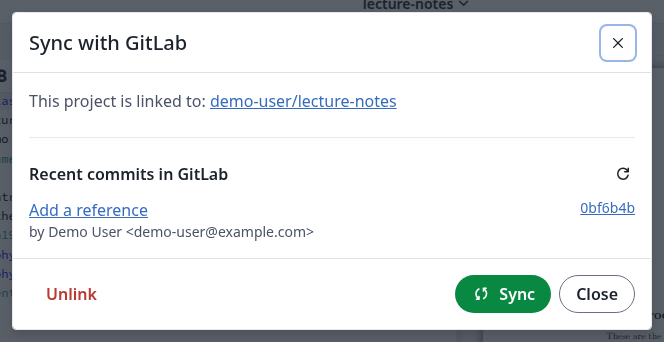

Подключите проект к репозиторию GitLab. Изменения передаются в обе стороны и только тогда, когда вы нажимаете **Sync**: ничего не синхронизируется само по себе.

<Info>

Сначала администратор должен включить [синхронизацию с GitLab](/ru/on-premises/configuration/overleaf-toolkit/integrations/gitlab-synchronisation).

</Info>

## Привязка учётной записи GitLab {#link-your-gitlab-account}

Это делается один раз.

<Steps>
<Step title="Откройте настройки учётной записи">
Нажмите **Account**, затем **Account settings**. В разделе **Project synchronisation** найдите **GitLab** и нажмите **Link**.

<Frame caption="GitLab в настройках учётной записи">
  
</Frame>
</Step>

<Step title="Авторизуйтесь на GitLab">
Откроется GitLab. Войдите, если потребуется, затем авторизуйте приложение.
</Step>

<Step title="Проверьте привязку">
Вы вернётесь в настройки учётной записи. Зелёное сообщение сообщит, что ваша учётная запись GitLab привязана, а на кнопке теперь написано **Unlink**.

<Frame caption="Ваша учётная запись GitLab привязана">
  
</Frame>
</Step>
</Steps>

Если ваша учётная запись ещё не привязана, **Import from GitLab** и карточка **GitLab** в редакторе сначала попросят её привязать. Нажмите **Link to your GitLab account**. Вы также окажетесь в настройках учётной записи, в новой вкладке, если начали в редакторе. Затем вернитесь и начните заново.

<Frame caption="Подсказка, если учётная запись не привязана">
  
</Frame>

## Импорт репозитория {#import-a-repository}

Так создаётся новый проект из репозитория GitLab, уже привязанный к нему.

<Steps>
<Step title="Откройте диалог импорта">
На странице проектов нажмите **New project**, затем **Import from GitLab**.

<Frame caption="Меню New project">
  
</Frame>
</Step>

<Step title="Выберите репозиторий">
Нажмите **Import to Overleaf** рядом с репозиторием. В списке есть ваши репозитории и репозитории ваших групп.

<Frame caption="Ваши репозитории GitLab">
  
</Frame>
</Step>

<Step title="Проверьте проект">
Новый проект откроется с файлами репозитория.

<Frame caption="Импортированный проект">
  
</Frame>
</Step>
</Steps>

## Экспорт проекта в новый репозиторий {#export-a-project-to-a-new-repository}

Так из проекта создаётся репозиторий, и они связываются. Проект можно привязать только этим способом или импортом: привязать его к уже существующему репозиторию нельзя.

<Steps>
<Step title="Откройте GitLab в редакторе">
Откройте проект. На левой панели нажмите **Integrations**, затем **GitLab**.

<Frame caption="Панель Integrations">
  
</Frame>
</Step>

<Step title="Заполните данные репозитория">
Выберите **Owner**: это можете быть вы или одна из ваших групп. Если вы выбираете группу, это поле называется **Organization**. **Repository Name** изначально совпадает с именем проекта. Описание необязательно, а **Private** выбрано по умолчанию. Нажмите **Create a GitLab repository**.

<Frame caption="Export Project to GitLab">
  
</Frame>

Если имя уже занято, в диалоговом окне появится <strong>Please check that the repository name is valid, and that you have permission to create the repository.</strong> Измените имя и снова нажмите кнопку.
</Step>

<Step title="Проверьте привязку">
В диалоговом окне теперь написано **This project is linked to** и указан репозиторий.

<Frame caption="Проект привязан">
  
</Frame>
</Step>
</Steps>

## Синхронизация {#sync}

<Steps>
<Step title="Откройте диалог синхронизации">
Откройте привязанный проект. На левой панели нажмите **Integrations**, затем **GitLab**.

**Recent commits in GitLab** перечисляет то, что попадёт в проект.

<Frame caption="Новый коммит ожидает в GitLab">
  
</Frame>
</Step>

<Step title="Опишите свои изменения">
Если вы что-то изменили в проекте, появится поле для сообщения коммита. Оно необязательно: если оставить его пустым, коммит будет называться `Updates from Overleaf`.

<Frame caption="Сообщение коммита для ваших изменений">
  
</Frame>
</Step>

<Step title="Нажмите Sync">
Нажмите **Sync**. Новые коммиты из GitLab попадают в проект, а ваши изменения отправляются в ветку репозитория по умолчанию. Если обе стороны изменили разные места, изменения объединяются автоматически.
</Step>

<Step title="Проверьте результат">
В диалоговом окне появится <strong>No new commits in GitLab since last merge.</strong>, а поле сообщения коммита исчезнет. Файлы в редакторе и коммиты на GitLab актуальны.

<Frame caption="Всё синхронизировано">
  
</Frame>
</Step>
</Steps>

### Если одни и те же строки изменились с обеих сторон {#if-the-same-lines-changed-on-both-sides}

Диалоговое окно сообщает, что изменения не удалось объединить, и называет новую ветку `overleaf-YYYY-MM-DD-HHMMSS`, в которой находятся ваши изменения. Overleaf также открывает на GitLab merge request из этой ветки.

<Frame caption="Конфликт">
  
</Frame>

1. Объедините эту ветку с веткой по умолчанию на GitLab или с помощью Git. Тем временем диалог можно закрыть: при повторном открытии он покажет то же сообщение.
2. Нажмите **I have manually merged. Continue**. Объединённый результат попадёт в проект. Если нажать кнопку до слияния ветки, диалог останется без изменений.
3. Ветка остаётся на GitLab, если вы не удалили её при слиянии. Удалите её, когда она станет не нужна.

То же диалоговое окно появляется, когда правила слияния репозитория задерживают merge request, например если требуется одобрение, даже если конфликтующих строк нет. Как только правило позволит, выполните слияние merge request на GitLab и нажмите **I have manually merged. Continue**. См. [Как работает синхронизация с GitLab](/ru/on-premises/configuration/overleaf-toolkit/integrations/gitlab-synchronisation#how-syncing-works-with-gitlab).

## Отвязка проекта {#unlink-a-project}

Сделайте это, если больше не хотите синхронизировать проект.

<Steps>
<Step title="Нажмите Unlink">
В диалоге синхронизации нажмите **Unlink**.
</Step>

<Step title="Подтвердите">
Нажмите **Confirm**. Это только удаляет привязку: подключение к репозиторию, которым вы владеете, упомянутое в предупреждении, остаётся возможностью на будущее, а не происходит сейчас.

<Frame caption="Подтверждение отвязки">
  
</Frame>
</Step>

<Step title="Проверьте результат">
Теперь в диалоговом окне отображается **Export Project to GitLab**. И проект, и репозиторий сохраняют своё содержимое. Чтобы снова синхронизировать, экспортируйте проект в новый репозиторий или импортируйте репозиторий в новый проект.
</Step>
</Steps>

## Отвязка учётной записи GitLab {#unlink-your-gitlab-account}

В **Account settings**, в разделе **GitLab**, нажмите **Unlink**, затем ещё раз **Unlink** в диалоговом окне.

<Frame caption="Отвязка учётной записи">
  
</Frame>

Ваши проекты остаются привязанными к своим репозиториям. Синхронизировать их нельзя, пока вы снова не привяжете учётную запись.

<Info>

О том, кто что может делать в общем проекте, см. [Кто может привязывать и синхронизировать](/ru/on-premises/configuration/overleaf-toolkit/integrations/gitlab-synchronisation#who-can-link-and-sync).

</Info>
