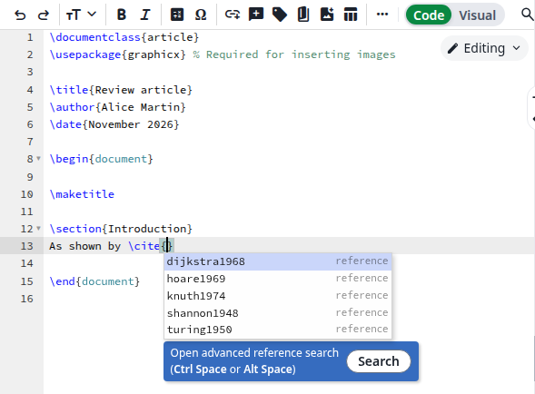

Импортируйте библиотеку Mendeley в проект как файл `.bib`, а затем цитируйте из него как обычно. Файл является копией: он меняется, только когда вы нажимаете **Refresh**.

<Info>

Если в **Account settings** нет параметра Mendeley, попросите администратора включить [интеграцию с Mendeley](/ru/on-premises/configuration/overleaf-toolkit/integrations/mendeley-integration).

</Info>

## Связать аккаунт Mendeley {#link-your-mendeley-account}

Это делается один раз.

<Steps>
<Step title="Откройте настройки аккаунта">
Нажмите **Account**, затем **Account settings**. В разделе **Reference managers** найдите **Mendeley** и нажмите **Link to Mendeley**.

<Frame caption="Mendeley в настройках аккаунта">
  
</Frame>

Карточка **Mendeley** на панели **Integrations** в редакторе ведёт туда же, в той же вкладке.

<Frame caption="Панель Integrations">
  
</Frame>
</Step>

<Step title="Разрешите доступ в Mendeley">
Откроется Mendeley. Войдите, если потребуется, и разрешите доступ приложению.
</Step>

<Step title="Проверьте связь">
Вы вернётесь в настройки аккаунта. Зелёное сообщение гласит **Reference manager linked**, а на кнопке теперь написано **Unlink**.

<Frame caption="Аккаунт Mendeley связан">
  
</Frame>
</Step>
</Steps>

Если вы не разрешите доступ в Mendeley, в том же разделе появится **Sorry, something went wrong**. Нажмите **Link to Mendeley**, чтобы попробовать снова.

## Создать файл из библиотеки {#create-a-file-from-your-library}

<Steps>
<Step title="Откройте диалог Add files">
Откройте проект. В дереве файлов нажмите **New file**, затем **From Mendeley**. Этот пункт появляется только после того, как аккаунт связан.
</Step>

<Step title="Выберите имя файла и библиотеку">
Поле **File Name** по умолчанию содержит `mendeley.bib`. Сохраните расширение `.bib`: без него не будет предпросмотра, и ни `\cite`, ни `\bibliography` не найдут записи.

Поле **Library** по умолчанию содержит **My Library**, а также перечисляет ваши группы. В одном файле хранится одна библиотека.

<Frame caption="Файл из личной библиотеки">
  
</Frame>
</Step>

<Step title="Нажмите Create">
Диалог закроется, и файл появится в дереве файлов. Нажмите на него: отобразятся время импорта и записи. Редактировать файл в редакторе нельзя.

<Frame caption="Импортированный файл">
  
</Frame>

Если кажется, что **Create** ничего не делает, файл с таким именем уже существует. Выберите другое имя.
</Step>
</Steps>

### Импорт группы {#import-a-group}

Повторите те же действия с отдельным именем файла и выберите группу в **Library**. В проекте может быть несколько таких файлов.

<Frame caption="Файл из группы">
  
</Frame>

## Цитирование из файла {#cite-from-the-file}

<Steps>
<Step title="Начните цитату">
В файле `.tex` введите `\cite{`. В списке отображаются записи из всех файлов `.bib` проекта. Нажмите на запись, чтобы вставить её.

<Frame caption="Записи импортированных файлов">
  
</Frame>
</Step>

<Step title="Или найдите по названию или автору">
Нажмите **Search** под списком или нажмите Ctrl+Space внутри фигурных скобок. Введите текст для фильтрации, выберите одну или несколько записей и нажмите **Insert**.

<Frame caption="Поиск литературы">
  
</Frame>
</Step>

<Step title="Добавьте список литературы">
Добавьте эти строки перед `\end{document}`, указав имя файла без `.bib`. Если файлов несколько, перечислите имена через запятую.

```latex
\bibliographystyle{plain}
\bibliography{mendeley}
```

Нажмите **Recompile**. Источник появится в PDF.

<Frame caption="Скомпилированный источник">
  
</Frame>
</Step>
</Steps>

Импортированные файлы не предлагаются в **Settings** в разделе **References**, **Main bibliography file for this project**, поэтому список остаётся пустым, если в проекте нет других файлов `.bib`. Цитировать из них всё равно можно.

<Frame caption="Пустой список ожидаем">
  
</Frame>

## Обновить файл {#refresh-the-file}

Изменения в библиотеке Mendeley не попадают в проект сами по себе.

<Steps>
<Step title="Откройте файл">
В дереве файлов нажмите на импортированный файл.
</Step>

<Step title="Нажмите Refresh">
Весь файл заново импортируется из библиотеки, выбранной при его создании: новые записи появляются, удалённые исчезают. Время вверху меняется.

<Frame caption="Обновлённый файл">
  
</Frame>
</Step>

<Step title="Перекомпилируйте">
Нажмите **Recompile**, чтобы обновить PDF.
</Step>
</Steps>

Каждый файл обновляется отдельно: файл группы обновляйте отдельно. Кто может обновлять файл в общем проекте, описано в [примечаниях для администраторов](/on-premises/configuration/overleaf-toolkit/integrations/mendeley-integration#notes).

## Отвязать аккаунт Mendeley {#unlink-your-mendeley-account}

В **Account settings** в разделе **Mendeley** нажмите **Unlink**, затем ещё раз **Unlink** в диалоге. На кнопке снова появится **Link to Mendeley**.

<Frame caption="Отвязка аккаунта">
  
</Frame>

Импортированные файлы остаются в проектах и по-прежнему компилируются. Пункт **From Mendeley** исчезает из диалога **Add files**, а **Refresh** показывает ошибку, пока вы снова не свяжете аккаунт.

<Frame caption="Обновление без связанного аккаунта">
  
</Frame>

После повторной привязки **Refresh** работает с теми же файлами.

## Если что-то пошло не так {#if-something-goes-wrong}

**Could not load references from Mendeley, please re-link your account and try again** или **There was an error accessing your Mendeley data** в диалоге **Add files**: Overleaf больше не может читать вашу библиотеку, например потому что вы отозвали его доступ в Mendeley. В **Account settings** нажмите **Unlink**, затем **Link to Mendeley**. До этого **Create** тоже не срабатывает и выдаёт сообщение **The project that contains this file is not shared with you**, даже в вашем собственном проекте.

<Frame caption="Overleaf больше не может читать вашу библиотеку">
  
</Frame>

**The remote service produced an error** при нажатии **Refresh**: запрос к Mendeley не удался. Содержимое файла сохраняется. Нажмите **Refresh** ещё раз позже.
