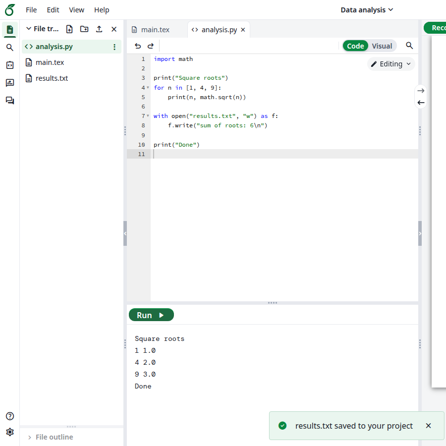

Скрипты Python выполняются в вашем браузере, поэтому вывод появляется прямо под редактором. Ничего настраивать не нужно.

<Steps>
<Step title="Создайте скрипт">
В дереве файлов нажмите значок **New file**. Введите имя, оканчивающееся на `.py`, и нажмите **Create**.

<Frame caption="Новый файл Python">
  
</Frame>

Под редактором появляются кнопка **Run** и панель вывода. В первый раз кнопка остаётся неактивной, пока загружается Python.
</Step>

<Step title="Запустите его">
Напишите код и нажмите **Run**. То, что печатает скрипт, появляется на панели вывода. Сохранять заранее не нужно.

Файлы, которые записывает скрипт, попадают в ваш проект. Сообщение сообщает, какие именно, например **results.txt saved to your project**, и файл появляется в дереве файлов.

<Frame caption="Вывод и сохранённый файл">
  
</Frame>
</Step>

<Step title="Остановите скрипт">
Пока скрипт выполняется, **Run** превращается в **Stop**. Нажмите её, чтобы прервать скрипт. Панель вывода заканчивается строкой **Execution interrupted**.

<Frame caption="Выполняющийся скрипт">
  
</Frame>
</Step>
</Steps>

## Используйте рисунок в документе {#use-a-figure-in-your-document}

Графикам негде отобразиться, поэтому сохраняйте их в файл. Например:

```python
import matplotlib.pyplot as plt

plt.plot([1, 2, 3], [1, 4, 9])
plt.savefig("figure.png")
```

`figure.png` появляется в проекте и готов для `\includegraphics{figure.png}`.

<Frame caption="Сохранённый график">
  
</Frame>

## Чтение файлов проекта {#read-your-project’s-files}

Скрипт может открывать файлы проекта по их пути:

```python
print(open("results.txt").read())
```

## Если что-то пошло не так {#if-something-goes-wrong}

<strong>Скрипт выдаёт ошибку.</strong> Ошибка появляется красным на панели вывода, после всего, что скрипт напечатал до неё.

<Frame caption="Ошибка в скрипте">
  
</Frame>

<strong>`ModuleNotFoundError: No module named ...`.</strong> Доступны только пакеты, встроенные в Pyodide, а пакеты, установленные через `pip`, использовать нельзя. NumPy и Matplotlib входят в число доступных, а сообщение содержит ссылку на [полный список](https://pyodide.org/en/stable/usage/packages-in-pyodide.html).

<Frame caption="Недоступный пакет">
  
</Frame>
