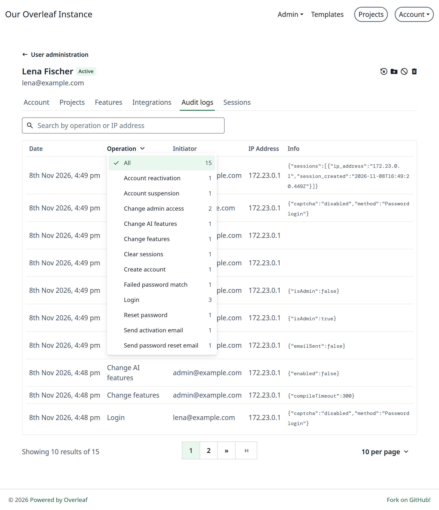

Att driva en Overleaf-instans för ett labb eller en institution ger samma frågor varje vecka. Varför kan den här studenten inte logga in? Vem använder fortfarande servern? Vem gav det kontot administratörsrättigheter? Vart tog fjolårets avhandling vägen? Vi har byggt om administratörspanelen så att du kan besvara dem utan att öppna ett databasskal.

Den nya panelen följer utseendet i Overleaf 6.3 och är översatt till alla språk som gränssnittet stöder. Den har en lista över alla användare, en lista över alla projekt, en sida för var och en av dem, en plats för att hantera dina mallar och granskningsloggar.

<Info>

Den nya administratörspanelen är sammanfogad i vår huvudgren och släpps officiellt i v6.4.0. Alla skärmbilder i det här inlägget kommer från en testinstans fylld med påhittade konton.

</Info>

### Vad den innehåller {#what’s-in-it}

* **Användarlista**: sökning, filter efter inloggningsmetod, roll och status samt massåtgärder.
* **Användarsida**: kontot, projekten, funktionerna, integrationerna, granskningsloggarna och sessionerna för en person.
* **Projektlista**: alla projekt på instansen, sökbara efter namn, ID, ägare eller delningslänk.
* **Projektsida**: inställningarna, filerna, medlemmarna, de borttagna filerna och granskningsloggarna för ett projekt.
* **Mallhantering**: publicera ett projekt som mall, uppdatera det och håll ordning i galleriet.
* **Granskningsloggar**: vem som gjorde vad, när och från vilken IP-adress.

## En lista för alla användare {#one-list-for-every-user}

Klicka på **Admin** och sedan på **Manage Users**. Varje konto är en rad som visar hur det loggar in, dess roll och dess status.

<Frame caption="Användarlistan">
  
</Frame>

Sök efter namn, e-postadress eller ID. Rubrikerna **Login**, **Role** och **Status** är filter, och varje alternativ visar hur många konton det skulle returnera. Du ser direkt hur många som kommer in via SAML, och varje OIDC-leverantör visas under det namn du gav den.

<Frame caption="Filtrera efter inloggningsmetod">
  
</Frame>

Varje konto har exakt en status, och de fyra statusarna summerar till totalen.

| Status       | Vad den betyder                                                         |
| ------------ | ----------------------------------------------------------------------- |
| **Active**   | Har loggat in eller öppnat ett projekt under de senaste 12 månaderna.   |
| **Pending**  | Har aldrig loggat in.                                                   |
| **Inactive** | Har loggat in tidigare, men inte under de senaste 12 månaderna.         |
| **Disabled** | En administratör har hindrat kontot från att logga in.                  |

Borttagna konton ligger inte i vägen, de har ett eget filter. Om en sökning även matchar ett borttaget konto säger en rad ovanför tabellen det och erbjuder att visa det.

<Frame caption="Filtrera efter status">
  
</Frame>

Sökning, sortering och sidindelning körs på servern, så listorna stannar inte längre vid de första 1 000 raderna.

### Ta in personer, med eller utan e-post {#bring-people-in-with-or-without-email}

**Create account** lägger till en användare och ger dig länken som användaren behöver. När [e-postleverans](/sv/on-premises/configuration/overleaf-toolkit/email-delivery  "mention") inte är konfigurerad säger dialogrutan det tydligt och låter dig kopiera länken, så att även en liten instans kan ta emot nya personer.

<Frame caption="Ett nytt kontos aktiveringslänk">
  
</Frame>

Panelen erbjuder rätt länk för varje konto: **Send activation email** för ett som aldrig har loggat in, giltig i 7 dagar, och **Send reset link** för ett som har gjort det, giltig i 1 timme. Konton som loggar in via SSO har inget lokalt lösenord och får därför ingen av dem.

### Ändra många konton på en gång {#change-many-accounts-at-once}

Markera några konton så erbjuder verktygsfältet **Send activation email**, **Transfer this user's projects**, **Disable**, **Enable**, **Make admin**, **Remove admin** och **Delete account**. Dialogrutan listar kontona innan du bekräftar. Om några misslyckas säger den vilka, och det som redan fungerade förblir gjort.

<Frame caption="Massåtgärder">
  
</Frame>

### Svårt att göra fel {#hard-to-get-wrong}

* Ditt eget konto är märkt **You** och dess åtgärder är nedtonade, så du kan inte inaktivera, ta bort eller degradera dig själv.
* Varje åtgärd kräver bekräftelse i en dialogruta som namnger kontot.
* **Delete account** kan först lämna över användarens projekt till någon annan.
* Ett borttaget konto kan återställas, tillsammans med de projekt som togs bort med det. Endast **Delete permanently** är slutgiltigt, och den varnar dig.

## Allt om en person {#everything-about-one-person}

Klicka på ett namn för att öppna användarens sida. Den har sex flikar och samma åtgärdsikoner som listan.

### Konto {#account}

Kontots uppgifter, från ID och e-postadresser till senaste inloggningen och dess IP-adress. Klicka på pennan för att ändra e-postadress, namn eller lösenord, eller för att slå på eller av **Admin**.

<Frame caption="Redigera ett konto">
  
</Frame>

### Projekt {#projects}

Projekten som den här personen äger, med egen sökning, statusfilter och åtgärder.

<Frame caption="En användares projekt">
  
</Frame>

### Funktioner {#features}

Vad som är påslaget för det här kontot, till exempel medarbetare per projekt, tidsgränsen för kompilering, integrationer och AI, tillsammans med kontots AI-användning och en knapp för att nollställa den.

<Frame caption="En användares funktioner">
  
</Frame>

### Integrationer {#integrations}

Personens Git-åtkomsttoken och de tjänster som personen har kopplat.

<Frame caption="En användares integrationer">
  
</Frame>

### Sessioner {#sessions}

Var personen är inloggad. **Clear sessions** loggar ut personen överallt, vilket är det första du gör när en bärbar dator försvinner.

<Frame caption="En användares sessioner">
  
</Frame>

## Alla projekt på instansen {#every-project-on-the-instance}

Klicka på **Admin** och sedan på **Project/Object Lookup**. Listan visar alla användares projekt med ägare och status. Sökrutan tar ett projekts namn, dess ID, dess ägare eller en länk. Klistra in en delningslänk så hittar du projektet bakom den.

<Frame caption="Alla projekt">
  
</Frame>

Filtret **Status** skiljer på projekt som är **Active**, **Archived**, **Trashed** och **Deleted**. Markera flera projekt för att ladda ner dem i en enda `.zip`-fil, byta ägare eller ta bort dem. I vyn **Deleted** är knapparna **Restore** och **Delete permanently**.

<Frame caption="Filtrera projekt efter status">
  
</Frame>

## Allt om ett projekt {#everything-about-one-project}

Klicka på ett projekts titel för att öppna dess sida.

### Översikt {#overview}

Ändra namn, länkdelning, kompilator, TeX Live-version och huvuddokument. **Change project owner** ger projektet till en annan användare, vilket hjälper när någon lämnar labbet och avhandlingen måste stanna.

<Frame caption="Redigera ett projekt">
  
</Frame>

### Filträd {#file-tree}

Projektets filer och mappar, skrivskyddade.

<Frame caption="Ett projekts filer">
  
</Frame>

### Medlemmar {#members}

Ägaren, medarbetarna och de väntande inbjudningarna. Ändra en medarbetares roll, ta bort åtkomsten eller skicka om eller återkalla en inbjudan.

<Frame caption="Ändra ett projekts medlemmar">
  
</Frame>

### Borttagna filer {#deleted-files}

Filer som tagits bort från projektet. **Restore file** lägger en kopia i projektets rotmapp, och raden visar kopians namn.

<Frame caption="En återställd fil">
  
</Frame>

## Mallhantering {#template-management}

En mall börjar som ett vanligt projekt. Du publicerar den från redigeraren och hanterar den från dess sida i galleriet eller från administratörspanelen.

### Alla mallar i en tabell {#all-templates-in-one-table}

Klicka på **Admin**, sedan **Project/Object Lookup** och sedan fliken **Templates**. Den listar varje publicerad mall med författare, ägare och när den senast ändrades, och du kan söka i den. Klicka på en titel för att öppna mallen, på en ägare för att öppna den användarens sida eller på papperskorgen för att ta bort en mall. En borttagning hamnar i [din egen granskningslogg](#when-there-is-no-log-left).

<Frame caption="Alla mallar i administratörspanelen">
  
</Frame>

### Publicera från redigeraren {#publish-from-the-editor}

Öppna ett projekt och kompilera det tills PDF:en ser rätt ut, eftersom galleriet visar PDF:en från den senaste lyckade kompileringen. Klicka sedan på **File** och därefter **Manage Template**, och fyll i titel, författare, en kategori, en beskrivning i Markdown och en licens. Projektets kompilator och huvuddokument följer med mallen, så projekt som öppnas från den använder samma.

<Frame caption="Publicera ett projekt som mall">
  
</Frame>

### Uppdatera en mall {#update-a-template}

För att ändra en malls filer och PDF publicerar du projektet igen under samma titel. Dialogrutan talar om att titeln redan finns, och knappen blir **Overwrite**. Projekt som personer redan har öppnat från mallen ändras inte.

<Frame caption="Publicera under samma titel">
  
</Frame>

### Mallsidan {#the-template-page}

Alla kan använda **Open as Template**, **View PDF** och nedladdningsknappen. Administratörer får dessutom **Admin: Source Project**, **Edit** och **Delete**.

<Frame caption="En malls sida">
  
</Frame>

**Edit** ändrar vad galleriet visar om en mall: titel, författare, kategori, beskrivning och licens, samt stavningskontrollspråket för projekt som öppnas från den. Filerna och PDF:en påverkas inte. Mallen behåller en egen kopia av filerna, så att ta bort källprojektet tar inte med sig mallen.

<Frame caption="Redigera en malls detaljer">
  
</Frame>

### Ett galleri för dina användare {#a-gallery-for-your-users}

Galleriet öppnas med ett kort för varje kategori, och varje kategori har en egen sida. Kategorierna kommer från din konfiguration av [Mallar](/sv/on-premises/configuration/overleaf-toolkit/templates  "mention"), där du också kan låta en användare som inte är administratör publicera.

<Frame caption="Mallgalleriet">
  
</Frame>

Sidan **All templates** visar varje mall med en förhandsvisning av dess första sida, och dina användare kan söka i den och sortera efter titel eller datum.

<Frame caption="Alla mallar">
  
</Frame>

## Granskningsloggar: vem gjorde vad, och när {#audit-logs-who-did-what-and-when}

Det här är den del vi är mest nöjda med. Varje konto och varje projekt har nu en egen granskningslogg, och webbplatsens administratörer kan läsa den direkt i panelen.

Öppna fliken **Audit logs** på en användares sida. De senaste posterna kommer först.

<Frame caption="Ett kontos granskningslogg">
  
</Frame>

Läst nerifrån och upp berättar den här sidan en historia. Lena loggade in. En administratör höjde hennes tidsgräns för kompilering till 300 sekunder, stängde av hennes AI-åtkomst, skickade en länk för att återställa lösenordet, gjorde henne till administratör och ångrade det, och inaktiverade sedan kontot och aktiverade det igen. Lena loggade in igen, och administratören rensade hennes sessioner.

| Kolumn         | Vad den berättar                                                                                       |
| -------------- | ------------------------------------------------------------------------------------------------------ |
| **Date**       | När det hände.                                                                                         |
| **Operation**  | Vad som hände.                                                                                         |
| **Initiator**  | Vem som gjorde det. Det en administratör gör med ett konto visar administratören, inte användaren.     |
| **IP Address** | Var begäran kom ifrån.                                                                                 |
| **Info**       | Detaljerna, som den nya tidsgränsen för kompilering, eller om e-postmeddelandet verkligen skickades.   |

### Hitta posten du behöver {#find-the-entry-you-need}

Sök efter åtgärd eller IP-adress. Rubriken **Operation** är ett filter som listar varje åtgärd i den här loggen och hur många gånger den har inträffat.

<Frame caption="Filtrera efter åtgärd">
  
</Frame>

### En logg för varje projekt {#a-log-for-every-project}

Projektsidan har samma flik. Den visar vem som bjöds in, vem som gick med, vems roll som ändrades, vem som laddade ner projektet och vem som tog över det.

<Frame caption="Ett projekts granskningslogg">
  
</Frame>

### Vad som registreras {#what-gets-recorded}

Det här är de viktigaste åtgärderna i varje logg, under de namn du ser i panelen.

| Logg    | Område                      | Åtgärder                                                                                                                                                                                                                                    |
| ------- | --------------------------- | ------------------------------------------------------------------------------------------------------------------------------------------------------------------------------------------------------------------------------------------- |
| Konto   | Inloggning och lösenord     | Login, Logout, Failed password match, Update password, Reset password                                                                                                                                                                       |
| Konto   | E-post och SSO              | Add email, Remove email, Change primary email, Link SSO, Unlink SSO                                                                                                                                                                         |
| Konto   | Integrationer               | Link GitHub, Unlink GitHub, Link Dropbox, Unlink Dropbox, Integration account linked, Integration account unlinked, Create Git token, Delete Git token                                                                                      |
| Konto   | Administratörsåtgärder      | Create account, Send activation email, Send password reset email, Change name, Change admin access, Change features, Change AI features, Reset AI usage, Account suspension, Account reactivation, Clear sessions, Transfer projects, Delete account, Restore account |
| Projekt | Delning                     | Send invite, Resend invite, Revoke invite, Accept invite, Join via token, Accept via link sharing, Remove collaborator, Leave project, Project role changed, Toggle access level, Transfer ownership                                       |
| Projekt | Filer                       | Project downloaded, Project exported docx, Project exported markdown, Project exported html, Restore deleted doc                                                                                                                            |
| Projekt | Administratörsåtgärder      | Project deleted, Project restored                                                                                                                                                                                                           |
| Projekt | Git-synkronisering          | Integration repo linked, Integration repo unlinked                                                                                                                                                                                          |

### När ingen logg finns kvar {#when-there-is-no-log-left}

**Delete permanently** tar bort ett konto eller ett projekt tillsammans med dess logg, och en mall har aldrig haft någon. Därför skrivs dessa åtgärder till loggen för den administratör som utförde dem, tillsammans med e-postadressen eller ID:t för det som togs bort.

<Frame caption="Permanenta borttagningar i administratörens egen logg">
  
</Frame>

### Bra att veta {#good-to-know}

* Poster sparas i två och ett halvt år, sedan tar MongoDB bort dem automatiskt.
* Bakom en omvänd proxy anger du [`OVERLEAF_TRUSTED_PROXY_IPS`](/sv/on-premises/configuration/overleaf-toolkit/environment-variables  "mention") så att loggen visar besökarens adress och inte proxyns.
* Allt registreras inte ännu. Git clone och push, ändringar av ett projekts inställningar som namn eller kompilator, och de projekt som en ägare skapar, arkiverar, kastar eller tar bort visas inte i projektloggen.

## Prova den {#try-it}

Den nya panelen levereras med Ayakaleaf Pro v6.4.0. Steg-för-steg-guiderna finns redan online:

* [Användarhantering](/sv/on-premises/user-guide/administrators/user-management  "mention")
* [Projekthantering](/sv/on-premises/user-guide/administrators/project-management  "mention")
* [Mallhantering](/on-premises/user-guide/administrators/template-management  "mention")

Om något saknas eller inte fungerar som du förväntar dig, berätta det för oss på [GitHub](https://github.com/ayaka-notes/ayakaleaf-pro/issues).
