Gör detta en gång, direkt efter [installationen](/sv/on-premises/installation/introduction). Den här sidan använder standardinloggningen med lösenord.

<Steps>
<Step id="open-the-launchpad" title="Öppna launchpad">
Öppna `/launchpad` på din instans, till exempel `http://localhost/launchpad`. Du ser **Create the first Admin account**.

Formuläret finns bara tills den första administratören finns. Därefter skickas utloggade besökare till inloggningssidan.
</Step>

<Step id="create-the-administrator-account" title="Skapa administratörskontot">
Ange en e-postadress och ett lösenord och klicka sedan på **Register**.

<Frame caption="Det första administratörskontot">
  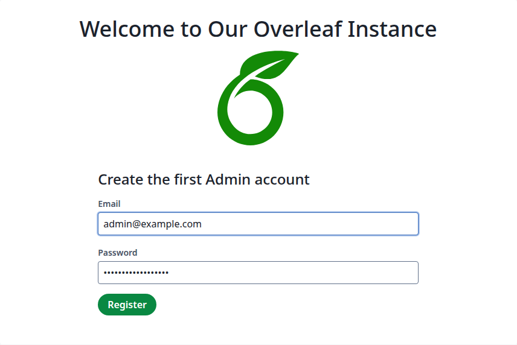
</Frame>

Om lösenordet nekas visas ett meddelande ovanför formuläret och inget konto skapas.

<Frame caption="Ett nekat lösenord">
  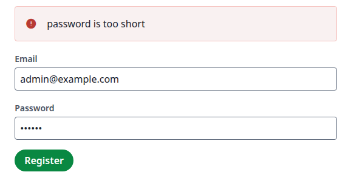
</Frame>

| Meddelande | Betydelse |
| --- | --- |
| `password is too short` | Färre än 8 tecken. |
| `password is too long` | Fler än 72 tecken. |
| `password contains an invalid character` | Tillåtna är bokstäverna `a-z` och `A-Z`, siffror och `@#$%^&*()-_=+[]{};:<>/?!£€.,`. Mellanslag och bokstäver med accent eller icke-latinska bokstäver är inte tillåtna. |
| `password contains part of email address` | Det innehåller e-postadressen eller delen före `@`, eller så är det en del av e-postadressen. För `admin@example.com` nekas både `admin-7Tq9-demo` och `example.com`. |
| `password is too similar to email address` | Det liknar e-postadressen för mycket, till exempel `adm1n@example.c0m`. |

Versaler, siffror och symboler krävs inte som standard. Se [Lösenordsbegränsningar](/sv/on-premises/configuration/overleaf-toolkit/authentication/password-restrictions) för att ändra längdgränserna.
</Step>

<Step id="log-in" title="Logga in">
Efter **Register** är du på inloggningssidan. Ange samma e-postadress och lösenord och klicka sedan på **Login**.

<Frame caption="Logga in med det nya kontot">
  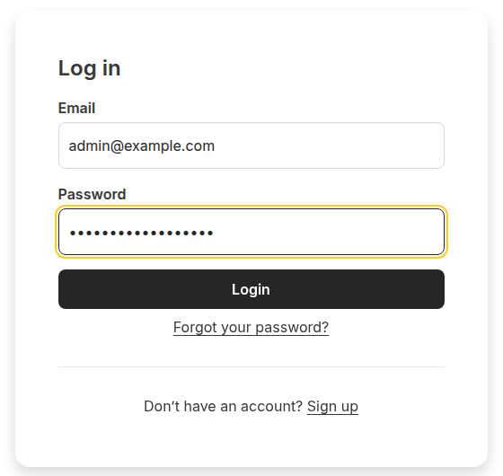
</Frame>

Du är tillbaka på launchpad, nu med **Status Checks**.
</Step>

<Step id="check-the-instance" title="Kontrollera instansen">
`websockets` ska visa **OK**.

Testa e-post genom att ange din adress under **Send a test email**, klicka på **Send** och sedan kontrollera inkorgen.

<Frame caption="Statuskontroller och testmejlet">
  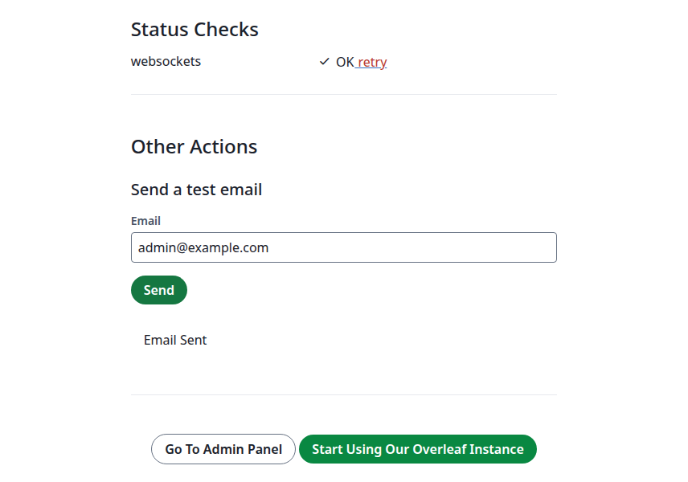
</Frame>

<Warning>

**Email Sent** bevisar inte att ett meddelande har lämnat servern. Utan [e-postleverans](/sv/on-premises/configuration/overleaf-toolkit/email-delivery) visar sidan samma text och ingenting kommer fram.

</Warning>

**Start Using** _ditt webbplatsnamn_ öppnar dina projekt. **Go To Admin Panel** öppnar webbplatsverktygen, se [Grundläggande hantering](/sv/on-premises/user-guide/administrators/basic-management).
</Step>

<Step id="create-the-first-user" title="Skapa den första användaren">
Klicka på **Admin** i toppmenyn och sedan på **Manage Users**.

<Frame caption="Menyn Admin">
  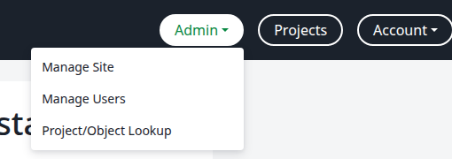
</Frame>

Klicka på **Create account**.

<Frame caption="Användarlistan">
  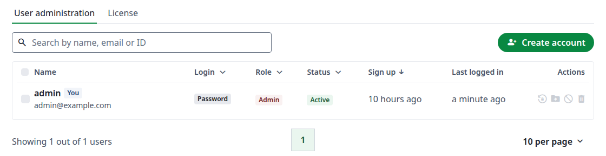
</Frame>

Ange användarens e-postadress. **First name** och **Last name** är valfria. Markera **Admin** bara för en annan administratör. Klicka på **Create**.

<Frame caption="Dialogrutan Create account">
  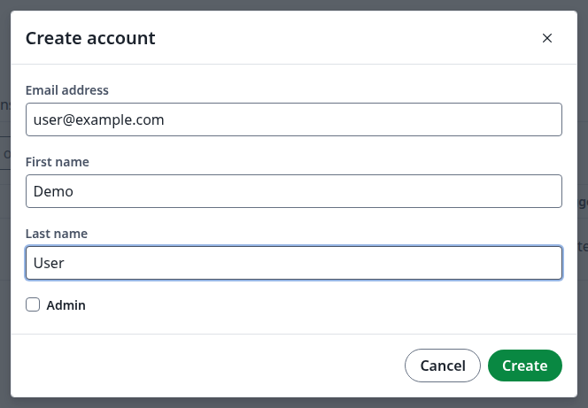
</Frame>

Dialogrutan visar sedan det nya kontot och dess aktiveringslänk, som går ut efter 7 dagar:

* **Email Sent** betyder att aktiveringsmejlet skickades.
* <strong>No email was sent. Copy the link and pass it on.</strong> betyder att mejlet inte skickades, till exempel för att [e-postleverans](/sv/on-premises/configuration/overleaf-toolkit/email-delivery) inte är konfigurerad.

<Frame caption="Det nya kontot och dess aktiveringslänk">
  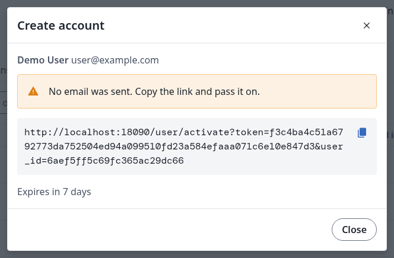
</Frame>

Klicka på **Close**. Kontot visas i listan med statusen **Pending**.

<Frame caption="Ett nytt konto förblir Pending tills första inloggningen">
  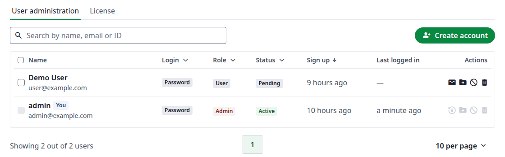
</Frame>
</Step>

<Step id="give-the-user-access" title="Ge användaren åtkomst">
**Med e-postleverans konfigurerad** får användaren ett aktiveringsmejl med en länk **Set password**. Länken öppnar den här sidan. Användaren anger ett lösenord, klickar på **Activate** och hamnar sedan på projektsidan. Lösenordsreglerna ovan gäller.

<Frame caption="Det användaren ser efter att ha öppnat länken">
  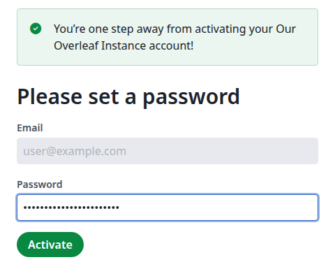
</Frame>

**Utan e-postleverans** skickar du länken vidare själv. Klicka på kopieringsikonen i dialogrutan efter **Create** och skicka länken till användaren, som anger ett lösenord som ovan.

Om du stängde dialogrutan eller länken har gått ut klickar du på kuvertikonen på användarens rad i **Manage Users** och sedan på **Send activation email**. Dialogrutan visar en ny länk, som går ut efter 7 dagar.

<Frame caption="En ny aktiveringslänk">
  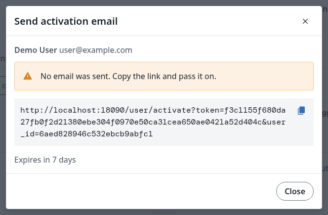
</Frame>

Du kan också ange ett lösenord själv. Klicka på användarens namn i **Manage Users** och sedan på pennikonen. Ange **New password** och klicka på **Save**. Ge lösenordet till användaren, som loggar in på `/login`.

<Frame caption="Ange ett lösenord på fliken Account">
  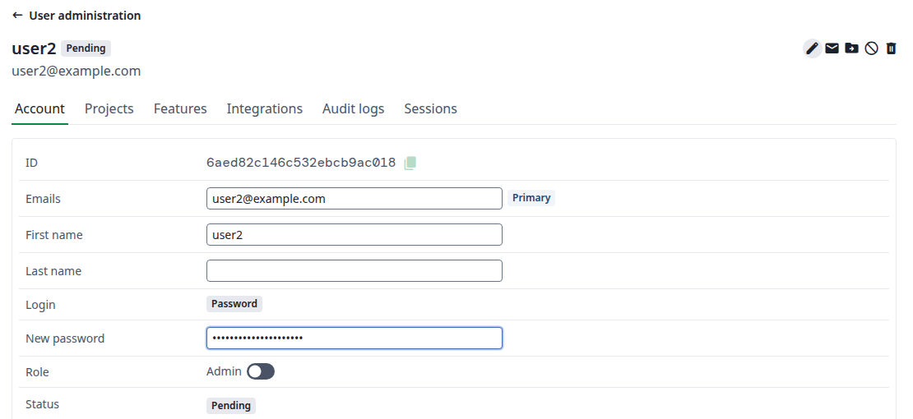
</Frame>
</Step>

<Step id="confirm-it-worked" title="Bekräfta att det fungerade">
Efter användarens första inloggning ändras statusen i **Manage Users** till **Active**.

<Frame caption="Användaren har loggat in">
  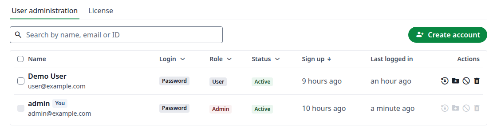
</Frame>
</Step>
</Steps>

<Info>

**Sign up** skapar inga konton som standard: sidan ber besökare kontakta adressen i `OVERLEAF_ADMIN_EMAIL`. Se [Offentlig åtkomst](/sv/on-premises/configuration/overleaf-toolkit/authentication/public-access) för att låta personer registrera sig själva.

</Info>
