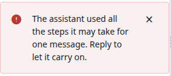

Assistenten arbetar med projektet du har öppet. Den läser dina dokument och föreslår ändringar, och du använder eller avvisar varje ändring. Svaren i skärmbilderna är exempel: vad du får beror på modellen som din webbplats använder.

<Info>

Om du inte ser **AI assistant** i vänsterfältet hänvisar du din administratör till [AI-integration](/sv/on-premises/configuration/overleaf-toolkit/integrations/ai-integration).

</Info>

## Starta en chatt {#start-a-chat}

<Steps>
<Step title="Öppna assistenten">
Klicka på **AI assistant** i redigerarens vänsterfält. Panelen öppnas bredvid redigeraren.
</Step>

<Step title="Godkänn villkoren">
Första gången visar panelen villkoren för AI-funktioner. Klicka på **Accept and continue**. Du gör det en gång, och det gäller även [Felassistenten](/sv/on-premises/user-guide/users/error-assistant).

<Frame caption="Villkoren, som visas en gång">
  
</Frame>
</Step>

<Step title="Fråga något">
Skriv i <strong>What would you like to do?</strong> och tryck på Retur, eller klicka på pilen. Du kan också klicka på ett förslag under **Start a chat**. Förslagen skiljer sig mellan chattar, och **Fix the compile errors** tillkommer när den senaste kompileringen har fel.

<Frame caption="En tom chatt">
  
</Frame>
</Step>

<Step title="Läs svaret">
Det assistenten gjorde visas som rader i en ruta, till exempel **Read line 15-16 of main.tex**, med en bock när steget är klart. Därefter kommer svaret. Om modellen delar sitt resonemang klickar du på **Reasoned for 1 s** för att läsa det.

<Frame caption="En fråga och dess svar">
  
</Frame>
</Step>
</Steps>

## Fråga om markerade rader {#ask-about-selected-lines}

Markera rader i redigeraren. En etikett som `main.tex: 16` visas ovanför meddelanderutan, och den markerade texten skickas med ditt meddelande. I en tom chatt handlar förslagen om markeringen, till exempel **Make it shorter**.

<Frame caption="En markerad rad">
  
</Frame>

## Granska en föreslagen ändring {#review-a-suggested-edit}

En ändring hamnar inte i ditt dokument förrän du använder den.

<Steps>
<Step title="Läs förslaget">
En ruta som heter **Edit line 16** visar orsaken, radnumret och ändringen: den gamla texten är överstruken och den nya markerad. Dokumentet har inte ändrats än. **Show result** visar bara den nya texten och **Show diff** går tillbaka.

<Frame caption="En ändring som väntar på ditt beslut">
  
</Frame>
</Step>

<Step title="Använd den">
Klicka på **Apply**. Ändringen visas i redigeraren, rutan får en bock och assistenten fortsätter. Om ändringen finns i ett annat dokument öppnas det dokumentet.

<Frame caption="Ändringen är använd">
  
</Frame>
</Step>

<Step title="Ångra om du ändrar dig">
**Undo** tar bort ändringen ur dokumentet och **Apply** lägger tillbaka den. Assistenten får inte veta om någondera.
</Step>
</Steps>

### Avvisa en ändring {#reject-an-edit}

Klicka på **Reject**. Dokumentet förblir som det är, rutan säger <strong>The user declined this edit.</strong> och assistenten fortsätter med vetskap om att du avböjde. Knapparna försvinner, så be om ändringen igen om du vill ha tillbaka den.

Om du skriver ett nytt meddelande i stället för att bestämma dig används inte ändringen, och rutan anger det.

<Frame caption="En avvisad ändring och en obeslutad">
  
</Frame>

## Vad assistenten kan göra i ett projekt {#what-the-assistant-can-do-in-a-project}

Bara ändringar väntar på dig. De andra stegen körs så snart assistenten tar dem.

| Raden i chatten | Vad den gör |
| -------------------- | ------------ |
| **Read line 15-16 of main.tex** | Läser rader i ett dokument |
| **Find “schedule” in main.tex** | Söker efter text i ett dokument |
| **List the project files** | Listar projektets filer |
| **Create appendix.tex** | Skapar ett tomt dokument och öppnar det |
| **Edit line 16** | Föreslår en ändring, se ovan |
| **Compile** | Kompilerar projektet |
| **Check the compile log** | Läser fel och varningar från den senaste kompileringen |
| **Look at PDF page 1** | Visar en sida av PDF-filen i chatten |
| **Read the PDF structure** | Läser PDF-filens struktur |
| **Switch to xelatex** | Byter projektets kompilator, som i **Settings** |
| <strong>Search the web for “...”</strong> | Söker på webben |
| <strong>Search the help pages for “...”</strong> | Söker i hjälpsidorna |

<Frame caption="En ny fil och sedan en ändring i ett annat dokument">
  
</Frame>

<Frame caption="En kompilering och en sida av PDF-filen">
  
</Frame>

En sökrad visar hur många resultat den hittade. Klicka på den för att lista dem. Om sökningarna är tillgängliga beror på din webbplats, se [Valfria söktjänster](/sv/on-premises/configuration/overleaf-toolkit/integrations/ai-integration#optional-search-services).

<Frame caption="Resultaten av en sökning">
  
</Frame>

Förslaget **Fix the compile errors** ber assistenten att kontrollera loggen och åtgärda det den hittar. Åtgärderna kommer som ändringar som du granskar.

## Bifoga en bild eller en PDF {#attach-an-image-or-a-pdf}

Klicka på bildikonen, **Attach image or PDF**, i meddelanderutan och välj en fil. Filnamnet visas ovanför din text. Skriv ditt meddelande och skicka det.

<Frame caption="En fil bifogad till ett meddelande">
  
</Frame>

Panelen avvisar andra filer med <strong>Only images and PDF files can be attached.</strong> och stora filer med <strong>Files must be smaller than 2 MB.</strong>

## Stoppa assistenten {#stop-the-assistant}

Medan assistenten arbetar blir pilen i meddelanderutan en knapp, **Stop**. Klicka på den. Ett pågående steg avslutas med <strong>Stopped by the user.</strong> och inget mer händer förrän du skriver igen.

<Frame caption="Knappen Stop">
  
</Frame>

## Om assistenten stannar av sig själv {#if-the-assistant-stops-by-itself}

Assistenten kan ta ett begränsat antal steg per meddelande. Vid gränsen säger panelen <strong>The assistant used all the steps it may take for one message. Reply to let it carry on.</strong> Svara, till exempel med `Go on`, så fortsätter den.

<Frame caption="Stegränsen">
  
</Frame>

Om panelen säger **Something’s gone wrong** misslyckades begäran. Skicka meddelandet igen eller klicka på **Start new chat**.

## Flytta panelen och börja om {#move-the-panel-and-start-over}

De här knapparna finns högst upp i panelen:

* **Start new chat** tömmer panelen. Det finns ingen lista över tidigare chattar. Att läsa in sidan igen tömmer också chatten.
* **Move to the right** placerar panelen till höger om PDF-filen, där den förblir öppen medan du använder filträdet. **Move to the left** flyttar tillbaka den. Chatten finns kvar.
* **Close** döljer panelen. Klicka på **AI assistant** i vänsterfältet för att få tillbaka den, med chatten kvar.

<Frame caption="Panelen till höger">
  
</Frame>

## Tokenanvändning {#token-usage}

Assistenten visar inte hur många tokens du har använt. Om din webbplats har en gräns och du når den får ditt nästa meddelande inget svar. Panelen visar **Usage limit reached** och hur lång tid det är tills du kan chatta igen, och meddelanderutan är nedtonad.

<Frame caption="Gränsen är nådd">
  
</Frame>

En ny chatt visar samma meddelande. Efter att sidan lästs in igen ser rutan normal ut, men nästa meddelande får också meddelandet. [Felassistenten](/sv/on-premises/user-guide/users/error-assistant) räknas mot samma gräns och visar **Usage limit reached** i loggposten.

Din administratör ställer in gränsen, se [Användning och återställning](/sv/on-premises/configuration/overleaf-toolkit/integrations/ai-integration#usage-and-reset).
