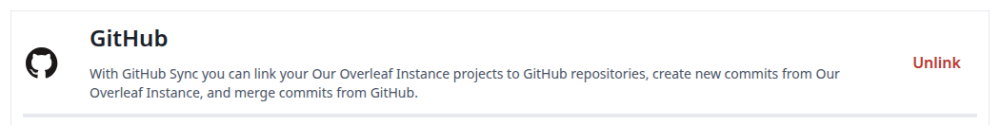
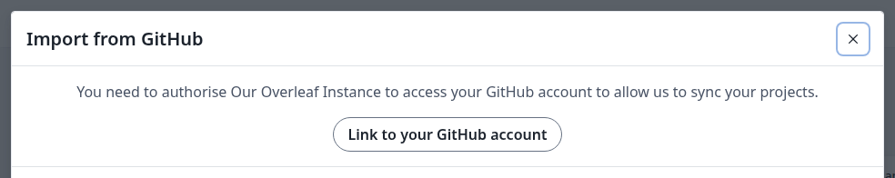

Anslut ett projekt till ett GitHub-repository. Ändringar går åt båda hållen, och bara när du klickar på **Sync**: inget synkroniseras av sig självt.

<Info>

Om du inte ser något GitHub-alternativ i **Account settings** eller i redigeraren ber du din administratör att aktivera [GitHub-synkronisering](/sv/on-premises/configuration/overleaf-toolkit/integrations/github-synchronisation).

</Info>

## Länka ditt GitHub-konto {#link-your-github-account}

Du gör detta en gång.

<Steps>
<Step title="Öppna dina kontoinställningar">
Klicka på **Account** och sedan på **Account settings**. Rulla till **GitHub** och klicka på **Link**.

<Frame caption="GitHub i kontoinställningarna">
  
</Frame>
</Step>

<Step title="Auktorisera på GitHub">
GitHub öppnas. Logga in om du blir ombedd och auktorisera sedan programmet.
</Step>

<Step title="Kontrollera länken">
Du är tillbaka i kontoinställningarna, och på knappen står nu **Unlink**.

<Frame caption="Ditt GitHub-konto är länkat">
  
</Frame>
</Step>
</Steps>

Om ditt konto inte är länkat ännu ber **Import from GitHub** och kortet **GitHub** i redigeraren dig att länka det först. Klicka på **Link to your GitHub account**. Även då hamnar du i kontoinställningarna, i en ny flik om du började i redigeraren. Gå sedan tillbaka och börja om.

<Frame caption="Uppmaningen när ditt konto inte är länkat">
  
</Frame>

## Importera ett repository {#import-a-repository}

Detta skapar ett nytt projekt från ett GitHub-repository, redan länkat till det.

<Steps>
<Step title="Öppna importdialogrutan">
Klicka på **New project** på projektsidan och sedan på **Import from GitHub**.

<Frame caption="Menyn New project">
  
</Frame>

<Info>

**New project** visas när du har ett projekt. Menyn **Create a new project** på välkomstsidan har ingen import, så skapa ett tomt projekt först.

</Info>
</Step>

<Step title="Välj repository">
Klicka på **Import to Overleaf** bredvid repositoryt. Listan innehåller dina repositories och dina organisationers.

<Frame caption="Dina GitHub-repositories">
  
</Frame>

Om en organisations repository saknas klickar du på <strong>Can't see what you're looking for?</strong> för GitHubs hjälp om att godkänna programmet för den organisationen.
</Step>

<Step title="Kontrollera projektet">
Det nya projektet öppnas med repositoryts filer.

<Frame caption="Det importerade projektet">
  
</Frame>
</Step>
</Steps>

## Exportera ett projekt till ett nytt repository {#export-a-project-to-a-new-repository}

Detta skapar ett repository från ett projekt som du äger och länkar dem. Ett projekt kan bara länkas på det här sättet eller genom import: du kan inte länka det till ett repository som redan finns.

<Steps>
<Step title="Öppna GitHub i redigeraren">
Öppna projektet. Klicka på **Integrations** i vänstra fältet och sedan på **GitHub**.

<Frame caption="Panelen Integrations">
  
</Frame>
</Step>

<Step title="Fyll i repositoryt">
Välj **Owner**, som kan vara du eller en av dina organisationer. **Repository Name** är från början projektets namn. Beskrivningen är valfri, och **Private** är valt som standard. Klicka på **Create a GitHub repository**.

<Frame caption="Export Project to GitHub">
  
</Frame>
</Step>

<Step title="Kontrollera länken">
Dialogrutan visar nu **This project is linked to** och namnet på repositoryt.

<Frame caption="Projektet är länkat">
  
</Frame>
</Step>
</Steps>

## Synkronisera {#sync}

<Steps>
<Step title="Öppna synkroniseringsdialogrutan">
Öppna ett länkat projekt. Klicka på **Integrations** i vänstra fältet och sedan på **GitHub**.

**Recent commits in GitHub** listar vad som kommer in i projektet.

<Frame caption="En ny commit väntar på GitHub">
  
</Frame>
</Step>

<Step title="Beskriv dina ändringar">
Om du har ändrat något i projektet visas en ruta för commit-meddelandet. Den är valfri: om du lämnar den tom heter commiten `Updates from Overleaf`.

<Frame caption="Commit-meddelandet för dina ändringar">
  
</Frame>
</Step>

<Step title="Klicka på Sync">
Klicka på **Sync**. Nya commits från GitHub kommer in i projektet, och dina ändringar går till repositoryts standardgren. Om båda sidor har ändrat olika saker sammanfogas de åt dig.
</Step>

<Step title="Kontrollera resultatet">
Dialogrutan visar <strong>No new commits in GitHub since last merge.</strong> och rutan för commit-meddelandet är borta. Filerna i redigeraren och commits på GitHub är uppdaterade.

<Frame caption="Allt är synkroniserat">
  
</Frame>
</Step>
</Steps>

### Om samma rader har ändrats på båda sidor {#if-the-same-lines-changed-on-both-sides}

Dialogrutan säger att ändringarna inte kunde sammanfogas och namnger en ny gren, `overleaf-YYYY-MM-DD-HHMMSS`, som innehåller dina ändringar.

<Frame caption="En konflikt">
  
</Frame>

1. Sammanfoga den grenen med standardgrenen på GitHub eller med Git. Du kan stänga dialogrutan under tiden: den visar samma meddelande när du öppnar den igen.
2. Klicka på **I have manually merged. Continue**. Det sammanfogade resultatet kommer in i projektet.
3. Grenen finns kvar på GitHub. Ta bort den när du inte längre behöver den.

## Ta bort länken för ett projekt {#unlink-a-project}

Gör detta när du inte längre vill att projektet ska synkroniseras. Bara projektägaren kan göra det.

<Steps>
<Step title="Klicka på Unlink">
Klicka på **Unlink** i synkroniseringsdialogrutan.
</Step>

<Step title="Bekräfta">
Klicka på **Confirm**. Anmärkningen om ett abonnemang hindrar dig inte från att länka projektet igen.

<Frame caption="Bekräfta borttagningen av länken">
  
</Frame>
</Step>

<Step title="Kontrollera resultatet">
Dialogrutan visar nu **Export Project to GitHub**. Både projektet och repositoryt behåller sitt innehåll. För att synkronisera igen exporterar du projektet till ett nytt repository eller importerar repositoryt till ett nytt projekt.
</Step>
</Steps>

## Ta bort länken för ditt GitHub-konto {#unlink-your-github-account}

I **Account settings**, under **GitHub**, klickar du på **Unlink** och sedan på **Unlink** igen i dialogrutan.

<Frame caption="Ta bort länken för ditt konto">
  
</Frame>

Dina projekt förblir länkade till sina repositories. Du kan inte synkronisera dem förrän du länkar ditt konto igen.

<Info>

Vem som kan göra vad i ett delat projekt finns i [Vem kan länka och synkronisera](/sv/on-premises/configuration/overleaf-toolkit/integrations/github-synchronisation#who-can-link-and-sync). Varje medarbetare som synkroniserar länkar sitt eget GitHub-konto.

</Info>
