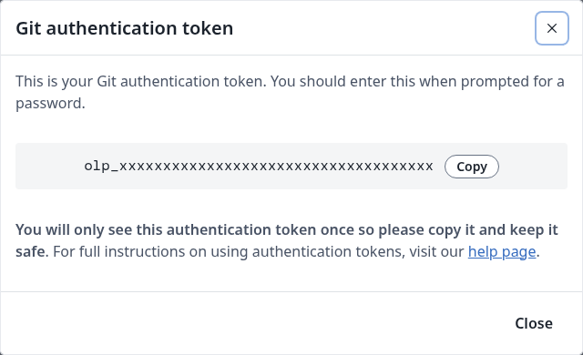

Varje projekt har en egen MCP-server, så att en AI-klient på din dator kan läsa och redigera projektet, kompilera det och svara på dess kommentarer. Klienten loggar in med en Git-autentiseringstoken.

<Info>

Om du inte ser något **MCP server**-kort hänvisar du administratören till [MCP-server](/sv/on-premises/configuration/overleaf-toolkit/integrations/mcp-server).

</Info>

## Nytt i v6.3.3 {#new-in-v6-3-3}

Från v6.3.3 kan klienten också arbeta med projekthistoriken: lista ändringarna, jämföra två versioner, läsa en fil som den var, spara och ta bort versioner och återställa en fil eller hela projektet. Den kan lista spårade ändringar och godkänna eller avvisa dem, och göra sina egna redigeringar till spårade ändringar när du ber om det. Den kan kommentera ett textavsnitt och redigera eller ta bort kommentarsmeddelanden, läsa och skicka meddelanden i projektchatten, flytta och byta namn på filer och mappar, skapa mappar och ändra stavningskontrollens språk. Vem som får göra vad följer din roll i projektet, precis som i redigeraren, eftersom klienten arbetar med din token: se [Vem får göra vad](#who-may-do-what).

MCP-servern introducerades i v6.3.1. v6.3.1 och v6.3.2 har samma 17 verktyg; v6.3.3 har 33.

| Verktyg | v6.3.1 och v6.3.2 | v6.3.3 |
| ----- | ----------------- | ------ |
| `get_clone_info`, `get_settings`, `list_files`, `delete_file`, `compile`, `get_compile_log`, `get_output_file_link`, `word_count`, `reply_to_comment`, `resolve_comment`, `reopen_comment` | Ja | Ja, oförändrade |
| `read_file` | Det senaste innehållet | Även en fil som den var vid en `version` |
| `edit_file`, `write_file` | Följer projektets inställning för spårade ändringar | Även `trackChanges`, för att göra redigeringen till en spårad ändring |
| `update_settings` | Kompilator, TeX Live-avbild och huvuddokument | Även stavningskontrollens språk |
| `list_versions` | Version, kommentar och datum | Även `id` som `delete_version` tar emot, och vem som sparade den |
| `list_comments` | Meddelanden utan id | Även `id` för varje meddelande, som `edit_comment_message` och `delete_comment_message` tar emot |
| `list_changes`, `diff`, `create_version`, `delete_version`, `restore_file`, `restore_project`, `list_tracked_changes`, `accept_tracked_changes`, `reject_tracked_changes`, `add_comment`, `edit_comment_message`, `delete_comment_message`, `list_chat_messages`, `send_chat_message`, `move_file`, `create_folder` | Nej | Ja |

## Anslut en klient {#connect-a-client}

<Steps>
<Step title="Öppna dialogen">
Öppna projektet. Klicka på **Integrations** i vänsterfältet och sedan på **MCP server**.

<Frame caption="Panelen Integrations">
  
</Frame>

Dialogen visar adressen till projektets server och en flik för varje klient: **Claude Code**, **Codex**, **Cursor**, **VS Code** och **Gemini CLI**.

<Frame caption="Dialogen MCP server">
  
</Frame>
</Step>

<Step title="Skapa en token">
Klicka på **Go to settings**. Dina kontoinställningar öppnas i en ny flik. Under **Git integration** klickar du på **Generate token**, eller på **Add another token** om du redan har en. Klicka på **Copy** och förvara token på ett säkert ställe, eftersom du bara ser den en gång. Klicka sedan på **Close**.

<Frame caption="Din nya token">
  
</Frame>

En token som du redan använder för [Git-integration](/on-premises/user-guide/users/git-integration) fungerar också, liksom en enda token för alla dina projekt.
</Step>

<Step title="Lägg till servern i din klient">
Tillbaka i dialogen klickar du på fliken för din klient och sedan på **Copy** bredvid konfigurationen.

| Flik | Var den hamnar | Token |
| --- | ------------- | --------- |
| **Claude Code** | Kör kommandot i en terminal | Ersätt `<token>` i kommandot |
| **Codex** | `~/.codex/config.toml` | Lägg den i miljövariabeln `OVERLEAF_TOKEN` |
| **Cursor** | `~/.cursor/mcp.json` | Lägg den i miljövariabeln `OVERLEAF_TOKEN` |
| **VS Code** | `.vscode/mcp.json` | Filen har en lösenordsfråga som heter `overleaf-token` i stället för token |
| **Gemini CLI** | Kör kommandot i en terminal | Ersätt `<token>` i kommandot |

Adressen hör till ett projekt. För att ansluta ett annat projekt lägger du till det under ett annat namn, eftersom `overleaf` redan är upptaget. För Claude Code ändrar du till exempel `overleaf` i kommandot till `overleaf-lab`.
</Step>
</Steps>

## Kontrollera anslutningen {#check-the-connection}

### Med Claude Code {#with-claude-code}

```bash
claude mcp list
```

Servern listas som ansluten:

```text
overleaf: https://<your-site>/project/<project-id>/mcp (HTTP) - ✔ Connected
```

### Med curl {#with-curl}

Det här fungerar oavsett klient. Ersätt adressen och token och skicka MCP-protokollets `initialize`-begäran:

```bash
curl -X POST https://<your-site>/project/<project-id>/mcp \
  -H "Authorization: Bearer <token>" \
  -H "Content-Type: application/json" \
  -H "Accept: application/json, text/event-stream" \
  -d '{"jsonrpc":"2.0","id":1,"method":"initialize","params":{"protocolVersion":"2025-06-18","capabilities":{},"clientInfo":{"name":"curl","version":"1.0"}}}'
```

Svaret anger serverns namn, följt av dess instruktioner för klienter:

```json
{"result":{"protocolVersion":"2025-06-18","capabilities":{"tools":{"listChanged":true}},"serverInfo":{"name":"overleaf","version":"1.0.0"},"instructions":"This server works on one Overleaf project. ..."},"jsonrpc":"2.0","id":1}
```

För att se verktygen skickar du `tools/list` med samma kommando. Svaret listar 33 verktyg, eller 31 om din webbplats har projektchatten avstängd. Före v6.3.3 listas 17.

```bash
  -d '{"jsonrpc":"2.0","id":2,"method":"tools/list","params":{}}'
```

För att anropa ett verktyg skickar du `tools/call`:

```bash
  -d '{"jsonrpc":"2.0","id":3,"method":"tools/call","params":{"name":"list_files","arguments":{}}}'
```

```json
{"result":{"content":[{"type":"text","text":"[\n  {\n    \"path\": \"main.tex\",\n    \"type\": \"doc\"\n  }\n]"}]},"jsonrpc":"2.0","id":3}
```

### I dina kontoinställningar {#in-your-account-settings}

Under **Git integration** visar **Last used** datumet för en token som servern har tagit emot.

<Frame caption="Den första token har använts">
  
</Frame>

### Om den inte ansluter {#if-it-does-not-connect}

| Vad du ser | Vad det betyder |
| ------------ | ------------- |
| Status `401`, eller i Claude Code `✘ Failed to connect` med `HTTP 401` | Token saknas, är fel eller har tagits bort |
| Status `404` | Inget projekt har detta ID |
| Status `405` | Begäran var inte en `POST` |
| Status `406` med `Not Acceptable` | Rubriken `Accept` saknas: klienten måste acceptera både `application/json` och `text/event-stream` |

## Vad du ser när en klient arbetar {#what-you-see-when-a-client-works}

Redigeringar visas i en öppen redigerare medan klienten gör dem, som en medarbetares, utan omladdning. Nya filer och mappar, flyttar och namnbyten visas i filträdet.

<Frame caption="En rad som lagts till av edit_file">
  
</Frame>

`edit_file` ändrar bara text som förekommer exakt en gång. Annars får klienten ett fel, till exempel `oldString not found in main.tex, read_file again` eller `oldString appears 2 times in main.tex, add context`, och inget ändras.

Från v6.3.3 flyttar eller byter `move_file` namn på en fil eller mapp och skapar vid behov mapparna i den nya sökvägen, och `create_folder` skapar en mapp. Om filen inte hittas eller den nya sökvägen redan finns får klienten ett fel och inget ändras. `update_settings` kan också ändra stavningskontrollens språk, till exempel till `de`, eller stänga av stavningskontrollen.

Svar på kommentarer visas i granskningspanelen under ditt namn, eftersom token är din. En kommentar som lösts via servern försvinner från panelen, och om den öppnas igen kommer den tillbaka.

<Frame caption="Ett svar som skickats av reply_to_comment">
  
</Frame>

Från v6.3.3 kommenterar `add_comment` ett textavsnitt. Texten måste förekomma exakt en gång i filen; när den förekommer fler gånger anger klienten också ett längre avsnitt runt den som förekommer en gång, och bara texten kommenteras. Kommentaren visas i granskningspanelen under ditt namn och stannar vid sin text när filen ändras. `edit_comment_message` ändrar ett av dina egna meddelanden. `delete_comment_message` tar bort ett meddelande, och om det första tas bort försvinner hela kommentaren, som i granskningspanelen.

`compile` kompilerar projektet och returnerar listan över utdatafiler. `get_output_file_link` ger sedan en länk för att ladda ned PDF:en eller en annan utdatafil. Länken behöver ingen token och slutar fungera efter 5 minuter.

Den fullständiga listan över verktyg finns i [Tools](/on-premises/configuration/overleaf-toolkit/integrations/mcp-server#tools).

## Spårade ändringar {#tracked-changes}

Från v6.3.3 kan du be klienten att göra sina redigeringar till spårade ändringar, till exempel *Rewrite the abstract as a tracked change*. `edit_file` och `write_file` gör då ändringen i en befintlig fil till en spårad ändring i ditt namn, även när spårning av ändringar är avstängd i projektet, och du godkänner eller avvisar den i granskningspanelen. En ny fil är aldrig en spårad ändring. Om du inte ber om det följer redigeringarna projektets inställning för spårade ändringar, precis som dina i redigeraren: de spåras när spårningen är på för dig eller för alla.

Om projektägarens konto inte har spårade ändringar får klienten `Track changes is off for this project` och inget ändras.

För att granska varje redigering som klienten gör slår du på spårade ändringar för dig själv. För att skilja dess redigeringar från dina i granskningspanelen ger du klienten token för ett annat konto som du delar projektet med.

`list_tracked_changes` listar de spårade ändringarna med fil, infogad eller borttagen text, författare och tid. `accept_tracked_changes` och `reject_tracked_changes` tar emot ändringarnas id och fungerar som granskningspanelen: en godkänd ändring stannar i texten, en avvisad infogning tas bort och en avvisad borttagning kommer tillbaka. En öppen redigerare visar resultatet utan omladdning. Verktygen säger åt klienten att bara godkänna eller avvisa de ändringar du ber om.

## Historik {#history}

Från v6.3.3 ser klienten projekthistoriken så som historikpanelen visar den.

| Verktyg | Vad det gör |
| ---- | ------------ |
| `list_changes` | Listar ändringarna, nyaste först: vem som ändrade vilka filer och när, med versionerna före och efter varje ändring. Äldre ändringar kommer i fler omgångar. |
| `diff` | Jämför två versioner: en fil som en unified diff, som `git diff`, eller filerna som lagts till, tagits bort, redigerats eller bytt namn |
| `read_file` med `version` | Läser en fil som den var vid en version |
| `list_versions` | Listar de sparade versionerna, med kommentar och vem som sparade dem |
| `create_version` | Sparar den senaste versionen, eller en tidigare, med en kommentar, som **Label this version** |
| `delete_version` | Tar bort en sparad version; dess ändringar finns kvar |
| `restore_file` | Återställer en fil som den var vid en version, som **Restore this version** |
| `restore_project` | Återställer hela projektet som det var vid en version, som **Restore project to this version** |

En återställning är i sig en ny ändring, så du kan ångra den på samma sätt. Verktygen säger åt klienten att bara återställa när du ber om det.

Om projektägaren inte har fullständig projekthistorik ser klienten bara ändringarna från de senaste 24 timmarna, eller den senaste ändringen om alla är äldre, som i historikpanelen. Den kan inte jämföra, läsa eller återställa äldre versioner.

## Projektchatt {#project-chat}

Från v6.3.3 läser `list_chat_messages` projektchatten, nyaste först, 50 meddelanden åt gången. `send_chat_message` skickar ett meddelande i ditt namn, och det visas direkt i en öppen chatt. Om din webbplats har projektchatten avstängd har klienten inget av verktygen.

## Vem får göra vad {#who-may-do-what}

Klienten får göra det som din roll i projektet tillåter.

| Vad klienten gör | Ägare | Redaktör | Granskare | Läsare (namngiven medarbetare) | Läsare (länkdelning) |
| -------------------- | ----: | -----: | -------: | --------------------------: | --------------------: |
| Läsa filer och inställningar, kompilera, läsa loggen, ladda ned PDF:en | Ja | Ja | Ja | Ja | Ja |
| Skriva, redigera, flytta och ta bort filer, skapa mappar, ändra inställningarna | Ja | Ja | Nej | Nej | Nej |
| Se historiken, kommentarerna och de spårade ändringarna | Ja | Ja | Ja | Ja | Nej |
| Läsa och skicka chattmeddelanden | Ja | Ja | Ja | Ja | Nej |
| Lägga till kommentarer och svara på dem | Ja | Ja | Ja | Nej | Nej |
| Lösa, öppna igen eller ta bort en kommentar | Ja | Ja | De som de själva startade | Nej | Nej |
| Redigera ett kommentarsmeddelande | Egna | Egna | Egna | Nej | Nej |
| Ta bort ett kommentarsmeddelande | Ja | Ja | Egna | Nej | Nej |
| Godkänna eller avvisa spårade ändringar | Ja | Ja | Nej | Nej | Nej |
| Spara en version | Ja | Ja | Ja | Nej | Nej |
| Ta bort en sparad version | Ja | De som de själva sparade | De som de själva sparade | Nej | Nej |
| Återställa en fil eller projektet | Ja | Ja | Nej | Nej | Nej |

Redaktörer som gått med via en länk räknas som redaktörer. Granskare kan inte redigera filer via MCP, inte ens som spårade ändringar.

## Koppla från en klient {#disconnect-a-client}

Ta bort token: se [Ta bort en token](/on-premises/user-guide/users/git-integration#delete-a-token). Från och med då svarar servern `401` på den token. Om du också använder den för Git slutar även Git att acceptera den.
