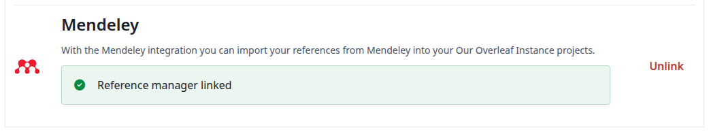

Importera ett Mendeley-bibliotek till ett projekt som en `.bib`-fil och citera sedan från den som vanligt. Filen är en kopia: den ändras bara när du klickar på **Refresh**.

<Info>

Om du inte ser något Mendeley-alternativ i **Account settings** ber du din administratör att aktivera [Mendeley-integration](/sv/on-premises/configuration/overleaf-toolkit/integrations/mendeley-integration).

</Info>

## Koppla ditt Mendeley-konto {#link-your-mendeley-account}

Du gör detta en gång.

<Steps>
<Step title="Öppna kontoinställningarna">
Klicka på **Account** och sedan på **Account settings**. Under **Reference managers** letar du upp **Mendeley** och klickar på **Link to Mendeley**.

<Frame caption="Mendeley i kontoinställningarna">
  
</Frame>

Kortet **Mendeley** i redigerarens panel **Integrations** tar dig till samma ställe, i samma flik.

<Frame caption="Panelen Integrations">
  
</Frame>
</Step>

<Step title="Godkänn hos Mendeley">
Mendeley öppnas. Logga in om du blir ombedd och godkänn sedan programmet.
</Step>

<Step title="Kontrollera kopplingen">
Du är tillbaka i kontoinställningarna. Ett grönt meddelande säger **Reference manager linked** och knappen säger nu **Unlink**.

<Frame caption="Ditt Mendeley-konto är kopplat">
  
</Frame>
</Step>
</Steps>

Om du inte tillåter åtkomst hos Mendeley visar samma avsnitt **Sorry, something went wrong**. Klicka på **Link to Mendeley** för att försöka igen.

## Skapa en fil från ditt bibliotek {#create-a-file-from-your-library}

<Steps>
<Step title="Öppna dialogrutan Add files">
Öppna ett projekt. Klicka på **New file** i filträdet och sedan på **From Mendeley**. Det här alternativet finns bara när ditt konto är kopplat.
</Step>

<Step title="Välj filnamn och bibliotek">
**File Name** är från början `mendeley.bib`. Behåll ändelsen `.bib`: utan den får du ingen förhandsvisning, och varken `\cite` eller `\bibliography` hittar posterna.

**Library** är från början **My Library** och listar även dina grupper. En fil innehåller ett bibliotek.

<Frame caption="En fil från ditt personliga bibliotek">
  
</Frame>
</Step>

<Step title="Klicka på Create">
Dialogrutan stängs och filen finns i filträdet. Klicka på den: den visar när den importerades och dess poster. Du kan inte redigera den i redigeraren.

<Frame caption="Den importerade filen">
  
</Frame>

Om **Create** inte verkar göra något finns redan en fil med det namnet. Välj ett annat namn.
</Step>
</Steps>

### Importera en grupp {#import-a-group}

Gör samma sak igen med ett eget filnamn och välj gruppen under **Library**. Ett projekt kan ha flera sådana filer.

<Frame caption="En fil från en grupp">
  
</Frame>

## Citera från filen {#cite-from-the-file}

<Steps>
<Step title="Börja en citering">
Skriv `\cite{` i en `.tex`-fil. Listan visar posterna i alla `.bib`-filer i projektet. Klicka på en för att infoga den.

<Frame caption="Posterna i de importerade filerna">
  
</Frame>
</Step>

<Step title="Eller sök på titel eller författare">
Klicka på **Search** under listan eller tryck på Ctrl+Mellanslag mellan klammerparenteserna. Skriv för att filtrera, klicka på en eller flera poster och sedan på **Insert**.

<Frame caption="Referenssökningen">
  
</Frame>
</Step>

<Step title="Lägg till litteraturlistan">
Lägg till de här raderna före `\end{document}` med namnet på din fil utan `.bib`. Separera namnen med kommatecken om du har flera filer.

```latex
\bibliographystyle{plain}
\bibliography{mendeley}
```

Klicka på **Recompile**. Referensen visas i PDF-filen.

<Frame caption="Den kompilerade referensen">
  
</Frame>
</Step>
</Steps>

Importerade filer erbjuds inte i **Settings** under **References**, **Main bibliography file for this project**, så listan förblir tom om projektet inte har någon annan `.bib`-fil. Du kan ändå citera från dem.

<Frame caption="Den tomma listan är väntad">
  
</Frame>

## Uppdatera filen {#refresh-the-file}

Ändringar i ditt Mendeley-bibliotek kommer inte till projektet av sig själva.

<Steps>
<Step title="Öppna filen">
Klicka på den importerade filen i filträdet.
</Step>

<Step title="Klicka på Refresh">
Hela filen importeras på nytt från det bibliotek du valde när du skapade den: nya poster visas och borttagna försvinner. Tiden högst upp ändras.

<Frame caption="Den uppdaterade filen">
  
</Frame>
</Step>

<Step title="Kompilera om">
Klicka på **Recompile** för att uppdatera PDF-filen.
</Step>
</Steps>

Varje fil uppdateras för sig: uppdatera din grupps fil separat. Vem som kan uppdatera en fil i ett delat projekt står i [anteckningarna för administratörer](/on-premises/configuration/overleaf-toolkit/integrations/mendeley-integration#notes).

## Koppla från ditt Mendeley-konto {#unlink-your-mendeley-account}

Klicka på **Unlink** under **Mendeley** i **Account settings** och sedan på **Unlink** igen i dialogrutan. Knappen säger **Link to Mendeley** igen.

<Frame caption="Koppla från ditt konto">
  
</Frame>

Filerna du importerade finns kvar i dina projekt och kompileras fortfarande. **From Mendeley** försvinner från dialogrutan **Add files**, och **Refresh** visar ett fel tills du kopplar ditt konto igen.

<Frame caption="Uppdatera utan kopplat konto">
  
</Frame>

När du har kopplat kontot igen fungerar **Refresh** på samma filer.

## Om något går fel {#if-something-goes-wrong}

**Could not load references from Mendeley, please re-link your account and try again**, eller **There was an error accessing your Mendeley data** i dialogrutan **Add files**: Overleaf kan inte längre läsa ditt bibliotek, till exempel för att du har tagit bort dess åtkomst hos Mendeley. Klicka på **Unlink** och sedan på **Link to Mendeley** i **Account settings**. Fram till dess misslyckas även **Create**, med meddelandet **The project that contains this file is not shared with you**, även i ditt eget projekt.

<Frame caption="Overleaf kan inte längre läsa ditt bibliotek">
  
</Frame>

**The remote service produced an error** när du klickar på **Refresh**: begäran till Mendeley misslyckades. Filen behåller sitt innehåll. Klicka på **Refresh** igen senare.
