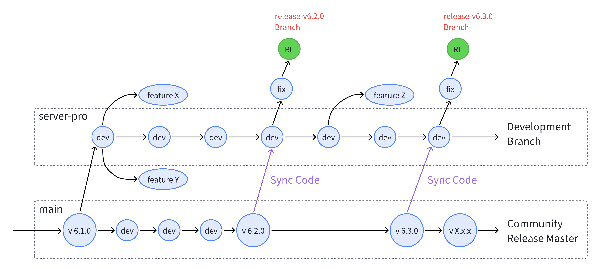

### Giriş {#introductions}

Geliştirmeye başlamadan önce aşağıdaki noktaları anlamanızı rica ediyoruz:

* Overleaf resmi olarak bir [dahili depoda](http://github.com/overleaf/internal) geliştirilir ve topluluk sürümü [overleaf/overleaf](https://github.com/overleaf/overleaf) üzerinde yayımlanır. Dahili ve herkese açık depolar arasındaki kod senkronizasyonundan bir copybot sorumludur.
* [Ayaka-notes/overleaf-pro](https://github.com/ayaka-notes/ayakaleaf-pro), Overleaf topluluk sürümünün bir çatalıdır (fork). Bu projenin uzun ömürlü olmasını istiyoruz; bu nedenle katkıda bulunmadan önce lütfen kurallara uyun.

### Commit Kuralları {#commit-rules}

* Lütfen mevcut Overleaf kodunda kapsamlı değişiklikler yapmayın. İşlevselliği mümkün olduğunca `services/web/modules` klasöründe toplayın. Bu, ileride kodu birleştirirken ve güncellerken iş yükümüzü en aza indirir.
* Vibe coding gerçekten çok kolay bir yöntemdir, ancak projemizi kolayca dağınık hale getirip ileride bakımını imkânsız kılabilir; bu yüzden lütfen dikkatli kullanın.
* Mümkün olduğunca mevcut çeviri anahtarlarını yeniden kullanın. Yeni bir anahtar gerçekten gerekiyorsa, onu tüm diller için tek seferde `services/web/locales/locales_patches/added/` içine ekleyin, bkz. [i18n Çevirilerini Güncelleme](/tr/dev/environment/update-i18n-translations).
* Kesinlikle gerekli olmadıkça yeni ortam değişkenleri eklemekten kaçının. Gerekliyse, Overleaf toolkit'teki veya [docs.overleaf.com](https://docs.overleaf.com/) adresindeki değişkenlerle mümkün olduğunca tutarlı olmalarını sağlayın.

### Dal Kuralları {#branch-rules}

overleaf-pro geliştirmesi için aşağıdaki dalları kullanıyoruz:

* `main`: Bu dal yalnızca upstream kod senkronizasyonu için kullanılır, lütfen buraya harici değişiklikleri **commit ETMEYİN**. Bu dalda `ce-v[X.x.x]` gibi etiketler belirleriz; bu etiket, ilgili commit'in Overleaf Resmi Topluluk Sürümü'ndeki `v[X.x.x]` sürümüne karşılık geldiğini gösterir. Not: bu etiket değiştirilemez!
* `server-pro`: Bu dal, günlük geliştirme için varsayılan daldır.
* `feat-X`: Bu dal belirli bir özelliğin geliştirilmesi için kullanılır, örneğin `feat-gitea-sync`.
* `release-vX.Y.Z`: Sürüme özel daldır; yayımlamadan önce bazı acil düzeltmeler (hot-fix) yaparız. Yama sürümleri de kendi dallarını alır, örneğin `release-v6.3.1`. Yayımlanan commit bu dalda `pro-vX.Y.Z` olarak etiketlenir.

<Frame caption="Overleaf Pro için Dal Kuralları">
  
</Frame>

### GitHub Action {#github-action}

[GitHub Action](https://github.com/ayaka-notes/ayakaleaf-pro/actions) otomatik CI/CD'den sorumludur. İmajları kendi makinenizde oluşturmanız gerekmez: aşağıdaki her imaj bir iş akışı (workflow) tarafından oluşturulur ve elle tetiklenebilenler tek tıklamayla oluşturulabilir.

| İş akışı | Tetikleyici | Kaynak | İmaj |
| --- | --- | --- | --- |
| Sync Upstream Code | Günlük, elle | `overleaf/overleaf` → `main` | — |
| Build Development Image | Günlük, elle | `server-pro` | `ghcr.io/ayaka-notes/overleaf-pro/dev:<service>` |
| Build Operations Image | `server-pro` dalına push / PR, elle | Push edilen commit veya PR head | `ghcr.io/ayaka-notes/overleaf-pro/ops:<YYYYMMDDHHMM>-<sha>`, `ops:latest` |
| Build Release Image | Elle | En son `release-v*` dalı | `ghcr.io/ayaka-notes/overleaf-pro:<version>`, `:latest` ve `overleaf-pro/git-bridge` |
| Test Operations Image | Günlük, elle | `ops:latest` veya elle başlatıldığında verilen `ops` etiketi | — (E2E test paketlerini bunun üzerinde çalıştırır) |

* **Geliştirme imajları**, `linux/amd64` ve `linux/arm64` için her biri bir mikroservis (`web`, `webpack`, `clsi`, ...) içerir. Codespace kurulumu, `bin/build` çalıştırmak yerine bunları `develop/docker-compose.image.yml` aracılığıyla çeker.
* **Operasyon imajları**, bir değişikliği uçtan uca test etmek için tam tek konteynerli imajlardır (`sharelatex/sharelatex` gibi). `ops:latest` yalnızca `server-pro` dalına yapılan push'larda güncellenir; bir PR yalnızca zaman damgalı bir etiket alır. Bu imajlar 7 gün saklanır ve yalnızca test amaçlıdır.
* **Sürüm imajları**, kullanıcıların dağıttığı imajlardır. Sürüm numarası dal adından gelir; dolayısıyla `release-v6.3.0`, `overleaf-pro:6.3.0` imajını yayımlar.

<Steps>
<Step title="Bir İş Akışını Elle Çalıştırma">
[Actions](https://github.com/ayaka-notes/ayakaleaf-pro/actions) sekmesini açın, soldan iş akışını seçin, **Run workflow** düğmesine tıklayın ve onaylayın. Build Operations Image ayrıca önbelleğe alınmış bir katman eskidiğinde kullanılmak üzere **Build without cache** seçeneğine sahiptir.
</Step>

<Step title="Kendi Fork'unuzda Oluşturma">
Aynı iş akışları bir fork'ta da çalışır: fork'unuzda Actions'ı etkinleştirin, ardından bunları fork'unuzun Actions sekmesinden çalıştırın. İmajlar yerleşik `GITHUB_TOKEN` ile `ghcr.io/<your-name>/overleaf-pro/...` adresine gönderilir; bu nedenle herhangi bir secret gerekmez. Sync Upstream Code ve eski imaj temizliği yalnızca `ayaka-notes` içinde çalışır.

Build Release Image, fork'unuzda bir `release-v*` dalı gerektirir.
</Step>
</Steps>

<Info>

Bir imajın hangi commit'ten oluşturulduğunu kontrol etmek için: operasyon imajı etiketi kısa commit hash'i ile biter, sürüm imajı ise bunu `com.overleaf.pro.revision` etiketinde (label) taşır (aşağıdaki Soru\&Cevap bölümündeki `docker inspect` komutuna bakın).

</Info>

### Soru\&Cevap {#q&a}

<Accordion title="Overleaf Community Edition `X.0.0` için commit hash'ini nasıl bulurum?">

Öncelikle Docker imajını çekmeniz ve bu imajdaki etiketleri incelemek için aşağıdaki komutu çalıştırmanız gerekir:

```shellscript title="bash" wrap
docker inspect --format='{{json .Config.Labels}}' sharelatex/sharelatex:6.0.0
{"com.overleaf.ce.revision":"b0d05c0cf0750714e1f467d20ed6c5f5e9467e8f","org.opencontainers.image.ref.name":"ubuntu","org.opencontainers.image.version":"24.04"}
```

Ardından [commit'in (b0d05c0)](https://github.com/overleaf/overleaf/commit/b0d05c0cf0750714e1f467d20ed6c5f5e9467e8f) upstream master dalında bulunup bulunmadığını kontrol edebilirsiniz.

</Accordion>

<Accordion title="CE imajında `6.0.0` ile `6.0.1` arasında commit hash'i neden aynı?">

Bu beklenen bir davranıştır. 6.0.1 sürümü, 6.0.0 imajı üzerine inşa edilmiş küçük bir yama sürümüdür. Değişiklikler, imajı yeni bir commit'ten yeniden oluşturmak yerine mevcut 6.0.0 imajına yama uygulanarak yapılır. Bu nedenle imaj içindeki commit hash'i 6.0.0 ve 6.0.1 arasında aynıdır.

Ayrıntılı bilgi için [hotfix](https://github.com/overleaf/overleaf/tree/main/server-ce/hotfix) bölümüne bakın.

</Accordion>
