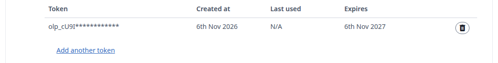

Bir proje üzerinde Git ile kendi bilgisayarınızda çalışın. Değişiklikler yalnızca `git pull` veya `git push` çalıştırdığınızda aktarılır.

<Info>

Önce bir yöneticinin [Git entegrasyonunu](/tr/on-premises/configuration/overleaf-toolkit/integrations/git-integration) açması gerekir.

</Info>

## Belirteç oluşturma {#create-a-token}

Git, hesap parolanızla değil, bir Git kimlik doğrulama belirteciyle oturum açar.

<Steps>
<Step title="Hesap ayarlarınızı açın">
**Account**, ardından **Account settings** öğesine tıklayın. **Git integration** altında **Generate token** öğesine tıklayın. Bir belirteciniz olduğunda bu düğmenin adı **Add another token** olur.

<Frame caption="Hesap ayarlarında Git entegrasyonu">
  
</Frame>
</Step>

<Step title="Belirteci kopyalayın">
**Copy** öğesine tıklayın ve belirteci güvenli bir yerde saklayın. Onu yalnızca bir kez görürsünüz. Ardından **Close** öğesine tıklayın.

<Frame caption="Yeni belirteciniz">
  
</Frame>
</Step>

<Step title="Belirteci kontrol edin">
Liste artık belirtecin başını, ne zaman oluşturulduğunu ve en son ne zaman kullanıldığını gösterir. Belirtecin süresi bir yıl sonra dolar. En fazla 10 belirteciniz olabilir.

<Frame caption="Belirteçleriniz">
  
</Frame>
</Step>
</Steps>

## Projeyi klonlama {#clone-a-project}

<Steps>
<Step title="Düzenleyicide Git entegrasyonunu açın">
Projeyi açın. Sol çubukta **Integrations**, ardından **Git integration** öğesine tıklayın.

<Frame caption="Integrations paneli">
  
</Frame>
</Step>

<Step title="Komutu kopyalayın">
**Clone with Git** iletişim kutusu, sitenizin adresini ve projenin kimliğini içeren komutu gösterir. **Copy** öğesine tıklayın. Henüz belirteciniz yoksa **Go to settings**, hesap ayarlarınızı yeni bir sekmede açar.

<Frame caption="Klonlama komutu">
  
</Frame>
</Step>

<Step title="Komutu çalıştırın">
Komutu bir terminale yapıştırın. Git parola istediğinde belirtecinizi yapıştırın.

```text
$ git clone https://git@<your-site>/git/<project-id>
Cloning into '<project-id>'...
Password for 'https://git@<your-site>': <your-token>
```

Proje kimliğiyle adlandırılmış bir klasör artık projenin dosyalarını `main` dalında içerir. Klasörün adını seçmek için adı komutun sonuna ekleyin.
</Step>
</Steps>

Git, siteye her bağlandığında belirteci sorar. Hatırlanmasını sağlamak için bir credential helper açın: Git bir kez daha sorar, ardından belirteci saklar. `store` helper, belirteci `~/.git-credentials` içinde şifrelenmemiş olarak saklar.

```bash
git config --global credential.helper store
```

## Düzenleyicideki değişiklikleri çekme {#pull-changes-from-the-editor}

Klasörün içinde şunu çalıştırın:

```bash
git pull
```

Git değişen dosyaları listeler. Düzenleyicide yapılan değişiklikler `Update on Overleaf.` adlı commit'ler olarak gelir.

```text
Updating db007e3..c3e6332
Fast-forward
 main.tex | 2 +-
 1 file changed, 1 insertion(+), 1 deletion(-)
```

## Değişikliklerinizi gönderme {#push-your-changes}

Değişikliklerinizi commit'leyin, ardından gönderin:

```bash
git add main.tex
git commit -m "Add a line from Git"
git push
```

Çıktının son satırı, ilerleyen dalı gösterir:

```text
   53aca61..db007e3  main -> main
```

Değişiklikler düzenleyicide görünür ve açık bir düzenleyici kendiliğinden güncellenir. Yeni dosyalar, klasörler ve yeniden adlandırmalar dosya ağacında görünür. **History** içinde değişikliğiniz <strong>You (via Git)</strong> olarak işaretlenir. Commit mesajınız orada gösterilmez.

<Frame caption="Proje geçmişinde bir push">
  
</Frame>

### Git push'unuzu reddederse {#if-git-refuses-your-push}

Proje bu arada değiştiyse Git push'u reddeder:

```text
 ! [rejected]        main -> main (fetch first)
```

Önce bu değişiklikleri alın, ardından yeniden gönderin:

```bash
git pull --no-rebase --no-edit
git push
```

Düz bir `git pull`, `fatal: Need to specify how to reconcile divergent branches.` ile durabilir. Yukarıdaki `--no-rebase` seçeneği bunu yanıtlar: iki tarafı birleştirir.

Her iki tarafta da aynı satırlar değiştiyse pull, `CONFLICT (content): Merge conflict in main.tex` ile durur. Dosyayı düzeltin, ardından şunu çalıştırın:

```bash
git add main.tex
git commit -m "Merge the changes from the editor"
git push
```

Sitenin kabul etmediği iki şey vardır:

* Diğer dallar: `! [remote rejected] feature -> feature (wrong branch)`. Yalnızca `main` vardır, bu yüzden çalışmanızı oraya gönderin.
* Zorla push: `! [remote rejected] main -> main (forced push prohibited)`. Bunun yerine değişikliklerinizi mevcut `main` dalının üzerine koyun.

### Git Authentication failed derse {#if-git-says-authentication-failed}

```text
remote: Enter your Git authentication token when prompted for a password.
fatal: Authentication failed for 'https://<your-site>/git/<project-id>/'
```

Belirteç yanlış veya silinmiş ya da hesap parolanızı girdiniz. Mevcut bir belirteci yeniden göremeyeceğiniz için, artık elinizde yoksa yeni bir belirteç oluşturun.

## Belirteci silme {#delete-a-token}

**Account settings** içinde, **Git integration** altında belirtecin yanındaki silme simgesine, ardından iletişim kutusunda **Delete** öğesine tıklayın. Bundan sonra Git bu belirtece `Authentication failed` yanıtını verir.

<Frame caption="Belirteci silme">
  
</Frame>

<Info>

Salt okunur erişimi olan ortak çalışanların neler yapabileceği için [Git entegrasyonu](/tr/on-premises/configuration/overleaf-toolkit/integrations/git-integration) sayfasındaki Q\&A bölümüne bakın.

</Info>
