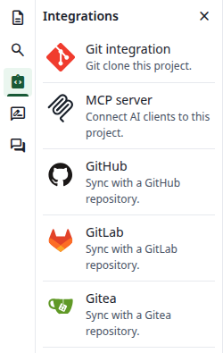
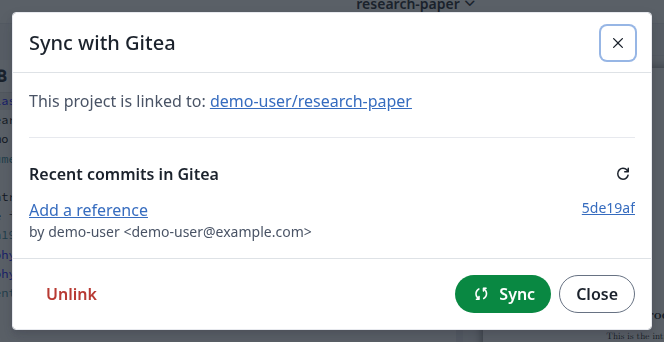
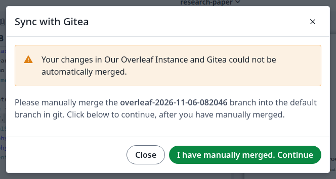
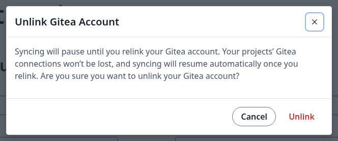

Bir projeyi bir Gitea deposuna bağlayın. Değişiklikler iki yönlü ve yalnızca **Sync** öğesine tıkladığınızda aktarılır: hiçbir şey kendiliğinden senkronize olmaz.

<Info>

Önce bir yöneticinin [Gitea Senkronizasyonunu](/tr/on-premises/configuration/overleaf-toolkit/integrations/gitea-synchronisation) açması gerekir.

</Info>

## Gitea hesabınızı bağlama {#link-your-gitea-account}

Bunu bir kez yaparsınız.

<Steps>
<Step title="Hesap ayarlarınızı açın">
**Account**, ardından **Account settings** öğesine tıklayın. **Project synchronisation** altında **Gitea** bölümünü bulun ve **Link** öğesine tıklayın.

<Frame caption="Hesap ayarlarında Gitea">
  
</Frame>
</Step>

<Step title="Gitea'da yetkilendirin">
Gitea açılır. İstenirse oturum açın, ardından uygulamayı yetkilendirin.
</Step>

<Step title="Bağlantıyı kontrol edin">
Hesap ayarlarına geri dönersiniz. Yeşil bir mesaj Gitea hesabınızın bağlandığını söyler ve düğmede artık **Unlink** yazar.

<Frame caption="Gitea hesabınız bağlandı">
  
</Frame>
</Step>
</Steps>

Hesabınız henüz bağlı değilse **Import from Gitea** ve düzenleyicideki **Gitea** kartı önce bağlamanızı ister. **Link to your Gitea account** öğesine tıklayın. Bu şekilde de hesap ayarlarına ulaşırsınız; düzenleyicide başladıysanız yeni bir sekmede. Ardından geri dönüp yeniden başlayın.

<Frame caption="Hesabınız bağlı değilken görünen uyarı">
  
</Frame>

## Depoyu içe aktarma {#import-a-repository}

Bu, bir Gitea deposundan, ona zaten bağlı yeni bir proje oluşturur.

<Steps>
<Step title="İçe aktarma iletişim kutusunu açın">
Projeler sayfasında **New project**, ardından **Import from Gitea** öğesine tıklayın.

<Frame caption="New project menüsü">
  
</Frame>
</Step>

<Step title="Depoyu seçin">
Deponun yanındaki **Import to Overleaf** öğesine tıklayın. Liste, sizin depolarınızı ve kuruluşlarınızın depolarını içerir. Boş bir depo listelenmez: en az bir commit gerekir.

<Frame caption="Gitea depolarınız">
  
</Frame>
</Step>

<Step title="Projeyi kontrol edin">
Yeni proje, deponun dosyalarıyla açılır.

<Frame caption="İçe aktarılan proje">
  
</Frame>
</Step>
</Steps>

## Projeyi yeni bir depoya dışa aktarma {#export-a-project-to-a-new-repository}

Bu, bir projeden bir depo oluşturur ve ikisini bağlar. Bir proje yalnızca bu yolla veya içe aktarılarak bağlanabilir: zaten var olan bir depoya bağlayamazsınız.

<Steps>
<Step title="Düzenleyicide Gitea'yı açın">
Projeyi açın. Sol çubukta **Integrations**, ardından **Gitea** öğesine tıklayın.

<Frame caption="Integrations paneli">
  
</Frame>
</Step>

<Step title="Depo bilgilerini doldurun">
**Owner** seçin; bu siz veya kuruluşlarınızdan biri olabilir. Bir kuruluş seçtiğinizde bu alanın adı **Organization** olur. **Repository Name** başlangıçta projenin adıdır: bu ad boşluk içeriyorsa değiştirin, çünkü Gitea boşluk kabul etmez. Açıklama isteğe bağlıdır ve **Private** varsayılan olarak seçilidir. **Create a Gitea repository** öğesine tıklayın.

<Frame caption="Export Project to Gitea">
  
</Frame>

Ad boşluk içeriyorsa veya zaten kullanılıyorsa iletişim kutusu <strong>Please check that the repository name is valid, and that you have permission to create the repository.</strong> der. Adı değiştirin ve düğmeye yeniden tıklayın.
</Step>

<Step title="Bağlantıyı kontrol edin">
İletişim kutusunda artık **This project is linked to** yazar ve depo adı belirtilir.

<Frame caption="Proje bağlandı">
  
</Frame>
</Step>
</Steps>

## Senkronize etme {#sync}

<Steps>
<Step title="Senkronizasyon iletişim kutusunu açın">
Bağlı bir projeyi açın. Sol çubukta **Integrations**, ardından **Gitea** öğesine tıklayın.

**Recent commits in Gitea**, projeye gelecek olanları listeler.

<Frame caption="Gitea'da bekleyen yeni bir commit">
  
</Frame>
</Step>

<Step title="Değişikliklerinizi açıklayın">
Projede bir şey değiştirdiyseniz bir commit mesajı kutusu görünür. İsteğe bağlıdır: boş bırakırsanız commit'in adı `Updates from Overleaf` olur.

<Frame caption="Değişiklikleriniz için commit mesajı">
  
</Frame>
</Step>

<Step title="Sync öğesine tıklayın">
**Sync** öğesine tıklayın. Gitea'daki yeni commit'ler projeye gelir ve değişiklikleriniz deponun varsayılan dalına gider. İki taraf farklı şeyler değiştirdiyse bunlar sizin için bir pull request aracılığıyla birleştirilir; bu pull request bir kayıt olarak Gitea'da kalır.
</Step>

<Step title="Sonucu kontrol edin">
İletişim kutusu <strong>No new commits in Gitea since last merge.</strong> gösterir ve commit mesajı kutusu kaybolur. Düzenleyicideki dosyalar ve Gitea'daki commit'ler günceldir.

<Frame caption="Her şey senkronize">
  
</Frame>
</Step>
</Steps>

### Aynı satırlar her iki tarafta da değiştiyse {#if-the-same-lines-changed-on-both-sides}

İletişim kutusu, değişikliklerin birleştirilemediğini söyler ve değişikliklerinizi tutan yeni bir dalın adını verir: `overleaf-YYYY-MM-DD-HHMMSS`. Overleaf ayrıca bu daldan Gitea'da bir pull request açar.

<Frame caption="Bir çakışma">
  
</Frame>

1.  Bu dalı Git ile varsayılan dala birleştirin ve çakışmayı düzeltin. Bu arada iletişim kutusunu kapatabilirsiniz: yeniden açtığınızda aynı mesajı gösterir.

    ```bash
    git clone <repository-address>
    cd <repository-name>
    git merge origin/overleaf-YYYY-MM-DD-HHMMSS
    # fix the conflict in the file Git names
    git add <file>
    git commit
    git push
    ```
2. **I have manually merged. Continue** öğesine tıklayın. Birleştirilmiş sonuç projeye gelir. Dal birleştirilmeden önce tıklarsanız iletişim kutusu olduğu gibi kalır.
3. Dal Gitea'da kalır ve pull request'i açık kalır. Artık ihtiyacınız olmadığında pull request'i kapatın ve dalı silin.

Hiçbir satır çakışmasa bile, bir dal koruma kuralı pull request'i bekletiyorsa (örneğin onay gerekiyorsa) aynı iletişim kutusu görünür. Kural izin verdiğinde pull request'i Gitea'da birleştirin ve **I have manually merged. Continue** öğesine tıklayın. [Gitea ile senkronizasyonun işleyişi](/tr/on-premises/configuration/overleaf-toolkit/integrations/gitea-synchronisation#how-syncing-works-with-gitea) bölümüne bakın.

## Projenin bağlantısını kaldırma {#unlink-a-project}

Projenin artık senkronize olmasını istemediğinizde bunu yapın.

<Steps>
<Step title="Unlink öğesine tıklayın">
Senkronizasyon iletişim kutusunda **Unlink** öğesine tıklayın.
</Step>

<Step title="Onaylayın">
**Confirm** öğesine tıklayın. Bu yalnızca bağlantıyı kaldırır: uyarıda bahsedilen, sahibi olduğunuz bir depoya bağlanma, daha sonra sahip olduğunuz bir seçenektir; şu anda gerçekleşen bir şey değildir.

<Frame caption="Bağlantı kaldırmayı onaylayın">
  
</Frame>
</Step>

<Step title="Sonucu kontrol edin">
İletişim kutusu artık **Export Project to Gitea** gösterir. Proje ve depo içeriklerini korur. Yeniden senkronize etmek için projeyi yeni bir depoya dışa aktarın veya depoyu yeni bir projeye içe aktarın.
</Step>
</Steps>

## Gitea hesabınızın bağlantısını kaldırma {#unlink-your-gitea-account}

**Account settings** içinde, **Gitea** altında **Unlink** öğesine, ardından iletişim kutusunda yeniden **Unlink** öğesine tıklayın.

<Frame caption="Hesabınızın bağlantısını kaldırın">
  
</Frame>

Projeleriniz depolarına bağlı kalır. Hesabınızı yeniden bağlayana kadar onları senkronize edemezsiniz.

<Info>

Paylaşılan bir projede kimin neyi yapabileceği için [Kim bağlayabilir ve senkronize edebilir](/tr/on-premises/configuration/overleaf-toolkit/integrations/gitea-synchronisation#who-can-link-and-sync) bölümüne bakın.

</Info>
