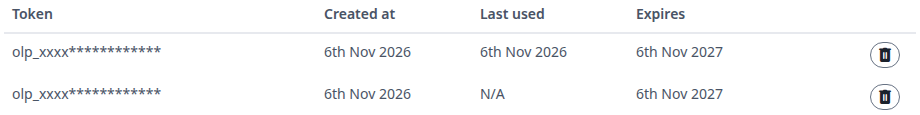

Her projenin kendi MCP sunucusu vardır; böylece bilgisayarınızdaki bir yapay zekâ istemcisi projeyi okuyup düzenleyebilir, derleyebilir ve yorumlarını yanıtlayabilir. İstemci bir Git kimlik doğrulama belirteciyle oturum açar.

<Info>

**MCP server** kartını görmüyorsanız yöneticinizi [MCP sunucusu](/tr/on-premises/configuration/overleaf-toolkit/integrations/mcp-server) sayfasına yönlendirin.

</Info>

## v6.3.3'te yenilikler {#new-in-v6-3-3}

v6.3.3'ten itibaren istemci proje geçmişiyle de çalışabilir: değişiklikleri listeleme, iki sürümü karşılaştırma, bir dosyayı eski hâliyle okuma, sürüm kaydetme ve silme, bir dosyayı veya tüm projeyi geri yükleme. İzlenen değişiklikleri listeleyip kabul veya reddedebilir ve siz istediğinizde kendi düzenlemelerini izlenen değişiklik olarak yapabilir. Bir metin parçasına yorum ekleyebilir, yorum mesajlarını düzenleyip silebilir, proje sohbetinde mesaj okuyup gönderebilir, dosya ve klasörleri taşıyıp yeniden adlandırabilir, klasör oluşturabilir ve yazım denetimi dilini değiştirebilir. İstemci sizin belirtecinizle çalıştığı için kimin neyi yapabileceği, düzenleyicide olduğu gibi projedeki rolünüze bağlıdır: bkz. [Kim neyi yapabilir](#who-may-do-what).

MCP sunucusu v6.3.1'de tanıtıldı. v6.3.1 ve v6.3.2 aynı 17 araca sahiptir; v6.3.3'te 33 araç vardır.

| Araçlar | v6.3.1 ve v6.3.2 | v6.3.3 |
| ----- | ----------------- | ------ |
| `get_clone_info`, `get_settings`, `list_files`, `delete_file`, `compile`, `get_compile_log`, `get_output_file_link`, `word_count`, `reply_to_comment`, `resolve_comment`, `reopen_comment` | Evet | Evet, değişmedi |
| `read_file` | En son içerik | Bir dosyanın bir `version` anındaki hâli de |
| `edit_file`, `write_file` | Projenin izlenen değişiklik ayarına uyar | Düzenlemeyi izlenen değişiklik yapmak için `trackChanges` de |
| `update_settings` | Derleyici, TeX Live imajı ve ana belge | Yazım denetimi dili de |
| `list_versions` | Sürüm, yorum ve tarih | `delete_version` için gereken `id` ve sürümü kimin kaydettiği de |
| `list_comments` | id içermeyen mesajlar | `edit_comment_message` ve `delete_comment_message` için gereken her mesajın `id` değeri de |
| `list_changes`, `diff`, `create_version`, `delete_version`, `restore_file`, `restore_project`, `list_tracked_changes`, `accept_tracked_changes`, `reject_tracked_changes`, `add_comment`, `edit_comment_message`, `delete_comment_message`, `list_chat_messages`, `send_chat_message`, `move_file`, `create_folder` | Hayır | Evet |

## İstemci bağlama {#connect-a-client}

<Steps>
<Step title="İletişim kutusunu açın">
Projeyi açın. Sol çubukta **Integrations**, ardından **MCP server** seçeneğine tıklayın.

<Frame caption="Integrations paneli">
  
</Frame>

İletişim kutusu bu projenin sunucusunun adresini ve her istemci için bir sekme gösterir: **Claude Code**, **Codex**, **Cursor**, **VS Code** ve **Gemini CLI**.

<Frame caption="MCP server iletişim kutusu">
  
</Frame>
</Step>

<Step title="Belirteç oluşturun">
**Go to settings** düğmesine tıklayın. Hesap ayarlarınız yeni bir sekmede açılır. **Git integration** altında **Generate token** düğmesine, zaten bir belirteciniz varsa **Add another token** düğmesine tıklayın. Belirteci yalnızca bir kez gördüğünüz için **Copy** düğmesine tıklayıp güvenli bir yerde saklayın. Ardından **Close** düğmesine tıklayın.

<Frame caption="Yeni belirteciniz">
  
</Frame>

[Git entegrasyonu](/on-premises/user-guide/users/git-integration) için zaten kullandığınız bir belirteç de çalışır; tek bir belirteci tüm projeleriniz için de kullanabilirsiniz.
</Step>

<Step title="Sunucuyu istemcinize ekleyin">
İletişim kutusuna dönün, istemcinizin sekmesine ve ardından yapılandırmanın yanındaki **Copy** düğmesine tıklayın.

| Sekme | Nereye gider | Belirteç |
| --- | ------------- | --------- |
| **Claude Code** | Komutu bir terminalde çalıştırın | Komuttaki `<token>` değerini değiştirin |
| **Codex** | `~/.codex/config.toml` | `OVERLEAF_TOKEN` ortam değişkenine koyun |
| **Cursor** | `~/.cursor/mcp.json` | `OVERLEAF_TOKEN` ortam değişkenine koyun |
| **VS Code** | `.vscode/mcp.json` | Dosyada belirteç yerine `overleaf-token` adlı bir parola istemi bulunur |
| **Gemini CLI** | Komutu bir terminalde çalıştırın | Komuttaki `<token>` değerini değiştirin |

Adres tek bir projeye aittir. Başka bir projeyi bağlamak için onu başka bir adla ekleyin, çünkü `overleaf` adı zaten kullanılıyor. Örneğin Claude Code için komuttaki `overleaf` değerini `overleaf-lab` olarak değiştirin.
</Step>
</Steps>

## Bağlantıyı doğrulama {#check-the-connection}

### Claude Code ile {#with-claude-code}

```bash
claude mcp list
```

Sunucu bağlı olarak listelenir:

```text
overleaf: https://<your-site>/project/<project-id>/mcp (HTTP) - ✔ Connected
```

### curl ile {#with-curl}

Bu yöntem istemciniz ne olursa olsun çalışır. Adresi ve belirteci değiştirin ve MCP protokolünün `initialize` isteğini gönderin:

```bash
curl -X POST https://<your-site>/project/<project-id>/mcp \
  -H "Authorization: Bearer <token>" \
  -H "Content-Type: application/json" \
  -H "Accept: application/json, text/event-stream" \
  -d '{"jsonrpc":"2.0","id":1,"method":"initialize","params":{"protocolVersion":"2025-06-18","capabilities":{},"clientInfo":{"name":"curl","version":"1.0"}}}'
```

Yanıt sunucunun adını ve ardından istemciler için talimatlarını içerir:

```json
{"result":{"protocolVersion":"2025-06-18","capabilities":{"tools":{"listChanged":true}},"serverInfo":{"name":"overleaf","version":"1.0.0"},"instructions":"This server works on one Overleaf project. ..."},"jsonrpc":"2.0","id":1}
```

Araçları görmek için aynı komutla `tools/list` gönderin. Yanıt 33 araç listeler; sitenizde proje sohbeti kapalıysa 31. v6.3.3'ten önce 17 araç listeler.

```bash
  -d '{"jsonrpc":"2.0","id":2,"method":"tools/list","params":{}}'
```

Birini çağırmak için `tools/call` gönderin:

```bash
  -d '{"jsonrpc":"2.0","id":3,"method":"tools/call","params":{"name":"list_files","arguments":{}}}'
```

```json
{"result":{"content":[{"type":"text","text":"[\n  {\n    \"path\": \"main.tex\",\n    \"type\": \"doc\"\n  }\n]"}]},"jsonrpc":"2.0","id":3}
```

### Hesap ayarlarınızda {#in-your-account-settings}

**Git integration** altında **Last used**, sunucunun aldığı bir belirtecin tarihini gösterir.

<Frame caption="İlk belirteç kullanıldı">
  
</Frame>

### Bağlanmazsa {#if-it-does-not-connect}

| Gördüğünüz | Anlamı |
| ------------ | ------------- |
| `401` durumu veya Claude Code'da `HTTP 401` ile `✘ Failed to connect` | Belirteç eksik, yanlış veya silinmiş |
| `404` durumu | Bu kimliğe sahip proje yok |
| `405` durumu | İstek bir `POST` değildi |
| `Not Acceptable` ile `406` durumu | `Accept` üst bilgisi eksik: istemci hem `application/json` hem de `text/event-stream` kabul etmelidir |

## İstemci çalışırken ne görürsünüz {#what-you-see-when-a-client-works}

Düzenlemeler, istemci onları yaptıkça açık bir düzenleyicide, bir ortak çalışanınkiler gibi, yeniden yüklemeden görünür. Yeni dosyalar ve klasörler, taşımalar ve yeniden adlandırmalar dosya ağacında görünür.

<Frame caption="edit_file tarafından eklenen bir satır">
  
</Frame>

`edit_file` yalnızca tam olarak bir kez geçen metni değiştirir. Aksi hâlde istemci `oldString not found in main.tex, read_file again` veya `oldString appears 2 times in main.tex, add context` gibi bir hata alır ve hiçbir şey değişmez.

v6.3.3'ten itibaren `move_file` bir dosyayı veya klasörü taşır ya da yeniden adlandırır ve gerekirse yeni yolun klasörlerini oluşturur; `create_folder` bir klasör oluşturur. Dosya bulunamazsa veya yeni yol zaten varsa istemci bir hata alır ve hiçbir şey değişmez. `update_settings` yazım denetimi dilini de değiştirebilir, örneğin `de` olarak, ya da yazım denetimini kapatabilir.

Belirteç sizin olduğu için yorumlara verilen yanıtlar inceleme panelinde sizin adınızla görünür. Sunucu üzerinden çözülen bir yorum panelden kalkar, yeniden açmak onu geri getirir.

<Frame caption="reply_to_comment tarafından gönderilen bir yanıt">
  
</Frame>

v6.3.3'ten itibaren `add_comment` bir metin parçasına yorum ekler. Metin dosyada tam olarak bir kez geçmelidir; birden fazla geçiyorsa istemci, onu çevreleyen ve yalnızca bir kez geçen daha uzun bir parça da verir ve yalnızca metne yorum eklenir. Yorum inceleme panelinde sizin adınızla görünür ve dosya değiştikçe metnine bağlı kalır. `edit_comment_message` kendi mesajlarınızdan birini değiştirir. `delete_comment_message` bir mesajı siler; ilk mesajı silmek, inceleme panelinde olduğu gibi yorumun tamamını siler.

`compile` projeyi derler ve çıktı dosyalarının listesini döndürür. Ardından `get_output_file_link`, PDF'i veya başka bir çıktı dosyasını indirmek için bir bağlantı verir. Bağlantı belirteç gerektirmez ve 5 dakika sonra çalışmayı durdurur.

Araçların tam listesi için [Tools](/on-premises/configuration/overleaf-toolkit/integrations/mcp-server#tools) bölümüne bakın.

## İzlenen değişiklikler {#tracked-changes}

v6.3.3'ten itibaren istemciden düzenlemelerini izlenen değişiklik olarak yapmasını isteyebilirsiniz, örneğin *Rewrite the abstract as a tracked change*. Bu durumda `edit_file` ve `write_file`, projede değişiklik izleme kapalı olsa bile mevcut bir dosyadaki değişikliği sizin adınıza izlenen değişiklik yapar ve siz onu inceleme panelinde kabul eder veya reddedersiniz. Yeni bir dosya hiçbir zaman izlenen değişiklik olmaz. İstemezseniz düzenlemeler, düzenleyicideki sizinkiler gibi projenin değişiklik izleme ayarına uyar: değişiklik izleme sizin için veya herkes için açıksa izlenir.

Proje sahibinin hesabında değişiklik izleme yoksa istemci `Track changes is off for this project` alır ve hiçbir şey değişmez.

İstemcinin her düzenlemesini incelemek için değişiklik izlemeyi kendiniz için açın. Onun düzenlemelerini inceleme panelinde sizinkilerden ayırt etmek için istemciye, projeyi paylaştığınız başka bir hesabın belirtecini verin.

`list_tracked_changes`, izlenen değişiklikleri dosyası, eklenen veya silinen metin, yazar ve zamanla birlikte listeler. `accept_tracked_changes` ve `reject_tracked_changes` değişikliklerin id değerlerini alır ve inceleme paneli gibi çalışır: kabul edilen değişiklik metinde kalır, reddedilen ekleme kaldırılır ve reddedilen silme geri gelir. Açık bir düzenleyici sonucu yeniden yüklemeden gösterir. Araçlar istemciye yalnızca sizin istediğiniz değişiklikleri kabul veya reddetmesini söyler.

## Geçmiş {#history}

v6.3.3'ten itibaren istemci proje geçmişini geçmiş panelinin gösterdiği gibi görür.

| Araç | Ne yapar |
| ---- | ------------ |
| `list_changes` | Değişiklikleri en yeniden başlayarak listeler: kim hangi dosyaları ne zaman değiştirdi, her değişiklikten önceki ve sonraki sürümlerle birlikte. Daha eski değişiklikler sonraki gruplarda gelir. |
| `diff` | İki sürümü karşılaştırır: bir dosyayı `git diff` gibi unified diff olarak ya da eklenen, kaldırılan, düzenlenen veya yeniden adlandırılan dosyaları |
| `version` ile `read_file` | Bir dosyayı bir sürümdeki hâliyle okur |
| `list_versions` | Kaydedilen sürümleri yorumları ve kaydedenleriyle listeler |
| `create_version` | En son sürümü veya daha eski bir sürümü bir yorumla kaydeder, **Label this version** gibi |
| `delete_version` | Kaydedilen bir sürümü siler; değişiklikleri kalır |
| `restore_file` | Bir dosyayı bir sürümdeki hâline geri yükler, **Restore this version** gibi |
| `restore_project` | Tüm projeyi bir sürümdeki hâline geri yükler, **Restore project to this version** gibi |

Geri yükleme kendi başına yeni bir değişikliktir, bu yüzden onu aynı yolla geri alabilirsiniz. Araçlar istemciye yalnızca siz istediğinizde geri yüklemesini söyler.

Proje sahibinin tam proje geçmişi yoksa istemci, geçmiş panelinde olduğu gibi yalnızca son 24 saatin değişikliklerini veya hepsi daha eskiyse en son değişikliği görür. Daha eski sürümleri karşılaştıramaz, okuyamaz veya geri yükleyemez.

## Proje sohbeti {#project-chat}

v6.3.3'ten itibaren `list_chat_messages` proje sohbetini en yeniden başlayarak her seferinde 50 mesaj okur. `send_chat_message` sizin adınıza bir mesaj gönderir ve mesaj açık bir sohbette hemen görünür. Sitenizde proje sohbeti kapalıysa istemcide bu iki araçtan hiçbiri yoktur.

## Kim neyi yapabilir {#who-may-do-what}

İstemci, projedeki rolünüzün izin verdiği şeyleri yapabilir.

| İstemcinin yaptığı | Sahip | Düzenleyen | İnceleyen | Görüntüleyen (adı verilen ortak çalışan) | Görüntüleyen (bağlantıyla paylaşım) |
| -------------------- | ----: | -----: | -------: | --------------------------: | --------------------: |
| Dosyaları ve ayarları okuma, derleme, günlüğü okuma, PDF'i indirme | Evet | Evet | Evet | Evet | Evet |
| Dosya yazma, düzenleme, taşıma ve silme, klasör oluşturma, ayarları değiştirme | Evet | Evet | Hayır | Hayır | Hayır |
| Geçmişi, yorumları ve izlenen değişiklikleri görme | Evet | Evet | Evet | Evet | Hayır |
| Sohbet mesajlarını okuma ve gönderme | Evet | Evet | Evet | Evet | Hayır |
| Yorum ekleme ve yanıtlama | Evet | Evet | Evet | Hayır | Hayır |
| Bir yorumu çözme, yeniden açma veya silme | Evet | Evet | Kendi başlattıkları | Hayır | Hayır |
| Bir yorum mesajını düzenleme | Kendi mesajları | Kendi mesajları | Kendi mesajları | Hayır | Hayır |
| Bir yorum mesajını silme | Evet | Evet | Kendi mesajları | Hayır | Hayır |
| İzlenen değişiklikleri kabul etme veya reddetme | Evet | Evet | Hayır | Hayır | Hayır |
| Sürüm kaydetme | Evet | Evet | Evet | Hayır | Hayır |
| Kaydedilen bir sürümü silme | Evet | Kendi kaydettikleri | Kendi kaydettikleri | Hayır | Hayır |
| Bir dosyayı veya projeyi geri yükleme | Evet | Evet | Hayır | Hayır | Hayır |

Bağlantıyla katılan düzenleyenler düzenleyen sayılır. İnceleyenler MCP üzerinden, izlenen değişiklik olarak bile, dosya düzenleyemez.

## İstemcinin bağlantısını kesme {#disconnect-a-client}

Belirteci silin: bkz. [Belirteç silme](/on-premises/user-guide/users/git-integration#delete-a-token). Bundan sonra sunucu bu belirtece `401` ile yanıt verir. Belirteci Git için de kullanıyorsanız Git de onu kabul etmeyi bırakır.
