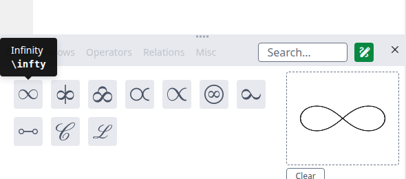
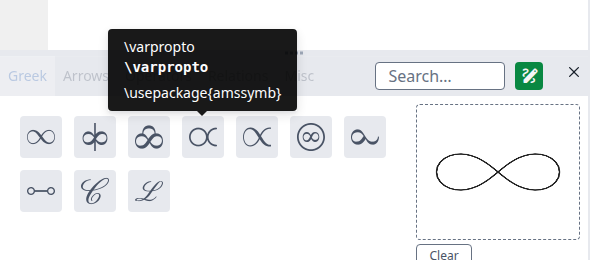

Sembol paleti belgenize matematik sembolleri ekler. Bir sembolün adını bilmiyorsanız çizin, tarayıcınız komutu bulur. Hiçbir şeyin ayarlanması gerekmez.

## Sembol ekleme {#insert-a-symbol}

<Steps>
<Step title="İmleci matematik ortamına yerleştirin">
Çoğu sembol yalnızca matematik ortamında çalışır. Sembolün gelmesi gereken yere tıklayın. Düzenleyici araç çubuğunda **Insert math**'e, ardından **Inline**'a tıklayın. İmleç artık `\(` ile `\)` arasındadır.

<Frame caption="Insert math menüsü">
  
</Frame>
</Step>

<Step title="Paleti açın">
Araç çubuğunda **Ω** düğmesine (**Insert symbol**) tıklayın. Sayfanın üstünde **Insert**'e, ardından **Symbol**'e de tıklayabilirsiniz. Palet düzenleyicinin altında açılır.

<Frame caption="Sembol paleti">
  
</Frame>
</Step>

<Step title="Sembolü bulun">
Bir sekmeye tıklayın: **Greek**, **Arrows**, **Operators**, **Relations** veya **Misc**. Adını ve komutunu görmek için işaretçiyi bir sembolün üzerinde tutun. Bazıları gerektirdikleri paket gibi bir not da gösterir.

<Frame caption="Bir sembolün adı, komutu ve notu">
  
</Frame>
</Step>

<Step title="Sembole tıklayın">
Komut imlecin bulunduğu yerde görünür. Palet açık kalır, böylece bir sonraki sembolü hemen ekleyebilirsiniz. Sembolü PDF'te görmek için **Recompile**'a tıklayın.

<Frame caption="Belgede ve PDF'te sembol">
  
</Frame>
</Step>
</Steps>

Palet **Visual** düzenleyicide de aynı şekilde çalışır.

## Sembol arama {#search-for-a-symbol}

**Search** kutusuna yazın. Bir komutu (`\sum`), sembolün adındaki bir kelimeyi (`arrow`) veya karakterin kendisini (`α`) arayabilirsiniz. Arama tüm sekmeleri kapsar. Sekmelere dönmek için kutuyu temizleyin.

<Frame caption="arrow araması">
  
</Frame>

Hiçbir şey eşleşmezse palet **No symbols found** gösterir.

## Sembol çizme {#draw-a-symbol}

Bir sembolü gözünüzde canlandırabildiğiniz ama adını bilmediğiniz durumlarda bunu kullanın.

<Steps>
<Step title="Kalem simgesine tıklayın">
**Search** kutusunun sağındaki kalem simgesine (**Draw a symbol**) tıklayın. Sekmeler devre dışı kalır ve sağda kesikli bir kutu görünür.

Tanıma hazır olana kadar <strong>Loading model…</strong> görünür. İlk seferde tarayıcınız sitenizden yaklaşık 40 MB indirir. Sonrasında bu dosyaları saklar.

<Frame caption="Çizim modu">
  
</Frame>
</Step>

<Step title="Kesikli kutuya çizin">
Bir çizgiyi bitirdiğinizde solda en yakını önde olmak üzere en fazla on eşleşme görünür. Komutunu görmek için işaretçiyi bir eşleşmenin üzerinde tutun. Birden fazla çizgiden oluşan bir sembolde eşleşmeler her çizgiden sonra güncellenir.

<Frame caption="Bir çizimin eşleşmeleri">
  
</Frame>
</Step>

<Step title="Eşleşmeye tıklayın">
Komut imlecin bulunduğu yerde görünür. Çiziminiz kalır, böylece başka bir eşleşmeyi deneyebilirsiniz. Bir sonraki sembolü çizmeden önce **Clear**'a tıklayın.

<Frame caption="İmleçteki komut">
  
</Frame>
</Step>
</Steps>

Sekmelere dönmek için kalem simgesine yeniden veya **Search** kutusuna tıklayın.

Tanıma tarayıcınızda çalışır. Çiziminiz sitenize gönderilmez.

### Paket gerektiren eşleşmeler {#matches-that-need-a-package}

Çizim 1.300'den fazla komutu tanır, sekmeler ise 117 tanesini listeler. Diğerlerinin çoğu bir LaTeX paketinden gelir. Bu durumda araç ipucu eklenecek satırı gösterir.

<Frame caption="Paket gerektiren bir eşleşme">
  
</Frame>

Satırı önsözünüze, `\begin{document}` öncesine ekleyin:

```latex
\usepackage{amssymb}
```

Palet bunu sizin için eklemez.

## Klavyeyi kullanma {#use-the-keyboard}

**Search** kutusundan, bir sembol seçilene kadar Tab'a basın. Ok tuşları semboller arasında gezinir. Enter seçili sembolü ekler ve paleti kapatır.

## Paleti kapatma {#close-the-palette}

Paletin sağ üstündeki <strong>×</strong> işaretine tıklayın. **Ω** düğmesi ile **Insert**, ardından **Symbol** de paleti kapatır.

## Bir sorun olursa {#if-something-goes-wrong}

| Gördüğünüz | Nedeni | Yapmanız gereken |
| ------------ | --- | ---------- |
| Derleme **Missing \$ inserted** diyor | Sembol matematik ortamının dışında | `\(` ile `\)` arasına taşıyın veya önce **Insert math** kullanın |
| Derleme **Undefined control sequence** diyor | Komut bir paket gerektiriyor | Hangisi olduğunu görmek için palette işaretçiyi sembolün üzerinde tutun ve önsözünüze ekleyin |
| Kalem simgesi yok | Tarayıcınız tanımayı çalıştıramıyor, örneğin Safari 15 | Tarayıcınızı güncelleyin veya başka bir tarayıcı kullanın. Sekmeler ve arama yine çalışır |
| Kesikli kutunun altında **Recognition unavailable** | Tarayıcı tanıma dosyalarını yükleyemedi | **Please try again**'e tıklayın |
