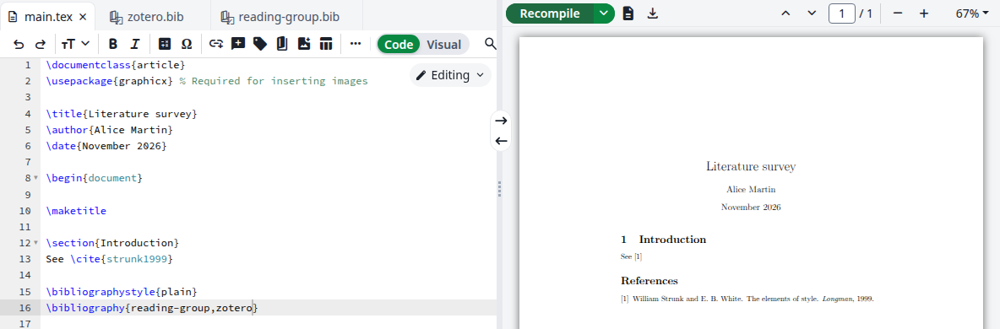

Bir Zotero kitaplığını projeye `.bib` dosyası olarak aktarın, ardından her zamanki gibi ondan alıntı yapın. Dosya bir kopyadır: yalnızca **Refresh** düğmesine tıkladığınızda değişir.

<Info>

**Account settings** içinde Zotero seçeneği görmüyorsanız yöneticinizden [Zotero entegrasyonunu](/tr/on-premises/configuration/overleaf-toolkit/integrations/zotero-integration) açmasını isteyin.

</Info>

## Zotero hesabınızı bağlama {#link-your-zotero-account}

Bunu yalnızca bir kez yaparsınız.

<Steps>
<Step title="Hesap ayarlarını açın">
**Account**, ardından **Account settings** öğesine tıklayın. **Reference managers** altında **Zotero** öğesini bulun ve **Link to Zotero** düğmesine tıklayın.

<Frame caption="Hesap ayarlarında Zotero">
  
</Frame>

Düzenleyicinin **Integrations** panelindeki **Zotero** kartı sizi aynı sekmede aynı yere götürür.

<Frame caption="Integrations paneli">
  
</Frame>
</Step>

<Step title="Zotero üzerinde yetki verin">
Zotero açılır. İstenirse oturum açın, ardından uygulamaya yetki verin. Uygulama yalnızca kitaplığınızı ve gruplarınızı okumak ister, bu nedenle Zotero içinde hiçbir şeyi değiştiremez.
</Step>

<Step title="Bağlantıyı denetleyin">
Hesap ayarlarına geri dönersiniz. Yeşil bir mesajda **Reference manager linked** yazar ve düğmede artık **Unlink** yazar.

<Frame caption="Zotero hesabınız bağlandı">
  
</Frame>
</Step>
</Steps>

Zotero üzerinde erişime izin vermezseniz aynı bölümde **Sorry, something went wrong** yazar. Yeniden denemek için **Link to Zotero** düğmesine tıklayın.

## Kitaplığınızdan dosya oluşturma {#create-a-file-from-your-library}

<Steps>
<Step title="Add files iletişim kutusunu açın">
Bir proje açın. Dosya ağacında **New file**, ardından **From Zotero** öğesine tıklayın. Bu öğe yalnızca hesabınız bağlandıktan sonra görünür.
</Step>

<Step title="Dosya adını ve kitaplığı seçin">
**File Name** başlangıçta `zotero.bib` olur. `.bib` uzantısını koruyun: uzantı olmadan önizleme alamazsınız ve ne `\cite` ne de `\bibliography` kayıtları bulabilir.

**Library** başlangıçta **My Library** olur ve grup kitaplıklarınızı da listeler. Bir dosya bir kitaplık içerir.

<Frame caption="Kişisel kitaplığınızdan bir dosya">
  
</Frame>
</Step>

<Step title="Create düğmesine tıklayın">
İletişim kutusu kapanır ve dosya dosya ağacında görünür. Dosyaya tıklayın: ne zaman aktarıldığını ve kayıtlarını gösterir. Dosyayı düzenleyicide düzenleyemezsiniz.

<Frame caption="Aktarılan dosya">
  
</Frame>

**Create** hiçbir şey yapmıyor gibi görünüyorsa bu ada sahip bir dosya zaten vardır. Başka bir ad seçin.
</Step>
</Steps>

### Grup kitaplığını aktarma {#import-a-group-library}

Aynı işlemi kendine ait bir dosya adıyla tekrarlayın ve **Library** altında grubu seçin. Bir projede bu dosyalardan birkaçı olabilir.

<Frame caption="Bir grup kitaplığından dosya">
  
</Frame>

## Dosyadan alıntı yapma {#cite-from-the-file}

<Steps>
<Step title="Alıntıya başlayın">
Bir `.tex` dosyasında `\cite{` yazın. Liste, projedeki tüm `.bib` dosyalarının kayıtlarını gösterir. Eklemek için birine tıklayın.

<Frame caption="Aktarılan dosyaların kayıtları">
  
</Frame>
</Step>

<Step title="Ya da başlığa veya yazara göre arayın">
Listenin altındaki **Search** düğmesine tıklayın veya süslü parantezlerin içinde Ctrl+Space tuşlarına basın. Filtrelemek için yazın, bir veya daha fazla kayda tıklayın, ardından **Insert** düğmesine tıklayın.

<Frame caption="Kaynak arama">
  
</Frame>
</Step>

<Step title="Kaynakçayı ekleyin">
Bu satırları `\end{document}` öncesine ekleyin; dosya adlarınızı `.bib` olmadan, virgülle ayırarak yazın:

```latex
\bibliographystyle{plain}
\bibliography{reading-group,zotero}
```

**Recompile** düğmesine tıklayın. Kaynak PDF'te görünür.

<Frame caption="Derlenmiş kaynak">
  
</Frame>
</Step>
</Steps>

Aktarılan dosyalar **Settings** içinde **References**, **Main bibliography file for this project** altında sunulmaz; bu nedenle projede başka bir `.bib` dosyası yoksa liste boş kalır. Yine de bu dosyalardan alıntı yapabilirsiniz.

<Frame caption="Boş liste beklenen bir durumdur">
  
</Frame>

## Dosyayı yenileme {#refresh-the-file}

Zotero kitaplığınızdaki değişiklikler projeye kendiliğinden gelmez ve derleme bunları getirmez.

<Steps>
<Step title="Dosyayı açın">
Dosya ağacında aktarılan dosyaya tıklayın.
</Step>

<Step title="Refresh düğmesine tıklayın">
Dosyanın tamamı, oluştururken seçtiğiniz kitaplıktan yeniden aktarılır: yeni kayıtlar görünür, silinenler kaybolur. Üstteki saat değişir.

<Frame caption="Yenilenen dosya">
  
</Frame>
</Step>

<Step title="Yeniden derleyin">
Yeni kayıtlar hemen `\cite{` listesinde yer alır. PDF'i güncellemek için **Recompile** düğmesine tıklayın.
</Step>
</Steps>

Her dosya ayrı ayrı yenilenir: grubunuzun dosyasını ayrıca yenileyin. Paylaşılan bir projede bir dosyayı kimin yenileyebileceği için [yöneticiler için notlara](/on-premises/configuration/overleaf-toolkit/integrations/zotero-integration#notes) bakın.

## Zotero hesabınızın bağlantısını kaldırma {#unlink-your-zotero-account}

**Account settings** içinde **Zotero** altında **Unlink** düğmesine, ardından iletişim kutusunda yeniden **Unlink** düğmesine tıklayın. Düğmede yeniden **Link to Zotero** yazar.

<Frame caption="Hesabınızın bağlantısını kaldırma">
  
</Frame>

Aktardığınız dosyalar projelerinizde kalır ve derlenmeye devam eder. **From Zotero**, **Add files** iletişim kutusundan kaybolur ve hesabınızı yeniden bağlayana kadar **Refresh** bir hata gösterir.

<Frame caption="Bağlı hesap olmadan yenileme">
  
</Frame>

Yeniden bağladıktan sonra **Refresh** aynı dosyalarda çalışır.

## Bir sorun olursa {#if-something-goes-wrong}

**Add files** iletişim kutusunda **Could not load references from Zotero, please re-link your account and try again** veya **There was an error accessing your Zotero data**: Overleaf artık kitaplığınızı okuyamıyor; örneğin Zotero üzerinde erişimini kaldırmışsınızdır. **Account settings** içinde **Unlink**, ardından **Link to Zotero** düğmesine tıklayın. O zamana kadar **Create** de kendi projenizde bile **The project that contains this file is not shared with you** mesajıyla başarısız olur.

<Frame caption="Overleaf artık kitaplığınızı okuyamıyor">
  
</Frame>

**Refresh** düğmesine tıkladığınızda **The remote service produced an error**: Zotero isteği başarısız oldu. Dosya içeriğini korur. Daha sonra yeniden **Refresh** düğmesine tıklayın.
