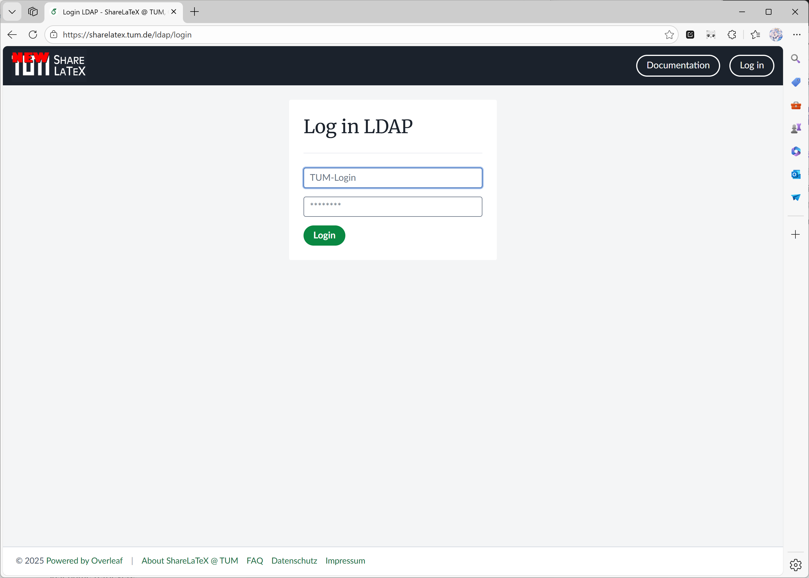

Наразі інтеграція з Git доступна в [ayaka-notes/overleaf](https://github.com/ayaka-notes/overleaf).

<Info>

Цю функцію спочатку розробив [ayaka-notes/ayakaleaf-pro](https://github.com/ayaka-notes/ayakaleaf-pro).

</Info>

<Steps>
<Step title="Увімкніть git-bridge (лише для користувачів Toolkit)">
Якщо ви використовуєте Toolkit, увімкніть `git-bridge`, задавши такий параметр у своєму `config/overleaf.rc`:

```text title="config/overleaf.rc"
GIT_BRIDGE_ENABLED=true
```

Toolkit ігнорує цей параметр, якщо також не задано `SERVER_PRO=true`. Більше нічого не потрібно: Toolkit сам задає `GIT_BRIDGE_HOST`, `GIT_BRIDGE_PORT` і `V1_HISTORY_URL` для контейнера `sharelatex`, тож пропустіть два кроки для Docker Compose нижче. Виконайте `bin/up`, щоб перестворити контейнери.
</Step>

<Step title="Додайте контейнер git-bridge (лише для користувачів Docker-compose)">
Користувачам, які використовують власний `docker-compose.yml`, потрібно додати до свого compose-файлу таку конфігурацію контейнера:

```yaml title="docker-compose.yml (git-bridge service)" wrap
git-bridge:
    restart: always
    image: ghcr.io/ayaka-notes/overleaf-pro/git-bridge:6.3.2 # tag should match the `sharelatex` container tag
    volumes:
        - ~/git_bridge_data:/data/git-bridge
    container_name: git-bridge
    expose:
        - "8000"
    environment:
        GIT_BRIDGE_API_BASE_URL: "http://sharelatex:3000/api/v0/" 
        GIT_BRIDGE_OAUTH2_SERVER: "http://sharelatex"
        GIT_BRIDGE_POSTBACK_BASE_URL: "http://git-bridge:8000"
        GIT_BRIDGE_ROOT_DIR: "/data/git-bridge"
    user: root
    command: ["/server-pro-start.sh"]
```

Використовуйте той самий тег, що й для образу `sharelatex`. [MCP-сервер](/uk/on-premises/configuration/overleaf-toolkit/integrations/mcp-server) (v6.3.1 і новіші) входить до образу `sharelatex` і вмикається разом з інтеграцією з Git, тож окремий контейнер йому не потрібен.
</Step>

<Step title="Оновіть конфігурацію контейнера sharelatex">
Також потрібно під'єднати контейнер `git-bridge` до контейнера `sharelatex` і визначити такі змінні середовища; зверніть особливу увагу на `V1_HISTORY_URL`:

```yaml title="docker-compose.yml (sharelatex service)"
sharelatex:
    links:
        - git-bridge
    environment:
         GIT_BRIDGE_ENABLED: true
         GIT_BRIDGE_HOST: "git-bridge"
         GIT_BRIDGE_PORT: "8000"
         # We use v1 now, if you used to set V1_HISTORY_URL, please update now
         V1_HISTORY_URL: "http://sharelatex:3100/api"
```
</Step>

<Step title="Автентифікація">
Для автентифікації git-клієнта користувачам потрібен Personal Access Token. Користувачі можуть керувати своїми Personal Access Token через інтерфейс застосунку (див. документацію):

<Frame caption="Personal Access Token для інтеграції з Git">
  
</Frame>
</Step>

<Step title="Моніторинг і ресурси">
Після ввімкнення `git-bridge` рекомендуємо стежити за ресурсами хоста. Зростання навантаження залежатиме від:

* кількості користувачів, які користуються цією функцією
* типів проєктів, розміщених у вашому екземплярі (великі проєкти зазвичай потребують більше ресурсів)
</Step>
</Steps>

### Перенесення проєктів до S3

Інтеграція з Git зберігає на диску повний git-репозиторій для кожного проєкту, який клонує користувач. Якщо дискового простору обмаль, можна активувати завдання swap, яке переміщуватиме рідше використовувані репозиторії до AWS S3. Якщо перенесений репозиторій знову знадобиться, його буде повернено на диск. Завдання swap керується такими змінними середовища:

| Назва                                 | Опис                                                                                                                                               |
| ------------------------------------- | -------------------------------------------------------------------------------------------------------------------------------------------------- |
| `GIT_BRIDGE_SWAPSTORE_TYPE`           | Установіть значення "s3", щоб активувати завдання swap.                                                                                            |
| `GIT_BRIDGE_SWAPSTORE_AWS_ACCESS_KEY` | Ваш ключ доступу AWS                                                                                                                               |
| `GIT_BRIDGE_SWAPSTORE_AWS_SECRET`     | Ваш секретний ключ AWS                                                                                                                             |
| `GIT_BRIDGE_SWAPSTORE_S3_BUCKET_NAME` | Цей бакет міститиме заархівовані git-репозиторії                                                                                                   |
| `GIT_BRIDGE_SWAPSTORE_AWS_REGION`     | Регіон бакета                                                                                                                                      |
| `GIT_BRIDGE_SWAPJOB_MIN_PROJECTS`     | <p>Мінімальна кількість проєктів, які зберігаються на диску.<br /><br /><strong>- За замовчуванням:</strong> 50</p>                                   |
| `GIT_BRIDGE_SWAPJOB_LOW_GIB`          | <p>Нижній поріг для swap. Завдання переміщуватиме проєкти, доки використання диска не опуститься нижче цього значення.<br /><br /><strong>- За замовчуванням:</strong> 128 GB</p> |
| `GIT_BRIDGE_SWAPJOB_HIGH_GIB`         | <p>Верхній поріг для swap. Завдання почне переміщення, коли використання диска досягне цього значення.<br /><br /><strong>- За замовчуванням:</strong> 256 GB</p> |
| `GIT_BRIDGE_SWAPJOB_INTERVAL_MILLIS`  | <p>Інтервал між перевірками використання диска та запусками завдання swap.<br /><br /><strong>- За замовчуванням:</strong> 3600000 ms = 1 година</p>   |

### Питання та відповіді

<Accordion title="Як працює модель дозволів Git Bridge, якщо я надаю доступ до свого проєкту іншій людині?">

Користувачі з доступом лише на читання можуть тільки клонувати проєкт; користувачі з доступом на читання й запис можуть клонувати проєкти та виконувати push. Примітка: щоб приєднатися до проєкту, користувачі мають увійти в систему.

</Accordion>

<Accordion title="Як клонувати проєкт і які ім'я користувача та пароль використовувати?">

У редакторі відкрийте **Integrations** на лівій панелі й натисніть **Git integration**. Там показано команду клонування у такому вигляді:

```sh
git clone https://<your-overleaf>/git/<project_id>
```

Коли Git запитає облікові дані, введіть `git` як ім'я користувача і Personal Access Token як пароль. Згенеруйте токен в **Account Settings**; він дійсний протягом одного року. Пароль вашого облікового запису не підійде.

Зміни не синхронізуються автоматично: використовуйте `git pull`, щоб отримати зміни, зроблені в редакторі, і `git push`, щоб надіслати свої. Шлях `/git` обслуговує контейнер `sharelatex`, тож зворотному проксі перед ним не потрібне додаткове правило.

</Accordion>

<Accordion title="`git push` завершується помилкою `HTTP 413` або `curl 55 Broken pipe`">

Push перевищує ліміт розміру завантаження, який задається `MAX_UPLOAD_SIZE` (у мегабайтах, за замовчуванням `50`) і також застосовується до push. Збільште його в `config/variables.env`, наприклад `MAX_UPLOAD_SIZE=200`, а потім виконайте `bin/up -d`. Якщо ви використовуєте [TLS-проксі](/uk/on-premises/configuration/overleaf-toolkit/tls-proxy) або власний зворотний проксі, також збільште його `client_max_body_size` (`50M` у файлі `config/nginx/nginx.conf` Toolkit).

Git-bridge також відхиляє файли, більші за 50 МБ, і проєкти з понад 2 000 файлів. Ці ліміти задаються `GIT_BRIDGE_REPOSTORE_MAX_FILE_SIZE` (у байтах) і `GIT_BRIDGE_REPOSTORE_MAX_FILE_NUM` у `config/variables.env`.

</Accordion>

<Accordion title="Журнал git-bridge показує `Failed to fetch log level`">

Це попередження нешкідливе, і клонування, pull та push продовжують працювати. У 6.2.x git-bridge раз на хвилину запитує рівень журналювання в сервера метаданих Google Cloud (`metadata.google.internal`), що працює лише в Google Cloud. В інших середовищах запит завершується невдачею, git-bridge записує помилку в журнал (наприклад, `null` або HTTP-статус) і зберігає рівень із `GIT_BRIDGE_LOG_LEVEL`. Починаючи з 6.3.0 цю перевірку вимкнено, а оновлення також оновлює образ git-bridge, версія якого відповідає основному образу.

</Accordion>

<Accordion title="Чи потрібні служба track-changes або `OVERLEAF_IS_SERVER_PRO=true` для Git і повної історії проєкту?">

<strong>Відповідь:</strong> Ні. В Ayakaleaf Pro немає служби track-changes. Історію проєкту зберігають служби `project-history` і `history-v1`, які завжди працюють усередині контейнера `sharelatex`. Git-bridge читає історію з `history-v1` за адресою `V1_HISTORY_URL` (`http://sharelatex:3100/api`), яку задає Toolkit. Не задавайте `OVERLEAF_IS_SERVER_PRO`: від неї не залежить жодна функція, вона лише перемикає міграції бази даних, що виконуються під час запуску, на набір для Server Pro.

</Accordion>
