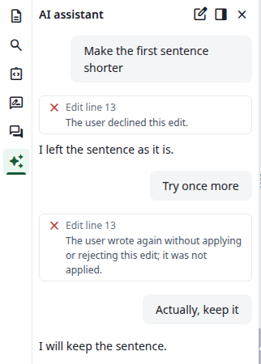

Асистент працює з відкритим проєктом. Він читає ваші документи й пропонує правки, а ви застосовуєте або відхиляєте кожну з них. Відповіді на знімках екрана наведено як приклад: що ви отримаєте, залежить від моделі, яку використовує ваш екземпляр.

<Info>

Якщо на лівій панелі немає **AI assistant**, спрямуйте адміністратора на сторінку [Інтеграція ШІ](/uk/on-premises/configuration/overleaf-toolkit/integrations/ai-integration).

</Info>

## Почати чат {#start-a-chat}

<Steps>
<Step title="Відкрийте асистента">
На лівій панелі редактора натисніть **AI assistant**. Поруч із редактором відкриється панель.
</Step>

<Step title="Прийміть умови">
Першого разу панель покаже умови використання функцій ШІ. Натисніть **Accept and continue**. Це робиться один раз і стосується також [Асистента помилок](/uk/on-premises/user-guide/users/error-assistant).

<Frame caption="Умови, показані один раз">
  
</Frame>
</Step>

<Step title="Поставте запитання">
Введіть текст у <strong>What would you like to do?</strong> і натисніть Enter або стрілку. Можна також натиснути підказку в **Start a chat**. Підказки змінюються від чату до чату, а якщо в останній компіляції були помилки, до них додається **Fix the compile errors**.

<Frame caption="Порожній чат">
  
</Frame>
</Step>

<Step title="Прочитайте відповідь">
Дії асистента відображаються рядками в блоці, наприклад **Read line 15-16 of main.tex**, із галочкою після завершення кроку. Далі йде відповідь. Якщо модель показує свої міркування, натисніть **Reasoned for 1 s**, щоб прочитати їх.

<Frame caption="Запитання та відповідь">
  
</Frame>
</Step>
</Steps>

## Запитати про виділені рядки {#ask-about-selected-lines}

Виділіть рядки в редакторі. Над полем повідомлення з'явиться мітка на кшталт `main.tex: 16`, і виділений текст буде надіслано разом із повідомленням. У порожньому чаті підказки стосуватимуться виділення, наприклад **Make it shorter**.

<Frame caption="Виділений рядок">
  
</Frame>

## Переглянути запропоновану правку {#review-a-suggested-edit}

Правка не потрапляє в документ, доки ви її не застосуєте.

<Steps>
<Step title="Прочитайте пропозицію">
Блок **Edit line 16** показує причину, номер рядка й зміну: старий текст закреслено, новий виділено. Документ ще не змінено. **Show result** показує лише новий текст, а **Show diff** повертає попередній вигляд.

<Frame caption="Правка, що чекає вашого рішення">
  
</Frame>
</Step>

<Step title="Застосуйте її">
Натисніть **Apply**. Зміна з'явиться в редакторі, блок отримає галочку, і асистент продовжить роботу. Якщо правка стосується іншого документа, цей документ відкриється.

<Frame caption="Правку застосовано">
  
</Frame>
</Step>

<Step title="Скасуйте, якщо передумаєте">
**Undo** прибирає зміну з документа, а **Apply** повертає її. Асистент не дізнається ні про те, ні про інше.
</Step>
</Steps>

### Відхилити правку {#reject-an-edit}

Натисніть **Reject**. Документ залишається як є, блок показує <strong>The user declined this edit.</strong>, і асистент продовжує, знаючи, що ви відмовилися. Кнопки зникають, тож щоб повернути правку, попросіть знову.

Якщо замість рішення ви напишете нове повідомлення, правку не буде застосовано, і блок про це повідомить.

<Frame caption="Відхилена правка та правка без рішення">
  
</Frame>

## Що асистент може робити в проєкті {#what-the-assistant-can-do-in-a-project}

Вашого рішення чекають лише правки. Інші кроки виконуються одразу, щойно асистент їх робить.

| Рядок у чаті | Що він робить |
| -------------------- | ------------ |
| **Read line 15-16 of main.tex** | Читає рядки документа |
| **Find “schedule” in main.tex** | Шукає текст у документі |
| **List the project files** | Перелічує файли проєкту |
| **Create appendix.tex** | Створює порожній документ і відкриває його |
| **Edit line 16** | Пропонує правку, див. вище |
| **Compile** | Компілює проєкт |
| **Check the compile log** | Читає помилки й попередження останньої компіляції |
| **Look at PDF page 1** | Показує сторінку PDF у чаті |
| **Read the PDF structure** | Читає структуру PDF |
| **Switch to xelatex** | Змінює компілятор проєкту, як у **Settings** |
| <strong>Search the web for “...”</strong> | Шукає в інтернеті |
| <strong>Search the help pages for “...”</strong> | Шукає на сторінках довідки |

<Frame caption="Новий файл, потім правка в іншому документі">
  
</Frame>

<Frame caption="Компіляція та сторінка PDF">
  
</Frame>

Рядок пошуку показує, скільки результатів знайдено. Натисніть на нього, щоб побачити список. Доступність пошуку залежить від вашого екземпляра, див. [Додаткові пошукові сервіси](/uk/on-premises/configuration/overleaf-toolkit/integrations/ai-integration#optional-search-services).

<Frame caption="Результати пошуку">
  
</Frame>

Підказка **Fix the compile errors** просить асистента перевірити журнал і виправити знайдене. Виправлення надходять як правки, які ви переглядаєте.

## Прикріпити зображення або PDF {#attach-an-image-or-a-pdf}

У полі повідомлення натисніть значок зображення **Attach image or PDF** і виберіть файл. Його назва з'явиться над вашим текстом. Напишіть повідомлення й надішліть його.

<Frame caption="Файл, прикріплений до повідомлення">
  
</Frame>

Інші файли панель відхиляє з повідомленням <strong>Only images and PDF files can be attached.</strong>, а великі файли з повідомленням <strong>Files must be smaller than 2 MB.</strong>

## Зупинити асистента {#stop-the-assistant}

Поки асистент працює, стрілка в полі повідомлення перетворюється на кнопку **Stop**. Натисніть її. Поточний крок завершиться повідомленням <strong>Stopped by the user.</strong>, і більше нічого не станеться, доки ви знову не напишете.

<Frame caption="Кнопка Stop">
  
</Frame>

## Якщо асистент зупинився сам {#if-the-assistant-stops-by-itself}

Асистент може виконати обмежену кількість кроків на одне повідомлення. Після досягнення ліміту панель показує <strong>The assistant used all the steps it may take for one message. Reply to let it carry on.</strong> Відповідайте, наприклад `Go on`, і він продовжить.

<Frame caption="Ліміт кроків">
  
</Frame>

Якщо панель показує **Something’s gone wrong**, запит не вдався. Надішліть повідомлення знову або натисніть **Start new chat**.

## Перемістити панель і почати заново {#move-the-panel-and-start-over}

Ці кнопки розташовано вгорі панелі:

* **Start new chat** очищає панель. Списку попередніх чатів немає. Перезавантаження сторінки теж очищає чат.
* **Move to the right** переміщує панель праворуч від PDF, де вона залишається відкритою, поки ви працюєте з деревом файлів. **Move to the left** повертає її назад. Чат зберігається.
* **Close** приховує панель. Натисніть **AI assistant** на лівій панелі, щоб повернути її разом із чатом.

<Frame caption="Панель праворуч">
  
</Frame>

## Використання токенів {#token-usage}

Асистент не показує, скільки токенів ви використали. Якщо ваш екземпляр задає ліміт і ви його досягли, наступне повідомлення залишиться без відповіді. Панель показує **Usage limit reached** і час до можливості знову спілкуватися, а поле повідомлення стає сірим.

<Frame caption="Ліміт досягнуто">
  
</Frame>

Новий чат показує те саме сповіщення. Після перезавантаження поле знову виглядає звично, але наступне повідомлення теж отримає сповіщення. [Асистент помилок](/uk/on-premises/user-guide/users/error-assistant) витрачає той самий ліміт і показує **Usage limit reached** у записі журналу.

Ліміт задає адміністратор, див. [Використання та скидання](/uk/on-premises/configuration/overleaf-toolkit/integrations/ai-integration#usage-and-reset).
