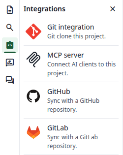

Під'єднайте проєкт до репозиторію GitLab. Зміни передаються в обидва боки і лише тоді, коли ви натискаєте **Sync**: нічого не синхронізується саме собою.

<Info>

Спочатку адміністратор має увімкнути [синхронізацію з GitLab](/uk/on-premises/configuration/overleaf-toolkit/integrations/gitlab-synchronisation).

</Info>

## Прив'язка облікового запису GitLab {#link-your-gitlab-account}

Це робиться один раз.

<Steps>
<Step title="Відкрийте налаштування облікового запису">
Натисніть **Account**, потім **Account settings**. У розділі **Project synchronisation** знайдіть **GitLab** і натисніть **Link**.

<Frame caption="GitLab у налаштуваннях облікового запису">
  
</Frame>
</Step>

<Step title="Авторизуйтеся на GitLab">
Відкриється GitLab. Увійдіть, якщо буде потрібно, потім авторизуйте застосунок.
</Step>

<Step title="Перевірте прив'язку">
Ви повернетеся до налаштувань облікового запису. Зелене повідомлення повідомить, що ваш обліковий запис GitLab прив'язано, а на кнопці тепер написано **Unlink**.

<Frame caption="Ваш обліковий запис GitLab прив'язано">
  
</Frame>
</Step>
</Steps>

Якщо ваш обліковий запис ще не прив'язано, **Import from GitLab** і картка **GitLab** у редакторі спершу попросять його прив'язати. Натисніть **Link to your GitLab account**. Ви також опинитеся в налаштуваннях облікового запису, у новій вкладці, якщо почали в редакторі. Потім поверніться й почніть знову.

<Frame caption="Підказка, якщо обліковий запис не прив'язано">
  
</Frame>

## Імпорт репозиторію {#import-a-repository}

Так створюється новий проєкт із репозиторію GitLab, уже прив'язаний до нього.

<Steps>
<Step title="Відкрийте діалог імпорту">
На сторінці проєктів натисніть **New project**, потім **Import from GitLab**.

<Frame caption="Меню New project">
  
</Frame>
</Step>

<Step title="Виберіть репозиторій">
Натисніть **Import to Overleaf** поруч із репозиторієм. У списку є ваші репозиторії та репозиторії ваших груп.

<Frame caption="Ваші репозиторії GitLab">
  
</Frame>
</Step>

<Step title="Перевірте проєкт">
Новий проєкт відкриється з файлами репозиторію.

<Frame caption="Імпортований проєкт">
  
</Frame>
</Step>
</Steps>

## Експорт проєкту в новий репозиторій {#export-a-project-to-a-new-repository}

Так із проєкту створюється репозиторій, і вони прив'язуються. Проєкт можна прив'язати лише цим способом або імпортом: прив'язати його до вже наявного репозиторію не можна.

<Steps>
<Step title="Відкрийте GitLab у редакторі">
Відкрийте проєкт. На лівій панелі натисніть **Integrations**, потім **GitLab**.

<Frame caption="Панель Integrations">
  
</Frame>
</Step>

<Step title="Заповніть дані репозиторію">
Виберіть **Owner**: це можете бути ви або одна з ваших груп. Якщо ви вибираєте групу, це поле називається **Organization**. **Repository Name** спочатку збігається з назвою проєкту. Опис необов'язковий, а **Private** вибрано за замовчуванням. Натисніть **Create a GitLab repository**.

<Frame caption="Export Project to GitLab">
  
</Frame>

Якщо назву вже зайнято, у діалоговому вікні з'явиться <strong>Please check that the repository name is valid, and that you have permission to create the repository.</strong> Змініть назву й знову натисніть кнопку.
</Step>

<Step title="Перевірте прив'язку">
У діалоговому вікні тепер написано **This project is linked to** і вказано репозиторій.

<Frame caption="Проєкт прив'язано">
  
</Frame>
</Step>
</Steps>

## Синхронізація {#sync}

<Steps>
<Step title="Відкрийте діалог синхронізації">
Відкрийте прив'язаний проєкт. На лівій панелі натисніть **Integrations**, потім **GitLab**.

**Recent commits in GitLab** перелічує те, що потрапить у проєкт.

<Frame caption="Новий коміт очікує в GitLab">
  
</Frame>
</Step>

<Step title="Опишіть свої зміни">
Якщо ви щось змінили в проєкті, з'явиться поле для повідомлення коміту. Воно необов'язкове: якщо залишити його порожнім, коміт називатиметься `Updates from Overleaf`.

<Frame caption="Повідомлення коміту для ваших змін">
  
</Frame>
</Step>

<Step title="Натисніть Sync">
Натисніть **Sync**. Нові коміти з GitLab потрапляють у проєкт, а ваші зміни надсилаються до гілки репозиторію за замовчуванням. Якщо обидві сторони змінили різні місця, зміни об'єднуються автоматично.
</Step>

<Step title="Перевірте результат">
У діалоговому вікні з'явиться <strong>No new commits in GitLab since last merge.</strong>, а поле повідомлення коміту зникне. Файли в редакторі та коміти на GitLab актуальні.

<Frame caption="Усе синхронізовано">
  
</Frame>
</Step>
</Steps>

### Якщо ті самі рядки змінилися з обох боків {#if-the-same-lines-changed-on-both-sides}

Діалогове вікно повідомляє, що зміни не вдалося об'єднати, і називає нову гілку `overleaf-YYYY-MM-DD-HHMMSS`, у якій містяться ваші зміни. Overleaf також відкриває на GitLab merge request із цієї гілки.

<Frame caption="Конфлікт">
  
</Frame>

1. Об'єднайте цю гілку з гілкою за замовчуванням на GitLab або за допомогою Git. Тим часом діалог можна закрити: під час повторного відкриття він покаже те саме повідомлення.
2. Натисніть **I have manually merged. Continue**. Об'єднаний результат потрапить у проєкт. Якщо натиснути кнопку до злиття гілки, діалог залишиться без змін.
3. Гілка залишається на GitLab, якщо ви не видалили її під час злиття. Видаліть її, коли вона стане непотрібною.

Те саме діалогове вікно з'являється, коли правила злиття репозиторію затримують merge request, наприклад якщо потрібне схвалення, навіть якщо конфліктних рядків немає. Щойно правило дозволить, виконайте злиття merge request на GitLab і натисніть **I have manually merged. Continue**. Див. [Як працює синхронізація з GitLab](/uk/on-premises/configuration/overleaf-toolkit/integrations/gitlab-synchronisation#how-syncing-works-with-gitlab).

## Відв'язування проєкту {#unlink-a-project}

Зробіть це, якщо більше не хочете синхронізувати проєкт.

<Steps>
<Step title="Натисніть Unlink">
У діалозі синхронізації натисніть **Unlink**.
</Step>

<Step title="Підтвердьте">
Натисніть **Confirm**. Це лише видаляє прив'язку: під'єднання до репозиторію, власником якого ви є, згадане в попередженні, залишається можливістю на майбутнє, а не відбувається зараз.

<Frame caption="Підтвердження відв'язування">
  
</Frame>
</Step>

<Step title="Перевірте результат">
Тепер у діалоговому вікні відображається **Export Project to GitLab**. І проєкт, і репозиторій зберігають свій вміст. Щоб знову синхронізувати, експортуйте проєкт у новий репозиторій або імпортуйте репозиторій у новий проєкт.
</Step>
</Steps>

## Відв'язування облікового запису GitLab {#unlink-your-gitlab-account}

В **Account settings**, у розділі **GitLab**, натисніть **Unlink**, потім ще раз **Unlink** у діалоговому вікні.

<Frame caption="Відв'язування облікового запису">
  
</Frame>

Ваші проєкти залишаються прив'язаними до своїх репозиторіїв. Синхронізувати їх не можна, доки ви знову не прив'яжете обліковий запис.

<Info>

Про те, хто що може робити в спільному проєкті, див. [Хто може прив'язувати й синхронізувати](/uk/on-premises/configuration/overleaf-toolkit/integrations/gitlab-synchronisation#who-can-link-and-sync).

</Info>
