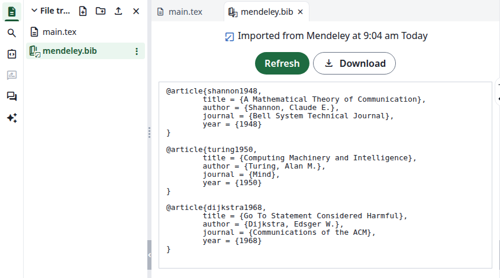
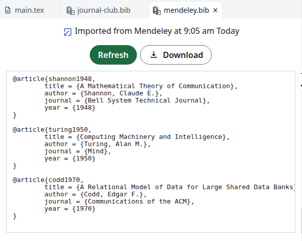

Імпортуйте бібліотеку Mendeley у проєкт як файл `.bib`, а потім цитуйте з нього як зазвичай. Файл є копією: він змінюється, лише коли ви натискаєте **Refresh**.

<Info>

Якщо в **Account settings** немає параметра Mendeley, попросіть адміністратора увімкнути [інтеграцію з Mendeley](/uk/on-premises/configuration/overleaf-toolkit/integrations/mendeley-integration).

</Info>

## Під'єднати обліковий запис Mendeley {#link-your-mendeley-account}

Це робиться один раз.

<Steps>
<Step title="Відкрийте налаштування облікового запису">
Натисніть **Account**, потім **Account settings**. У розділі **Reference managers** знайдіть **Mendeley** і натисніть **Link to Mendeley**.

<Frame caption="Mendeley у налаштуваннях облікового запису">
  
</Frame>

Картка **Mendeley** на панелі **Integrations** редактора веде туди ж, у тій самій вкладці.

<Frame caption="Панель Integrations">
  
</Frame>
</Step>

<Step title="Надайте дозвіл у Mendeley">
Відкриється Mendeley. Увійдіть, якщо буде потрібно, і надайте дозвіл застосунку.
</Step>

<Step title="Перевірте під'єднання">
Ви повернетеся до налаштувань облікового запису. Зелене повідомлення каже **Reference manager linked**, а на кнопці тепер написано **Unlink**.

<Frame caption="Обліковий запис Mendeley під'єднано">
  
</Frame>
</Step>
</Steps>

Якщо ви не надасте доступ у Mendeley, у тому самому розділі з'явиться **Sorry, something went wrong**. Натисніть **Link to Mendeley**, щоб спробувати ще раз.

## Створити файл із бібліотеки {#create-a-file-from-your-library}

<Steps>
<Step title="Відкрийте діалог Add files">
Відкрийте проєкт. У дереві файлів натисніть **New file**, потім **From Mendeley**. Цей пункт з'являється лише після під'єднання облікового запису.
</Step>

<Step title="Виберіть назву файлу та бібліотеку">
Поле **File Name** спочатку містить `mendeley.bib`. Залиште розширення `.bib`: без нього не буде попереднього перегляду, і ні `\cite`, ні `\bibliography` не знайдуть записів.

Поле **Library** спочатку містить **My Library**, а також перелічує ваші групи. Один файл містить одну бібліотеку.

<Frame caption="Файл з особистої бібліотеки">
  
</Frame>
</Step>

<Step title="Натисніть Create">
Діалог закриється, і файл з'явиться в дереві файлів. Натисніть на нього: він показує час імпорту та свої записи. Редагувати його в редакторі не можна.

<Frame caption="Імпортований файл">
  
</Frame>

Якщо здається, що **Create** нічого не робить, файл із такою назвою вже існує. Виберіть іншу назву.
</Step>
</Steps>

### Імпорт групи {#import-a-group}

Повторіть ті самі дії з окремою назвою файлу та виберіть групу в **Library**. У проєкті може бути кілька таких файлів.

<Frame caption="Файл із групи">
  
</Frame>

## Цитування з файлу {#cite-from-the-file}

<Steps>
<Step title="Почніть цитату">
У файлі `.tex` введіть `\cite{`. У списку показано записи з усіх файлів `.bib` проєкту. Натисніть на запис, щоб вставити його.

<Frame caption="Записи імпортованих файлів">
  
</Frame>
</Step>

<Step title="Або знайдіть за назвою чи автором">
Натисніть **Search** під списком або натисніть Ctrl+Space усередині фігурних дужок. Введіть текст для фільтрування, виберіть один чи кілька записів, потім натисніть **Insert**.

<Frame caption="Пошук літератури">
  
</Frame>
</Step>

<Step title="Додайте список літератури">
Додайте ці рядки перед `\end{document}`, вказавши назву файлу без `.bib`. Якщо файлів кілька, перелічіть назви через кому.

```latex
\bibliographystyle{plain}
\bibliography{mendeley}
```

Натисніть **Recompile**. Джерело з'явиться в PDF.

<Frame caption="Скомпільоване джерело">
  
</Frame>
</Step>
</Steps>

Імпортовані файли не пропонуються в **Settings** у розділі **References**, **Main bibliography file for this project**, тому список залишається порожнім, якщо в проєкті немає інших файлів `.bib`. Цитувати з них однаково можна.

<Frame caption="Порожній список очікуваний">
  
</Frame>

## Оновити файл {#refresh-the-file}

Зміни в бібліотеці Mendeley не потрапляють до проєкту самі.

<Steps>
<Step title="Відкрийте файл">
У дереві файлів натисніть на імпортований файл.
</Step>

<Step title="Натисніть Refresh">
Увесь файл повторно імпортується з бібліотеки, вибраної під час його створення: нові записи з'являються, видалені зникають. Час угорі змінюється.

<Frame caption="Оновлений файл">
  
</Frame>
</Step>

<Step title="Перекомпілюйте">
Натисніть **Recompile**, щоб оновити PDF.
</Step>
</Steps>

Кожен файл оновлюється окремо: файл групи оновлюйте окремо. Хто може оновлювати файл у спільному проєкті, описано в [примітках для адміністраторів](/on-premises/configuration/overleaf-toolkit/integrations/mendeley-integration#notes).

## Від'єднати обліковий запис Mendeley {#unlink-your-mendeley-account}

В **Account settings** у розділі **Mendeley** натисніть **Unlink**, потім ще раз **Unlink** у діалозі. На кнопці знову з'явиться **Link to Mendeley**.

<Frame caption="Від'єднання облікового запису">
  
</Frame>

Імпортовані файли залишаються у ваших проєктах і далі компілюються. Пункт **From Mendeley** зникає з діалогу **Add files**, а **Refresh** показує помилку, доки ви знову не під'єднаєте обліковий запис.

<Frame caption="Оновлення без під'єднаного облікового запису">
  
</Frame>

Після повторного під'єднання **Refresh** працює з тими самими файлами.

## Якщо щось пішло не так {#if-something-goes-wrong}

**Could not load references from Mendeley, please re-link your account and try again** або **There was an error accessing your Mendeley data** у діалозі **Add files**: Overleaf більше не може читати вашу бібліотеку, наприклад тому, що ви відкликали його доступ у Mendeley. В **Account settings** натисніть **Unlink**, потім **Link to Mendeley**. Доти **Create** теж не спрацьовує й показує повідомлення **The project that contains this file is not shared with you**, навіть у вашому власному проєкті.

<Frame caption="Overleaf більше не може читати вашу бібліотеку">
  
</Frame>

**The remote service produced an error** після натискання **Refresh**: запит до Mendeley не вдався. Вміст файлу зберігається. Натисніть **Refresh** ще раз пізніше.
