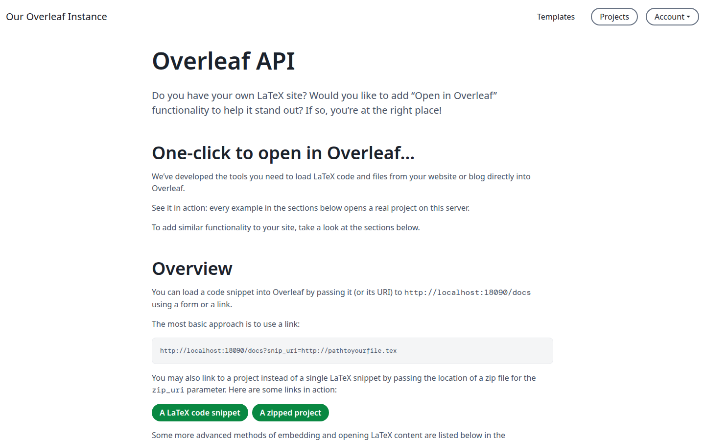

Розмістіть посилання на своєму сайті, у блозі чи на сторінці курсу. Кожен, хто натисне на нього, отримає власний новий проєкт із вашими файлами. Нічого налаштовувати не потрібно.

Відвідувачам потрібен обліковий запис у вашому екземплярі. Відвідувач, який не ввійшов, спочатку потрапляє на сторінку входу, а проєкт відкривається після входу.

На сторінках цієї функції використовується назва Overleaf. Ваше посилання чи кнопка може містити будь-який текст, наприклад **Open in Ayakaleaf**.

## Перегляньте приклади {#see-the-examples}

Відкрийте `/devs` на своєму сайті, наприклад `https://ayakaleaf.example.com/devs`. Жодне меню не веде на цю сторінку, тому введіть адресу вручну. За замовчуванням для її перегляду потрібно ввійти.

<Frame caption="Сторінка Overleaf API">
  
</Frame>

Натисніть **A LaTeX code snippet** або **A zipped project**. Відкриється новий проєкт із прикладом.

<Frame caption="Проєкт із zip-прикладу">
  
</Frame>

## Посилання на файл на вашому сайті {#link-to-a-file-on-your-website}

<Steps>
<Step title="Складіть посилання">
Поставте URL-закодовану адресу файлу після `/docs?snip_uri=`:

```text
https://ayakaleaf.example.com/docs?snip_uri=https%3A%2F%2Fexample.com%2Fmain.tex
```

Для проєкту в zip-архіві використовуйте `zip_uri`:

```text
https://ayakaleaf.example.com/docs?zip_uri=https%3A%2F%2Fexample.com%2Fproject.zip
```

Ваш екземпляр завантажує файл, тому він має бути доступний через HTTP або HTTPS. Адреси в приватній мережі відхиляються, див. [External URL](/uk/on-premises/configuration/overleaf-toolkit/external-url).
</Step>

<Step title="Додайте його на сторінку">
```html
<a href="https://ayakaleaf.example.com/docs?snip_uri=https%3A%2F%2Fexample.com%2Fmain.tex">Open in Ayakaleaf</a>
```
</Step>

<Step title="Натисніть на нього">
Новий проєкт відкривається в редакторі з єдиним файлом, збереженим як `main.tex`.

<Frame caption="Проєкт, відкритий за посиланням">
  
</Frame>

Кожне натискання створює ще один проєкт. Проєкт є копією, тому подальші зміни вашого файлу до нього не потрапляють.
</Step>
</Steps>

## Помістіть файл у посилання {#put-the-file-in-the-link}

Для невеликого файлу нічого розміщувати не потрібно: помістіть його вміст у посилання як Base64 data URL. У JavaScript:

```javascript
const tex = '\\documentclass{article}\n\\begin{document}\nHello from a link.\n\\end{document}\n'
const link = 'https://ayakaleaf.example.com/docs?' + new URLSearchParams({
  snip_uri: 'data:application/x-tex;base64,' + btoa(tex),
  name: 'Hello from a link',
})
```

`btoa` приймає лише символи Latin-1, тому інший текст спочатку закодуйте в UTF-8. Для проєкту в zip-архіві використовуйте `zip_uri` і `data:application/zip;base64,`.

Посилання, довше приблизно 8 КБ, відхиляється з помилкою **414 Request-URI Too Large**. Для чогось більшого розмістіть файл або використайте [форму](#use-a-button-instead-of-a-link).

## Виберіть параметри {#choose-the-options}

Додайте їх до посилання або до форми як приховані поля:

| Параметр                   | Що робить                                                                                                                 | Приклад                                            |
| --------------------------- | ---------------------------------------------------------------------------------------------------------------------------- | -------------------------------------------------- |
| `name`                      | Задає назву проєкту. Без нього проєкт із zip-архіву отримує назву зі свого `\title`, а все інше називається `Open in Overleaf project`. | `name=My%20notes`                                  |
| `engine`                    | Задає компілятор: `latex_dvipdf`, `pdflatex`, `xelatex` або `lualatex`.                                                      | `engine=xelatex`                                   |
| `main_document`             | Задає основний файл `.tex`, який відкривається першим.                                                                                | `main_document=thesis.tex`                         |
| `snip_uri[]`, `snip_name[]` | Імпортує кілька файлів, кожен зі своєю назвою, у тому самому порядку.                                                            | `snip_uri[]=.../a.tex&snip_name[]=a.tex`           |

Файл `.tex` без `\documentclass` обгортається у стандартний документ, тому одразу компілюється:

```latex
\documentclass[12pt]{article}
\usepackage[english]{babel}
\usepackage{amsmath}
\usepackage{tikz}
\begin{document}
Your file
\end{document}
```

## Кнопка замість посилання {#use-a-button-instead-of-a-link}

Форма надсилає ті самі параметри, що й посилання:

```html
<form action="https://ayakaleaf.example.com/docs" method="post" target="_blank">
  <input type="hidden" name="snip_uri" value="https://example.com/main.tex">
  <input type="hidden" name="engine" value="xelatex">
  <button type="submit">Open in Ayakaleaf</button>
</form>
```

Щоб надіслати сам LaTeX, використовуйте `snip` для звичайного тексту або `encoded_snip` для тексту, пропущеного через `encodeURIComponent`.

Форма працює не завжди, тому краще використовувати посилання, якщо тільки файл не задовгий для нього:

| Де розміщено форму                                     | Відвідувач увійшов            | Відвідувач не увійшов        |
| ----------------------------------------------------- | ------------------------------- | ------------------------------- |
| На тому самому домені, що й ваш екземпляр, або на піддомені   | Проєкт відкривається               | Сторінка входу, проєкту немає      |
| На іншому домені                                     | Сторінка входу, проєкту немає      | Сторінка входу, проєкту немає      |

Якщо адміністратор задає `OVERLEAF_ALLOW_PUBLIC_ACCESS=true`, проєкт відкривається в усіх цих випадках, за потреби після входу. Цей параметр також відкриває інші сторінки для відвідувачів, які не ввійшли, див. [Page Access](/uk/on-premises/configuration/overleaf-toolkit/authentication/public-access#page-access).

Інші налаштування, доступні адміністраторам, описано в [Overleaf Import API](/uk/on-premises/configuration/overleaf-toolkit/integrations/overleaf-import-api). На сторінці `/devs` є більше прикладів.

## Якщо проєкт не відкривається {#if-the-project-does-not-open}

Сторінка повідомляє, що пішло не так. **View the Overleaf API docs** веде на `/devs`.

<Frame caption="Посилання, яке екземпляр не може використати">
  
</Frame>

| Повідомлення                                      | Причина                                                 | Що робити                                  |
| -------------------------------------------- | --------------------------------------------------- | ------------------------------------------- |
| `no snippet, snip_uri or zip_uri provided`   | У посиланні немає жодного з цих параметрів                          | Перевірте назви параметрів                   |
| `invalid url: ...`                           | Адреса не починається з HTTP або HTTPS       | Використайте адресу HTTP чи HTTPS або data URL |
| `could not download ... (HTTP 404)`          | За цією адресою файлу немає                     | Перевірте адресу                           |
| `could not download ... (HTTP 403)`          | Адреса розташована в приватній мережі                 | Розмістіть файл там, де ваш екземпляр може його отримати |
| `zip_uri did not resolve to a zip archive`   | Файл за `zip_uri` не є zip-архівом         | Перевірте файл                              |
| `invalid base64 data url`                    | Data URL пошкоджено                             | Закодуйте файл заново та застосуйте URL-кодування до посилання |
