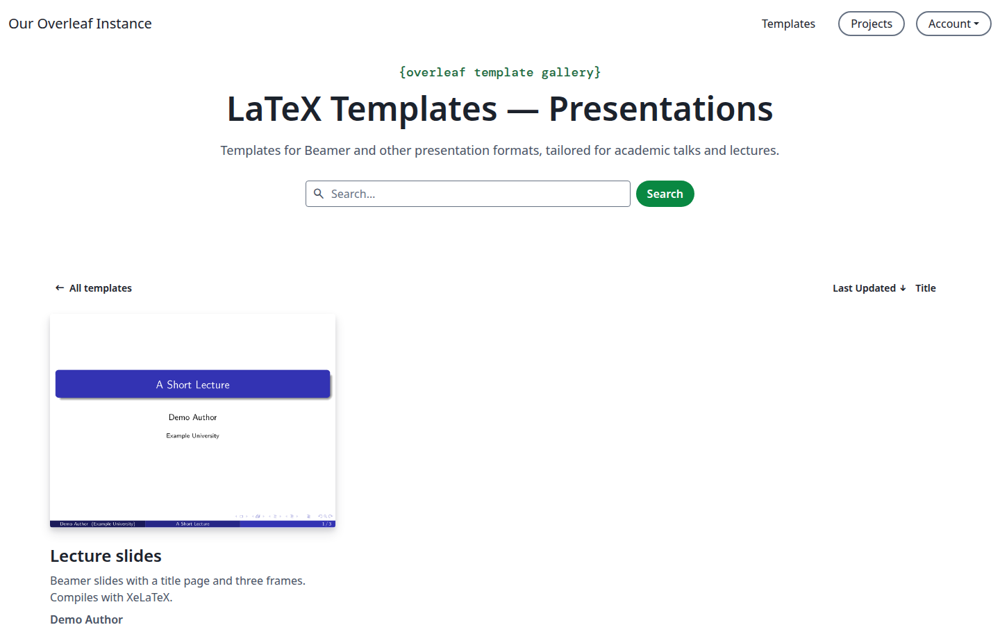

Шаблони є проєктами, які опублікував ваш адміністратор. Відкривши шаблон, ви отримуєте власний новий проєкт.

<Info>

Якщо ви не бачите посилання **Templates**, попросіть адміністратора увімкнути [галерею шаблонів](/uk/on-premises/configuration/overleaf-toolkit/templates).

</Info>

## Відкриття галереї {#open-the-gallery}

На сторінці проєктів натисніть **Templates** у правому верхньому куті.

<Frame caption="Посилання Templates">
  
</Frame>

Відкриється сторінка **All templates**, де першими йдуть нещодавно оновлені шаблони.

<Frame caption="Усі шаблони">
  
</Frame>

Якщо у вас ще немає проєктів, натисніть **Browse templates** на сторінці привітання.

<Frame caption="Сторінка привітання">
  
</Frame>

Якщо проєкти у вас є, можна також натиснути **New project**, потім **More templates**, а потім вибрати категорію.

<Frame caption="More templates">
  
</Frame>

За замовчуванням галерея потребує входу: якщо вам надіслали посилання на шаблон, а ви не ввійшли, спершу відкриється сторінка входу, а потім шаблон.

## Пошук шаблону {#find-a-template}

**Шукайте** в полі пошуку. Список оновлюється під час введення і шукає збіги в назві, авторі та описі. Якщо збігів немає, сторінка показує <strong>No Templates.</strong>

<Frame caption="Пошук slides">
  
</Frame>

**Сортуйте** за допомогою **Last Updated** або **Title** праворуч над списком. Натисніть поточне сортування ще раз, щоб змінити порядок на зворотний.

**Перемикайте сторінки** під списком. На одній сторінці дев'ять шаблонів.

<Frame caption="Кнопки сторінок">
  
</Frame>

<strong>Перегляд за категоріями:</strong> натисніть **Template Gallery** на сторінці **All templates**. На сторінці галереї є картка для кожної категорії, а під ними всі шаблони.

<Frame caption="Категорії">
  
</Frame>

Натисніть картку, щоб побачити шаблони цієї категорії. Тут теж можна шукати й сортувати, а **All templates** поверне вас назад.

<Frame caption="Сторінка категорії">
  
</Frame>

## Відкриття шаблону як нового проєкту {#open-a-template-as-a-new-project}

<Steps>
<Step title="Відкрийте шаблон">
Натисніть шаблон. Ви побачите попередній перегляд його першої сторінки, автора, дату останнього оновлення, ліцензію та анотацію.

<Frame caption="Сторінка шаблону">
  
</Frame>

**View PDF** відкриває весь PDF. Кнопка поруч завантажує файли у вигляді zip-архіву.
</Step>

<Step title="Натисніть Open as Template">
Після короткого екрана завантаження відкриється редактор із вашим новим проєктом.

<Frame caption="Ваш новий проєкт">
  
</Frame>
</Step>

<Step title="Перевірте проєкт">
Проєкт має ту саму назву й ті самі файли, що й шаблон, а також той самий компілятор і головний документ. Він компілюється під час відкриття, а в списку проєктів його власником вказано вас.

Повторне відкриття того самого шаблону створює ще один проєкт, наприклад `Journal article (1)`.

<Frame caption="Кожне відкриття створює проєкт">
  
</Frame>
</Step>
</Steps>

Ваш проєкт не залежить від шаблону: він залишається незмінним, коли шаблон оновлюють або видаляють.

<Info>

Звичайний обліковий запис не може публікувати чи змінювати шаблони: у меню **File** немає пункту **Manage Template**, а на сторінці шаблону немає **Edit** і **Delete**. Щоб додати шаблон до галереї, зверніться до адміністратора.

</Info>
