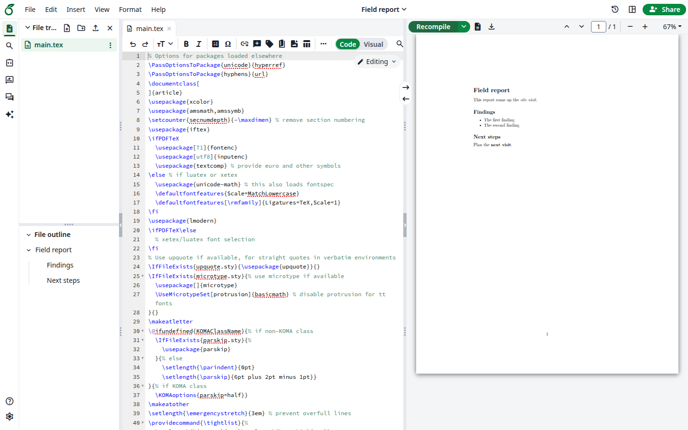

<Info>

Якщо ви не бачите цих параметрів, попросіть адміністратора увімкнути [Pandoc Import and Export](/uk/on-premises/configuration/overleaf-toolkit/pandoc-import-and-export).

</Info>

## Імпорт документа {#import-a-document}

Так ви створюєте новий проєкт LaTeX із документа Word (`.docx`) або файлу Markdown (`.md`). Назва проєкту береться з назви файлу.

<Steps>
<Step title="Відкрийте діалог імпорту">
На сторінці проєктів натисніть **New project**. У розділі **Import** натисніть **Word document** або **Markdown document**.

<Frame caption="Меню New project">
  
</Frame>
</Step>

<Step title="Виберіть файл">
Натисніть **Select .docx file** або перетягніть файл у діалог. Для Markdown кнопка називається **Select .md file**. Імпорт починається одразу.

<Frame caption="Вибір документа Word">
  
</Frame>
</Step>

<Step title="Почніть редагування">
Новий проєкт відкривається з повідомленням **Document ready for editing**. Натисніть **Start editing**.

<Frame caption="Імпорт завершено">
  
</Frame>
</Step>

<Step title="Перевірте результат">
Тепер документ міститься в `main.tex`, а його заголовки видно в структурі файлу. Натисніть **Recompile**, щоб побачити PDF. Перевірте оформлення, особливо таблиці, рисунки та посилання на джерела, які можуть потребувати правок.

<Frame caption="Імпортований проєкт">
  
</Frame>
</Step>
</Steps>

### Якщо імпорт не вдався {#if-the-import-fails}

Якщо файл не вдається перетворити, діалог показує **Your document couldn't be imported**. Розгорніть **Conversion error details**, щоб дізнатися причину. Проєкт не створюється.

<Frame caption="Документ, який не вдалося імпортувати">
  
</Frame>

Діалог приймає лише вибраний тип. Файл `.md` у діалозі Word спричиняє повідомлення **You can only upload: .docx**.

## Експорт проєкту {#export-a-project}

Відкрийте проєкт і натисніть на його назву вгорі редактора. Виберіть один із варіантів:

| Варіант                              | Що ви отримаєте                                       |
| ----------------------------------- | --------------------------------------------- |
| <strong>Export as Word document (.docx)</strong> | Файл `.docx` з назвою проєкту        |
| <strong>Export as Markdown (.md)</strong>        | Файл `.zip` з `main.md`                  |
| <strong>Export as HTML (.html)</strong>          | Файл `.zip` з `main.html`                |

Завантаження починається само. Перетворення не може відтворити все форматування LaTeX, тому перевірте результат.

<Frame caption="Параметри експорту">
  
</Frame>
