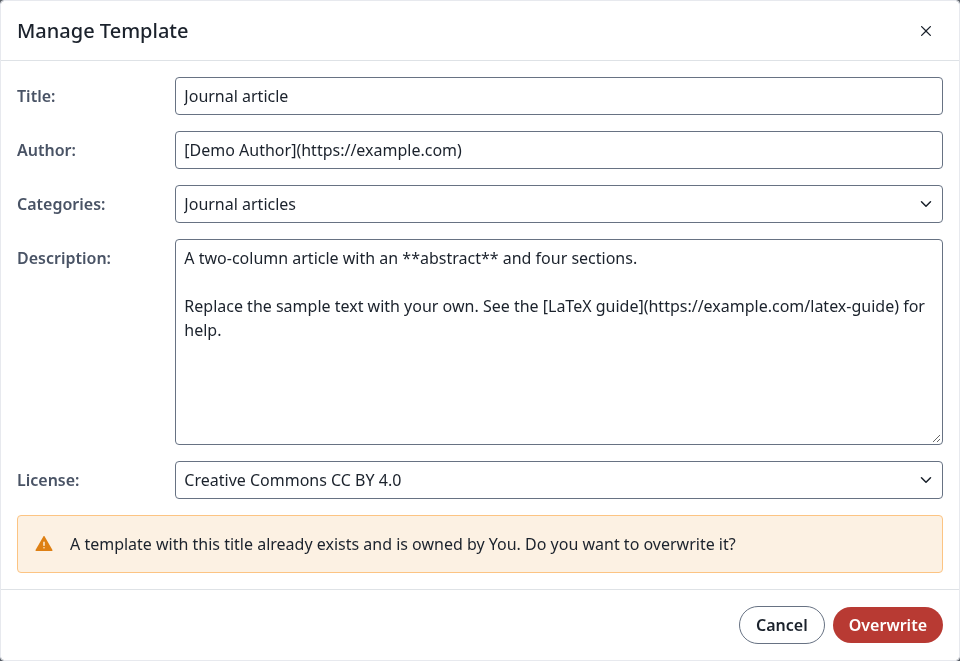

Bạn xuất bản mẫu từ trình soạn thảo và quản lý mẫu trên trang của mẫu trong thư viện hoặc trong bảng quản trị.

<Info>

Để bật thư viện, chọn danh mục của thư viện hoặc cho phép người dùng không phải quản trị viên xuất bản, hãy xem [Mẫu](/vi/on-premises/configuration/overleaf-toolkit/templates).

</Info>

## Xuất bản một dự án {#publish-a-project}

<Steps>
<Step title="Biên dịch dự án">
Mở dự án và nhấp vào **Recompile**. PDF bạn thấy là PDF mà thư viện sẽ hiển thị.

Khi trình soạn thảo chưa có PDF, chẳng hạn khi bạn mở một dự án không biên dịch được, **Manage Template** sẽ bị làm mờ.

<Frame caption="Chưa có PDF nên chưa có gì để xuất bản">
  
</Frame>

<Warning>

Việc xuất bản lưu các tệp ở trạng thái hiện tại và PDF của lần biên dịch thành công gần nhất. Nếu bạn đã chỉnh sửa dự án sau lần biên dịch đó, hoặc lần biên dịch gần nhất bị lỗi, thư viện sẽ hiển thị một PDF cũ bên cạnh các tệp mới hơn, và các tệp này có thể không biên dịch được. Hãy biên dịch lại cho đến khi PDF đúng, rồi mới xuất bản.

</Warning>
</Step>

<Step title="Mở biểu mẫu">
Trong menu trên cùng của trình soạn thảo, nhấp vào **File**, rồi **Manage Template**.

<Frame caption="Menu File">
  
</Frame>
</Step>

<Step title="Điền biểu mẫu">
<Frame caption="Hộp thoại Manage Template">
  
</Frame>

| Trường | Ghi chú |
| --- | --- |
| **Title** | Ban đầu là tên dự án. Phải là duy nhất trong thư viện. Tối đa 150 ký tự. |
| **Author** | Ban đầu là tên của bạn. Một liên kết Markdown như `[Demo Author](https://example.com)` sẽ trở thành liên kết trên trang mẫu. |
| **Categories** | Một danh mục, xem [Danh mục](/vi/on-premises/user-guide/administrators/template-management#categories). |
| **Description** | Hỗ trợ Markdown. Tối đa 4096 ký tự. Trang mẫu hiển thị nội dung này dưới dạng **Abstract**, còn thư viện hiển thị phần đầu dưới dạng văn bản thuần. |
| **License** | **Creative Commons CC BY 4.0**, **LaTeX Project Public License 1.3c** hoặc <strong>Other (as stated in the work)</strong>. |

Trình biên dịch và tài liệu chính của dự án đi kèm với mẫu, vì vậy hãy thiết lập chúng trong dự án trước. Các dự án mở từ mẫu sẽ dùng cùng thiết lập đó.
</Step>

<Step title="Nhấp vào Publish">
Trang mẫu sẽ mở ra.

<Frame caption="Mẫu mới">
  
</Frame>

**Admin: Source Project**, **Edit** và **Delete** chỉ dành cho bạn. Người dùng khác chỉ thấy **Open as Template**, **View PDF** và nút tải xuống.
</Step>

<Step title="Kiểm tra thư viện">
Nhấp vào **Templates** ở góc trên bên phải. Mẫu mới nằm đầu danh sách.
</Step>
</Steps>

## Danh mục {#categories}

Mỗi mẫu thuộc một danh mục. Tên và mô tả lấy từ [cấu hình](/vi/on-premises/configuration/overleaf-toolkit/templates#configuration) của bạn và không thể thay đổi trên trang web.

Bạn sẽ thấy chúng ở những nơi sau:

* **Categories** trong biểu mẫu.
* Các thẻ ở đầu trang thư viện, `/templates`. Nhấp vào **Template Gallery** trên trang **All templates** để đến đó.
* Một trang cho mỗi danh mục, ví dụ `/templates/presentation`. Danh mục không có mẫu nào sẽ hiển thị <strong>No Templates.</strong>
* **New project**, rồi **More templates**, trên trang dự án.
* Liên kết phía trên tiêu đề trên trang mẫu.

<Frame caption="Danh mục trên trang thư viện">
  
</Frame>

**All templates** trong biểu mẫu nghĩa là không có danh mục riêng: mẫu chỉ xuất hiện trong danh sách đầy đủ.

## Cập nhật mẫu {#update-a-template}

Để thay đổi các tệp và PDF, hãy xuất bản lại dự án với cùng tiêu đề.

<Steps>
<Step title="Thay đổi dự án">
Chỉnh sửa dự án và nhấp vào **Recompile**.
</Step>

<Step title="Xuất bản lại">
Nhấp vào **File**, rồi **Manage Template**. Biểu mẫu hiển thị thông tin chi tiết của mẫu, bạn có thể thay đổi. Nhấp vào **Publish**.

Một thông báo cho biết tiêu đề đã tồn tại, và nút chuyển thành **Overwrite**.

<Frame caption="Xuất bản với cùng tiêu đề">
  
</Frame>

Nếu bạn thay đổi **Title** lúc này, thông báo sẽ biến mất và **Publish** sẽ tạo một mẫu mới.
</Step>

<Step title="Nhấp vào Overwrite">
Cùng trang mẫu đó sẽ mở ra với PDF mới.

<Frame caption="Mẫu đã cập nhật">
  
</Frame>

Các dự án người dùng đã mở từ mẫu trước đó không thay đổi.
</Step>
</Steps>

<Warning>

Biểu mẫu tìm mẫu theo tên dự án. Nếu bạn đã đổi tên mẫu bằng **Edit**, biểu mẫu sẽ mở với tên dự án, tên của bạn, danh mục đầu tiên và phần mô tả trống, và việc nhập tiêu đề của mẫu không khôi phục được thông tin chi tiết. Khi đó **Overwrite** sẽ thay thế thông tin chi tiết bằng nội dung trong biểu mẫu, vì vậy hãy điền lại chúng trước.

</Warning>

## Chỉnh sửa thông tin chi tiết {#edit-the-details}

Thao tác này thay đổi những gì thư viện hiển thị về một mẫu, không thay đổi tệp hay PDF của mẫu.

<Steps>
<Step title="Mở mẫu">
Nhấp vào **Templates** ở góc trên bên phải, nhấp vào mẫu, rồi nhấp vào **Edit**.
</Step>

<Step title="Thay đổi các trường">
Các trường giống như khi xuất bản, thêm một trường: **Language** là ngôn ngữ kiểm tra chính tả của các dự án mở từ mẫu. Với dự án được xuất bản bằng ngôn ngữ mặc định, trường này hiển thị **Off**, và các dự án mở từ đó dùng <strong>English (American)</strong>.

<Frame caption="Hộp thoại Edit template">
  
</Frame>

Tiêu đề đã được mẫu khác sử dụng sẽ bị từ chối: **Save** vẫn bị làm mờ cho đến khi bạn thay đổi **Title**.
</Step>

<Step title="Nhấp vào Save">
Hộp thoại đóng lại và trang mẫu hiển thị thông tin chi tiết mới.
</Step>
</Steps>

## Dự án nguồn {#the-source-project}

**Admin: Source Project** mở dự án mà mẫu được xuất bản từ đó.

Mẫu giữ bản sao tệp riêng. Nếu bạn xóa vĩnh viễn dự án, nút này sẽ biến mất, và người dùng vẫn có thể mở mẫu. Dự án chỉ nằm trong **Trash** vẫn giữ nút này. Xem thêm phần hỏi đáp trong [Mẫu](/vi/on-premises/configuration/overleaf-toolkit/templates).

## Xóa mẫu {#delete-a-template}

<Steps>
<Step title="Nhấp vào Delete">
Trên trang mẫu, nhấp vào **Delete**. Hộp thoại nêu tên mẫu.

<Frame caption="Hộp thoại Delete template">
  
</Frame>
</Step>

<Step title="Nhấp vào Confirm">
Bạn quay lại trang trước đó, và mẫu không còn trong thư viện. Liên kết của mẫu giờ hiển thị **Not found**.

Dự án nguồn vẫn còn, các dự án người dùng đã mở từ mẫu cũng vậy.
</Step>
</Steps>

## Quản lý mẫu trong bảng quản trị {#manage-templates-in-the-admin-panel}

Nhấp vào **Admin**, rồi **Project/Object Lookup**, rồi tab **Templates**. Tab này liệt kê mọi mẫu cùng tác giả và chủ sở hữu, và bạn có thể tìm kiếm trong đó.

<Frame caption="Tất cả mẫu trong bảng quản trị">
  
</Frame>

* Nhấp vào tiêu đề để mở trang mẫu, hoặc biểu tượng mở để mở trang đó trong tab mới.
* Nhấp vào chủ sở hữu để mở trang của người dùng đó.
* Nhấp vào biểu tượng thùng rác, rồi **Delete**, để xóa mẫu. Hộp thoại cảnh báo rằng không thể hoàn tác thao tác này, và mẫu sẽ rời khỏi thư viện.

## Nếu việc xuất bản bị từ chối {#if-publishing-is-refused}

Biểu mẫu cho phép bạn nhập nhiều hơn mức trang web chấp nhận. **Title** dài hơn 150 ký tự sẽ hiển thị `Template title exceeds the maximum length of 150 characters.`, và **Description** dài hơn 4096 ký tự sẽ hiển thị `Template description exceeds the maximum length of 4096 characters.`

Sau đó **Publish** vẫn bị làm mờ ngay cả khi bạn rút ngắn văn bản. Nhấp vào **Cancel**, rồi **File** và **Manage Template**, và điền lại biểu mẫu.
