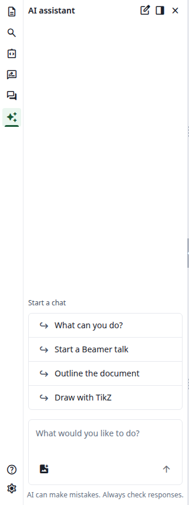

Trợ lý làm việc trên dự án bạn đang mở. Trợ lý đọc tài liệu của bạn và đề xuất chỉnh sửa, còn bạn áp dụng hoặc từ chối từng chỉnh sửa. Các câu trả lời trong ảnh chụp màn hình chỉ là ví dụ: câu trả lời bạn nhận được phụ thuộc vào mô hình mà trang của bạn sử dụng.

<Info>

Nếu bạn không thấy **AI assistant** ở thanh bên trái, hãy chuyển quản trị viên đến trang [Tích hợp AI](/vi/on-premises/configuration/overleaf-toolkit/integrations/ai-integration).

</Info>

## Bắt đầu trò chuyện {#start-a-chat}

<Steps>
<Step title="Mở trợ lý">
Ở thanh bên trái của trình soạn thảo, nhấp vào **AI assistant**. Bảng điều khiển mở ra cạnh trình soạn thảo.
</Step>

<Step title="Chấp nhận điều khoản">
Lần đầu tiên, bảng điều khiển hiển thị điều khoản của các tính năng AI. Nhấp vào **Accept and continue**. Bạn chỉ làm việc này một lần, và nó cũng áp dụng cho [Trợ lý lỗi](/vi/on-premises/user-guide/users/error-assistant).

<Frame caption="Điều khoản, chỉ hiển thị một lần">
  
</Frame>
</Step>

<Step title="Đặt câu hỏi">
Gõ vào <strong>What would you like to do?</strong> rồi nhấn Enter, hoặc nhấp vào mũi tên. Bạn cũng có thể nhấp vào một gợi ý trong **Start a chat**. Các gợi ý thay đổi giữa các cuộc trò chuyện, và **Fix the compile errors** được thêm vào khi lần biên dịch gần nhất có lỗi.

<Frame caption="Một cuộc trò chuyện trống">
  
</Frame>
</Step>

<Step title="Đọc câu trả lời">
Những gì trợ lý đã làm hiển thị thành các dòng trong một hộp, như **Read line 15-16 of main.tex**, kèm dấu tích khi bước hoàn tất. Sau đó là câu trả lời. Nếu mô hình chia sẻ quá trình suy luận, nhấp vào **Reasoned for 1 s** để đọc.

<Frame caption="Một câu hỏi và câu trả lời">
  
</Frame>
</Step>
</Steps>

## Hỏi về các dòng đã chọn {#ask-about-selected-lines}

Chọn các dòng trong trình soạn thảo. Một nhãn như `main.tex: 16` xuất hiện phía trên ô tin nhắn, và văn bản đã chọn được gửi kèm tin nhắn của bạn. Trong cuộc trò chuyện trống, các gợi ý chuyển sang liên quan đến phần chọn, như **Make it shorter**.

<Frame caption="Một dòng đã chọn">
  
</Frame>

## Xem lại chỉnh sửa được đề xuất {#review-a-suggested-edit}

Một chỉnh sửa chỉ vào tài liệu khi bạn áp dụng nó.

<Steps>
<Step title="Đọc đề xuất">
Một hộp tên **Edit line 16** hiển thị lý do, số dòng và thay đổi: văn bản cũ bị gạch ngang và văn bản mới được làm nổi bật. Tài liệu vẫn chưa thay đổi. **Show result** chỉ hiển thị văn bản mới, còn **Show diff** quay lại.

<Frame caption="Một chỉnh sửa đang chờ bạn quyết định">
  
</Frame>
</Step>

<Step title="Áp dụng">
Nhấp vào **Apply**. Thay đổi xuất hiện trong trình soạn thảo, hộp nhận dấu tích và trợ lý tiếp tục. Nếu chỉnh sửa nằm trong tài liệu khác, tài liệu đó sẽ mở ra.

<Frame caption="Chỉnh sửa đã được áp dụng">
  
</Frame>
</Step>

<Step title="Hoàn tác nếu bạn đổi ý">
**Undo** gỡ thay đổi khỏi tài liệu, còn **Apply** đưa nó trở lại. Trợ lý không được thông báo về thao tác nào.
</Step>
</Steps>

### Từ chối chỉnh sửa {#reject-an-edit}

Nhấp vào **Reject**. Tài liệu giữ nguyên, hộp hiển thị <strong>The user declined this edit.</strong> và trợ lý tiếp tục, biết rằng bạn đã từ chối. Các nút biến mất, nên muốn lấy lại chỉnh sửa, hãy yêu cầu lại.

Nếu bạn viết tin nhắn mới thay vì quyết định, chỉnh sửa sẽ không được áp dụng và hộp sẽ ghi rõ điều đó.

<Frame caption="Một chỉnh sửa bị từ chối và một chỉnh sửa chưa quyết định">
  
</Frame>

## Trợ lý có thể làm gì trong dự án {#what-the-assistant-can-do-in-a-project}

Chỉ có chỉnh sửa chờ bạn. Các bước khác chạy ngay khi trợ lý thực hiện.

| Dòng trong cuộc trò chuyện | Chức năng |
| -------------------- | ------------ |
| **Read line 15-16 of main.tex** | Đọc các dòng của tài liệu |
| **Find “schedule” in main.tex** | Tìm văn bản trong tài liệu |
| **List the project files** | Liệt kê các tệp của dự án |
| **Create appendix.tex** | Tạo tài liệu trống và mở nó |
| **Edit line 16** | Đề xuất chỉnh sửa, xem ở trên |
| **Compile** | Biên dịch dự án |
| **Check the compile log** | Đọc lỗi và cảnh báo của lần biên dịch gần nhất |
| **Look at PDF page 1** | Hiển thị một trang PDF trong cuộc trò chuyện |
| **Read the PDF structure** | Đọc cấu trúc của PDF |
| **Switch to xelatex** | Đổi trình biên dịch của dự án, như trong **Settings** |
| <strong>Search the web for “...”</strong> | Tìm kiếm trên web |
| <strong>Search the help pages for “...”</strong> | Tìm kiếm trong các trang trợ giúp |

<Frame caption="Một tệp mới, rồi một chỉnh sửa trong tài liệu khác">
  
</Frame>

<Frame caption="Một lần biên dịch và một trang PDF">
  
</Frame>

Dòng tìm kiếm cho biết đã tìm thấy bao nhiêu kết quả. Nhấp vào để liệt kê chúng. Việc có thể tìm kiếm hay không phụ thuộc vào trang của bạn, xem [Dịch vụ tìm kiếm tùy chọn](/vi/on-premises/configuration/overleaf-toolkit/integrations/ai-integration#optional-search-services).

<Frame caption="Kết quả tìm kiếm">
  
</Frame>

Gợi ý **Fix the compile errors** yêu cầu trợ lý kiểm tra nhật ký và sửa những gì tìm thấy. Các bản sửa đến dưới dạng chỉnh sửa để bạn xem lại.

## Đính kèm hình ảnh hoặc PDF {#attach-an-image-or-a-pdf}

Trong ô tin nhắn, nhấp vào biểu tượng hình ảnh, **Attach image or PDF**, và chọn một tệp. Tên tệp xuất hiện phía trên văn bản của bạn. Viết tin nhắn và gửi đi.

<Frame caption="Một tệp đính kèm tin nhắn">
  
</Frame>

Bảng điều khiển từ chối các tệp khác với <strong>Only images and PDF files can be attached.</strong> và tệp lớn với <strong>Files must be smaller than 2 MB.</strong>

## Dừng trợ lý {#stop-the-assistant}

Trong khi trợ lý đang làm việc, mũi tên trong ô tin nhắn trở thành nút **Stop**. Nhấp vào đó. Bước đang chạy kết thúc với <strong>Stopped by the user.</strong> và không có gì khác xảy ra cho đến khi bạn viết lại.

<Frame caption="Nút Stop">
  
</Frame>

## Nếu trợ lý tự dừng {#if-the-assistant-stops-by-itself}

Trợ lý chỉ có thể thực hiện một số bước giới hạn cho mỗi tin nhắn. Khi đạt giới hạn, bảng điều khiển hiển thị <strong>The assistant used all the steps it may take for one message. Reply to let it carry on.</strong> Hãy trả lời, chẳng hạn `Go on`, và trợ lý sẽ tiếp tục.

<Frame caption="Giới hạn bước">
  
</Frame>

Nếu bảng điều khiển hiển thị **Something’s gone wrong**, yêu cầu đã thất bại. Gửi lại tin nhắn, hoặc nhấp vào **Start new chat**.

## Di chuyển bảng điều khiển và bắt đầu lại {#move-the-panel-and-start-over}

Các nút sau nằm ở đầu bảng điều khiển:

* **Start new chat** xóa bảng điều khiển. Không có danh sách các cuộc trò chuyện trước. Tải lại trang cũng xóa cuộc trò chuyện.
* **Move to the right** đặt bảng điều khiển ở bên phải PDF, nơi nó vẫn mở trong khi bạn dùng cây tệp. **Move to the left** đưa nó trở lại. Cuộc trò chuyện được giữ nguyên.
* **Close** ẩn bảng điều khiển. Nhấp vào **AI assistant** ở thanh bên trái để mở lại, cuộc trò chuyện vẫn còn đó.

<Frame caption="Bảng điều khiển ở bên phải">
  
</Frame>

## Mức sử dụng token {#token-usage}

Trợ lý không hiển thị bạn đã dùng bao nhiêu token. Nếu trang của bạn đặt giới hạn và bạn đạt đến giới hạn đó, tin nhắn tiếp theo sẽ không được trả lời. Bảng điều khiển hiển thị **Usage limit reached** và thời gian còn lại trước khi bạn có thể trò chuyện tiếp, và ô tin nhắn chuyển sang màu xám.

<Frame caption="Đã đạt giới hạn">
  
</Frame>

Cuộc trò chuyện mới cũng hiển thị thông báo tương tự. Sau khi tải lại, ô trông bình thường trở lại, nhưng tin nhắn tiếp theo cũng nhận thông báo. [Trợ lý lỗi](/vi/on-premises/user-guide/users/error-assistant) được tính vào cùng giới hạn và hiển thị **Usage limit reached** trong mục nhật ký.

Quản trị viên đặt giới hạn, xem [Mức sử dụng và đặt lại](/vi/on-premises/configuration/overleaf-toolkit/integrations/ai-integration#usage-and-reset).
