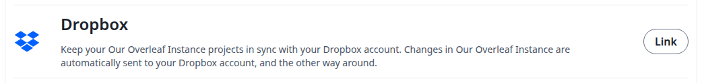
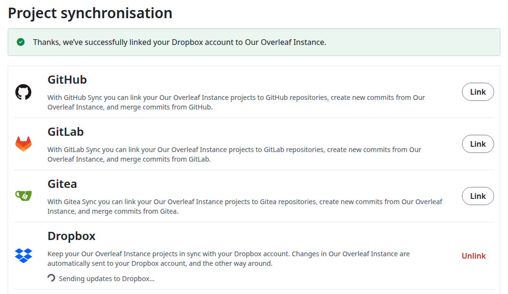

Giữ cho tất cả dự án của bạn đồng bộ với một thư mục trong Dropbox. Thay đổi đi theo cả hai chiều ở chế độ nền, với một ngoại lệ: nội dung bạn gõ trong trình soạn thảo đến Dropbox vài phút sau khi bạn rời dự án, hoặc khi bạn nhấp vào **sync this project now**.

<Info>

Nếu bạn không thấy tùy chọn Dropbox trong **Account settings** hoặc trong trình soạn thảo, hãy yêu cầu quản trị viên bật [Đồng bộ hóa Dropbox](/vi/on-premises/configuration/overleaf-toolkit/integrations/dropbox-synchronisation).

</Info>

## Liên kết tài khoản Dropbox {#link-your-dropbox-account}

Bạn chỉ làm việc này một lần.

<Steps>
<Step title="Mở cài đặt tài khoản">
Nhấp vào **Account**, sau đó **Account settings**. Trong **Project synchronisation**, tìm **Dropbox** và nhấp vào **Link**.

<Frame caption="Dropbox trong cài đặt tài khoản">
  
</Frame>
</Step>

<Step title="Ủy quyền trên Dropbox">
Dropbox mở ra. Đăng nhập nếu được yêu cầu, sau đó ủy quyền cho ứng dụng.
</Step>

<Step title="Kiểm tra liên kết">
Bạn quay lại cài đặt tài khoản. Một thông báo màu xanh lá cho biết tài khoản Dropbox của bạn đã được liên kết, và nút giờ hiển thị **Unlink**. Bên dưới Dropbox, một trạng thái cho biết các dự án của bạn đang được gửi.

<Frame caption="Tài khoản Dropbox của bạn đã được liên kết">
  
</Frame>

Trạng thái chuyển thành **Overleaf and Dropbox have processed all updates** khi tất cả đã đến nơi.

<Frame caption="Mọi thứ đã được đồng bộ">
  
</Frame>
</Step>
</Steps>

Nếu tài khoản của bạn chưa được liên kết, thẻ **Dropbox** trong trình soạn thảo sẽ yêu cầu bạn liên kết trước. Nhấp vào **Update Dropbox Settings**: cài đặt tài khoản mở ra trong một tab mới. Liên kết tài khoản ở đó, sau đó tải lại trang trình soạn thảo, như hộp thoại hướng dẫn.

<Frame caption="Lời nhắc khi tài khoản chưa được liên kết">
  
</Frame>

Nếu bạn không cho phép truy cập trên Dropbox, bạn quay lại cài đặt tài khoản mà không có thông báo nào, và nút vẫn hiển thị **Link**.

### Nếu bạn có các dự án trùng tên {#if-you-have-projects-with-the-same-name}

Bạn không thể liên kết khi có hai dự án trùng tên. Thông báo nêu tên chúng. Dự án đã lưu trữ và dự án trong thùng rác cũng được tính.

<Frame caption="Hai dự án trùng tên">
  
</Frame>

Đổi tên một trong hai dự án và nhấp lại vào **Link**.

## Tìm dự án của bạn trong Dropbox {#find-your-projects-in-dropbox}

Mỗi dự án của bạn là một thư mục trong `Apps/<app name>/` trong Dropbox, chứa tất cả tệp của dự án. Quản trị viên của bạn đã chọn tên ứng dụng. Mọi dự án đều được đồng bộ, kể cả những dự án bạn tạo sau này: bạn không thể chỉ chọn một vài dự án.

Để xem thư mục của một dự án, hãy mở dự án. Ở thanh bên trái, nhấp vào **Integrations**, sau đó **Dropbox**.

<Frame caption="Bảng Integrations">
  
</Frame>

Hộp thoại nêu tên thư mục và liên kết đến thư mục đó trên Dropbox.

<Frame caption="Thư mục của dự án này">
  
</Frame>

Một dự án mới trùng tên với dự án bạn đã có sẽ nhận thư mục được đánh số, chẳng hạn `Field notes (1)`. Hộp thoại cho biết thư mục nào là của nó.

<Frame caption="Thư mục được đánh số">
  
</Frame>

## Thay đổi bạn thực hiện trong Overleaf {#changes-you-make-in-overleaf}

Bạn không cần nhấp vào gì cả.

* **Tệp mới, đổi tên, di chuyển và xóa** đến Dropbox ngay lập tức. Thư mục mới xuất hiện ở đó cùng tệp đầu tiên của nó.
* **Đổi tên dự án** sẽ đổi tên thư mục của dự án.
* **Các chỉnh sửa bạn gõ trong trình soạn thảo** không đến Dropbox khi dự án đang mở, và nhấp vào **Recompile** không gửi chúng. Chúng được gửi khoảng ba phút sau khi mọi người rời dự án. Để gửi sớm hơn, hãy xem [Buộc đồng bộ](#force-a-sync).
* **Xóa dự án** vẫn để lại thư mục của nó trong Dropbox. Hãy tự xóa thư mục nếu bạn không còn cần.

## Thay đổi bạn thực hiện trong Dropbox {#changes-you-make-in-dropbox}

Ở đây bạn cũng không cần nhấp vào gì cả. Dropbox thông báo cho Overleaf về thay đổi, và thay đổi thường xuất hiện trong vài giây, kể cả trong trình soạn thảo đang mở, mà không cần tải lại.

* **Tệp mới, chỉnh sửa, đổi tên và xóa** trong thư mục dự án được áp dụng cho dự án. Thư mục mới cũng vậy.
* **Thư mục mới ở cấp cao nhất của thư mục ứng dụng** trở thành một dự án mới.
* **Các tệp Overleaf không đồng bộ**, chẳng hạn tệp `.DS_Store` hoặc `.aux`, chỉ ở lại trong Dropbox.

Lịch sử dự án đánh dấu những thay đổi này bằng <strong>(via Dropbox)</strong>.

### Nếu tệp đang mở trong trình soạn thảo {#if-the-file-is-open-in-the-editor}

Tệp thay đổi ngay trước mắt bạn, và một hộp thoại thông báo cho bạn. Nhấp vào **OK**.

<Frame caption="Tệp bạn đang mở đã thay đổi trong Dropbox">
  
</Frame>

Phiên bản Dropbox thay thế nội dung bạn đã gõ nhưng chưa được gửi. Văn bản của bạn không bị mất: nó vẫn nằm trong lịch sử dự án.

<Frame caption="Văn bản bị thay thế trong lịch sử">
  
</Frame>

### Đổi tên hoặc xóa thư mục dự án {#rename-or-delete-a-project-folder}

Hãy đổi tên dự án trong Overleaf, không phải trong Dropbox. Với Overleaf, một thư mục được đổi tên trong Dropbox là một thư mục bị xóa cộng với một thư mục mới: bạn có một dự án mới với tên mới, và dự án cũ vẫn còn.

Khi bạn xóa thư mục dự án trong Dropbox, dự án vẫn ở trong danh sách dự án của bạn, cùng tệp và lịch sử. Lần tiếp theo bạn mở dự án, một hộp thoại thông báo cho bạn một lần. Nhấp vào **OK**.

<Frame caption="Thư mục của dự án này đã biến mất khỏi Dropbox">
  
</Frame>

Dự án vẫn tiếp tục đồng bộ. Để đưa toàn bộ dự án trở lại Dropbox, hãy nhấp vào **sync this project now**.

### Khi dự án đã lưu trữ hoặc nằm trong thùng rác {#while-a-project-is-archived-or-in-the-trash}

Các thay đổi bạn thực hiện trong thư mục của dự án trên Dropbox không được áp dụng, và việc khôi phục dự án không đưa chúng vào. Khi đó Overleaf ngừng gửi các tệp bạn đã thay đổi, nên hai phía khác nhau. Hãy lưu tệp đó thêm một lần nữa trong Dropbox: phiên bản Dropbox sẽ thay thế phiên bản trong Overleaf.

## Buộc đồng bộ {#force-a-sync}

Mỗi dự án có liên kết riêng. Hãy dùng liên kết này khi bạn muốn chỉnh sửa của mình có trong Dropbox ngay, mà không cần rời dự án.

<Steps>
<Step title="Mở hộp thoại đồng bộ">
Mở dự án. Ở thanh bên trái, nhấp vào **Integrations**, sau đó **Dropbox**.
</Step>

<Step title="Nhấp vào sync this project now">
Liên kết nằm ở cuối <strong>Changes not appearing in Dropbox?</strong>
</Step>

<Step title="Kiểm tra kết quả">
Một thông báo màu xanh dương cho biết quá trình đồng bộ thủ công đã bắt đầu, và trạng thái hiển thị **Sending and receiving updates**. Trạng thái trở lại **Overleaf and Dropbox have processed all updates** khi đồng bộ xong.

<Frame caption="Đang đồng bộ thủ công">
  
</Frame>
</Step>
</Steps>

Liên kết gửi toàn bộ dự án đến Dropbox, bao gồm các chỉnh sửa vẫn còn trong trình soạn thảo. Liên kết cũng đọc các thay đổi đang chờ trong Dropbox, cho tất cả dự án của bạn. Nếu trang của bạn không thể nhận [thông báo từ Dropbox](/vi/on-premises/configuration/overleaf-toolkit/integrations/dropbox-synchronisation#webhook), thay đổi từ Dropbox chỉ vào bằng cách này.

Bạn có thể làm việc này một lần mỗi phút cho mỗi dự án. Nếu sớm hơn, một thông báo màu đỏ yêu cầu bạn chờ.

<Frame caption="Chờ một phút trước lần tiếp theo">
  
</Frame>

## Hủy liên kết tài khoản Dropbox {#unlink-your-dropbox-account}

<Steps>
<Step title="Nhấp vào Unlink">
Trong **Account settings**, ở mục **Dropbox**, nhấp vào **Unlink**.
</Step>

<Step title="Xác nhận">
Nhấp vào **Unlink** trong hộp thoại.

<Frame caption="Hủy liên kết tài khoản">
  
</Frame>
</Step>

<Step title="Kiểm tra kết quả">
Nút lại hiển thị **Link**, và thẻ **Dropbox** trong trình soạn thảo cho biết tài khoản của bạn chưa được liên kết. Không còn gì được đồng bộ theo chiều nào nữa. Dự án của bạn và các thư mục trong Dropbox vẫn giữ tệp của chúng.
</Step>
</Steps>

### Liên kết lại sau này {#link-again-later}

Nhấp vào **Link**. Các dự án của bạn lại được gửi đến Dropbox:

* Mỗi tệp thay thế tệp cùng tên trong Dropbox. Những gì bạn đã thay đổi trong các tệp đó trên Dropbox khi chưa liên kết sẽ bị ghi đè, vì vậy hãy chuyển những thay đổi đó vào dự án trước.
* Tệp chỉ có trong Dropbox vẫn ở đó, và vào dự án khi bạn thay đổi nó lần tới.
* Dự án bạn đổi tên khi chưa liên kết sẽ nhận một thư mục mới. Thư mục cũ vẫn còn.

### Nếu Overleaf hủy liên kết tài khoản của bạn {#if-overleaf-unlinks-your-account}

Overleaf hủy liên kết tài khoản của bạn khi Dropbox không còn chấp nhận liên kết. Danh sách dự án cho biết lý do, cho đến khi bạn liên kết lại.

<Frame caption="Tài khoản của bạn đã bị hủy liên kết">
  
</Frame>

Về các lý do, hãy xem phần Q\&A của [Đồng bộ hóa Dropbox](/vi/on-premises/configuration/overleaf-toolkit/integrations/dropbox-synchronisation).

<Info>

Để biết cộng tác viên nhận được gì trong dự án chia sẻ, hãy xem [Cách đồng bộ hoạt động](/vi/on-premises/configuration/overleaf-toolkit/integrations/dropbox-synchronisation#cách-đồng-bộ-hoạt-động).

</Info>
