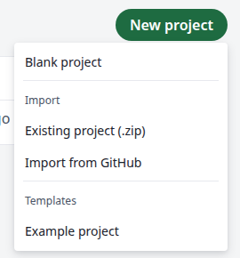

Kết nối dự án với một kho GitHub. Thay đổi đi theo cả hai chiều, và chỉ khi bạn nhấp vào **Sync**: không có gì tự đồng bộ.

<Info>

Nếu bạn không thấy tùy chọn GitHub trong **Account settings** hoặc trong trình soạn thảo, hãy yêu cầu quản trị viên bật [Đồng bộ hóa GitHub](/vi/on-premises/configuration/overleaf-toolkit/integrations/github-synchronisation).

</Info>

## Liên kết tài khoản GitHub {#link-your-github-account}

Bạn chỉ làm việc này một lần.

<Steps>
<Step title="Mở cài đặt tài khoản">
Nhấp vào **Account**, sau đó **Account settings**. Cuộn đến **GitHub** và nhấp vào **Link**.

<Frame caption="GitHub trong cài đặt tài khoản">
  
</Frame>
</Step>

<Step title="Ủy quyền trên GitHub">
GitHub mở ra. Đăng nhập nếu được yêu cầu, sau đó ủy quyền cho ứng dụng.
</Step>

<Step title="Kiểm tra liên kết">
Bạn quay lại cài đặt tài khoản, và nút giờ hiển thị **Unlink**.

<Frame caption="Tài khoản GitHub của bạn đã được liên kết">
  
</Frame>
</Step>
</Steps>

Nếu tài khoản của bạn chưa được liên kết, **Import from GitHub** và thẻ **GitHub** trong trình soạn thảo sẽ yêu cầu bạn liên kết trước. Nhấp vào **Link to your GitHub account**. Bạn cũng sẽ đến cài đặt tài khoản, trong một tab mới nếu bạn bắt đầu từ trình soạn thảo. Sau đó quay lại và bắt đầu lại.

<Frame caption="Lời nhắc khi tài khoản chưa được liên kết">
  
</Frame>

## Nhập kho {#import-a-repository}

Thao tác này tạo một dự án mới từ kho GitHub, đã được liên kết sẵn với kho đó.

<Steps>
<Step title="Mở hộp thoại nhập">
Trên trang dự án, nhấp vào **New project**, sau đó **Import from GitHub**.

<Frame caption="Menu New project">
  
</Frame>

<Info>

**New project** xuất hiện khi bạn đã có dự án. Menu **Create a new project** trên trang chào mừng không có chức năng nhập, vì vậy hãy tạo một dự án trống trước.

</Info>
</Step>

<Step title="Chọn kho">
Nhấp vào **Import to Overleaf** bên cạnh kho. Danh sách gồm các kho của bạn và của các tổ chức của bạn.

<Frame caption="Các kho GitHub của bạn">
  
</Frame>

Nếu thiếu kho của một tổ chức, hãy nhấp vào <strong>Can't see what you're looking for?</strong> để xem hướng dẫn của GitHub về việc phê duyệt ứng dụng cho tổ chức đó.
</Step>

<Step title="Kiểm tra dự án">
Dự án mới mở ra với các tệp của kho.

<Frame caption="Dự án đã nhập">
  
</Frame>
</Step>
</Steps>

## Xuất dự án sang kho mới {#export-a-project-to-a-new-repository}

Thao tác này tạo một kho từ dự án mà bạn sở hữu và liên kết chúng. Dự án chỉ có thể được liên kết theo cách này hoặc bằng cách nhập: bạn không thể liên kết nó với một kho đã tồn tại.

<Steps>
<Step title="Mở GitHub trong trình soạn thảo">
Mở dự án. Ở thanh bên trái, nhấp vào **Integrations**, sau đó **GitHub**.

<Frame caption="Bảng Integrations">
  
</Frame>
</Step>

<Step title="Điền thông tin kho">
Chọn **Owner**, có thể là bạn hoặc một trong các tổ chức của bạn. **Repository Name** ban đầu là tên dự án. Mô tả là tùy chọn, và **Private** được chọn theo mặc định. Nhấp vào **Create a GitHub repository**.

<Frame caption="Export Project to GitHub">
  
</Frame>
</Step>

<Step title="Kiểm tra liên kết">
Hộp thoại giờ hiển thị **This project is linked to** và tên kho.

<Frame caption="Dự án đã được liên kết">
  
</Frame>
</Step>
</Steps>

## Đồng bộ {#sync}

<Steps>
<Step title="Mở hộp thoại đồng bộ">
Mở một dự án đã liên kết. Ở thanh bên trái, nhấp vào **Integrations**, sau đó **GitHub**.

**Recent commits in GitHub** liệt kê những gì sẽ vào dự án.

<Frame caption="Một commit mới đang chờ trên GitHub">
  
</Frame>
</Step>

<Step title="Mô tả thay đổi của bạn">
Nếu bạn đã thay đổi gì đó trong dự án, một ô nhập thông điệp commit sẽ xuất hiện. Ô này là tùy chọn: nếu bạn để trống, commit có tên `Updates from Overleaf`.

<Frame caption="Thông điệp commit cho thay đổi của bạn">
  
</Frame>
</Step>

<Step title="Nhấp vào Sync">
Nhấp vào **Sync**. Các commit mới từ GitHub vào dự án, và thay đổi của bạn đi đến nhánh mặc định của kho. Nếu hai phía thay đổi những phần khác nhau, chúng được hợp nhất giúp bạn.
</Step>

<Step title="Kiểm tra kết quả">
Hộp thoại hiển thị <strong>No new commits in GitHub since last merge.</strong> và ô thông điệp commit biến mất. Các tệp trong trình soạn thảo và các commit trên GitHub đều đã cập nhật.

<Frame caption="Mọi thứ đã được đồng bộ">
  
</Frame>
</Step>
</Steps>

### Nếu cùng các dòng đã thay đổi ở cả hai phía {#if-the-same-lines-changed-on-both-sides}

Hộp thoại cho biết không thể hợp nhất các thay đổi và nêu tên một nhánh mới, `overleaf-YYYY-MM-DD-HHMMSS`, chứa thay đổi của bạn.

<Frame caption="Xung đột">
  
</Frame>

1. Hợp nhất nhánh đó vào nhánh mặc định trên GitHub hoặc bằng Git. Trong lúc đó, bạn có thể đóng hộp thoại: nó hiển thị cùng thông báo khi bạn mở lại.
2. Nhấp vào **I have manually merged. Continue**. Kết quả đã hợp nhất vào dự án.
3. Nhánh vẫn ở trên GitHub. Hãy xóa nó khi bạn không còn cần.

## Hủy liên kết dự án {#unlink-a-project}

Làm việc này khi bạn không còn muốn dự án đồng bộ. Chỉ chủ sở hữu dự án mới làm được.

<Steps>
<Step title="Nhấp vào Unlink">
Trong hộp thoại đồng bộ, nhấp vào **Unlink**.
</Step>

<Step title="Xác nhận">
Nhấp vào **Confirm**. Ghi chú về gói đăng ký không ngăn bạn liên kết lại dự án.

<Frame caption="Xác nhận hủy liên kết">
  
</Frame>
</Step>

<Step title="Kiểm tra kết quả">
Hộp thoại giờ hiển thị **Export Project to GitHub**. Cả dự án và kho đều giữ nguyên nội dung. Để đồng bộ lại, hãy xuất dự án sang một kho mới, hoặc nhập kho vào một dự án mới.
</Step>
</Steps>

## Hủy liên kết tài khoản GitHub {#unlink-your-github-account}

Trong **Account settings**, ở mục **GitHub**, nhấp vào **Unlink**, sau đó nhấp **Unlink** lần nữa trong hộp thoại.

<Frame caption="Hủy liên kết tài khoản">
  
</Frame>

Các dự án của bạn vẫn liên kết với kho của chúng. Bạn không thể đồng bộ chúng cho đến khi liên kết lại tài khoản.

<Info>

Để biết ai có thể làm gì trong dự án chia sẻ, hãy xem [Ai có thể liên kết và đồng bộ](/vi/on-premises/configuration/overleaf-toolkit/integrations/github-synchronisation#who-can-link-and-sync). Mỗi cộng tác viên đồng bộ đều liên kết tài khoản GitHub của riêng mình.

</Info>
