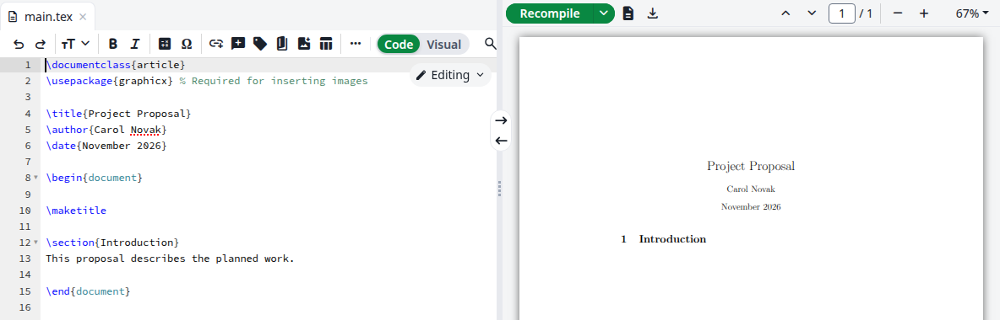

Mỗi dự án có máy chủ MCP riêng, nhờ đó một ứng dụng AI trên máy tính của bạn có thể đọc và chỉnh sửa dự án, biên dịch và trả lời các bình luận. Ứng dụng đăng nhập bằng token xác thực Git.

<Info>

Nếu bạn không thấy thẻ **MCP server**, hãy chỉ quản trị viên tới trang [Máy chủ MCP](/vi/on-premises/configuration/overleaf-toolkit/integrations/mcp-server).

</Info>

## Mới trong v6.3.3 {#new-in-v6-3-3}

Từ v6.3.3, ứng dụng cũng có thể làm việc với lịch sử dự án: liệt kê thay đổi, so sánh hai phiên bản, đọc một tệp như trước đây, lưu và xóa phiên bản, khôi phục một tệp hoặc toàn bộ dự án. Ứng dụng có thể liệt kê các thay đổi được theo dõi và chấp nhận hoặc từ chối chúng, và biến các chỉnh sửa của chính nó thành thay đổi được theo dõi khi bạn yêu cầu. Ứng dụng có thể bình luận vào một đoạn văn bản và sửa hoặc xóa tin nhắn bình luận, đọc và gửi tin nhắn trong trò chuyện dự án, di chuyển và đổi tên tệp và thư mục, tạo thư mục và đổi ngôn ngữ kiểm tra chính tả. Ai được làm gì tuân theo vai trò của bạn trong dự án, giống như trong trình soạn thảo, vì ứng dụng làm việc bằng token của bạn: xem [Ai được làm gì](#who-may-do-what).

Máy chủ MCP được giới thiệu trong v6.3.1. v6.3.1 và v6.3.2 có cùng 17 công cụ; v6.3.3 có 33.

| Công cụ | v6.3.1 và v6.3.2 | v6.3.3 |
| ----- | ----------------- | ------ |
| `get_clone_info`, `get_settings`, `list_files`, `delete_file`, `compile`, `get_compile_log`, `get_output_file_link`, `word_count`, `reply_to_comment`, `resolve_comment`, `reopen_comment` | Có | Có, không đổi |
| `read_file` | Nội dung mới nhất | Cả tệp như tại một `version` |
| `edit_file`, `write_file` | Theo thiết lập theo dõi thay đổi của dự án | Cả `trackChanges`, để biến chỉnh sửa thành thay đổi được theo dõi |
| `update_settings` | Trình biên dịch, image TeX Live và tài liệu chính | Cả ngôn ngữ kiểm tra chính tả |
| `list_versions` | Phiên bản, chú thích và ngày | Cả `id` mà `delete_version` nhận, và người đã lưu |
| `list_comments` | Tin nhắn không có id | Cả `id` của từng tin nhắn, mà `edit_comment_message` và `delete_comment_message` nhận |
| `list_changes`, `diff`, `create_version`, `delete_version`, `restore_file`, `restore_project`, `list_tracked_changes`, `accept_tracked_changes`, `reject_tracked_changes`, `add_comment`, `edit_comment_message`, `delete_comment_message`, `list_chat_messages`, `send_chat_message`, `move_file`, `create_folder` | Không | Có |

## Kết nối ứng dụng {#connect-a-client}

<Steps>
<Step title="Mở hộp thoại">
Mở dự án. Ở thanh bên trái, nhấp **Integrations**, rồi **MCP server**.

<Frame caption="Bảng Integrations">
  
</Frame>

Hộp thoại hiển thị địa chỉ máy chủ của dự án này và một thẻ cho mỗi ứng dụng: **Claude Code**, **Codex**, **Cursor**, **VS Code** và **Gemini CLI**.

<Frame caption="Hộp thoại MCP server">
  
</Frame>
</Step>

<Step title="Tạo token">
Nhấp **Go to settings**. Cài đặt tài khoản của bạn mở trong thẻ mới. Trong **Git integration**, nhấp **Generate token**, hoặc **Add another token** nếu bạn đã có một token. Nhấp **Copy** và giữ token ở nơi an toàn, vì bạn chỉ thấy nó một lần. Sau đó nhấp **Close**.

<Frame caption="Token mới của bạn">
  
</Frame>

Token bạn đang dùng cho [tích hợp Git](/on-premises/user-guide/users/git-integration) cũng dùng được, và một token có thể dùng cho mọi dự án của bạn.
</Step>

<Step title="Thêm máy chủ vào ứng dụng">
Quay lại hộp thoại, nhấp thẻ của ứng dụng bạn dùng rồi nhấp **Copy** bên cạnh cấu hình.

| Thẻ | Đặt ở đâu | Token |
| --- | ------------- | --------- |
| **Claude Code** | Chạy lệnh trong terminal | Thay `<token>` trong lệnh |
| **Codex** | `~/.codex/config.toml` | Đặt vào biến môi trường `OVERLEAF_TOKEN` |
| **Cursor** | `~/.cursor/mcp.json` | Đặt vào biến môi trường `OVERLEAF_TOKEN` |
| **VS Code** | `.vscode/mcp.json` | Tệp có lời nhắc mật khẩu tên `overleaf-token` thay cho token |
| **Gemini CLI** | Chạy lệnh trong terminal | Thay `<token>` trong lệnh |

Địa chỉ thuộc về một dự án. Để kết nối dự án khác, hãy thêm nó với tên khác, vì `overleaf` đã được dùng. Ví dụ, với Claude Code, đổi `overleaf` trong lệnh thành `overleaf-lab`.
</Step>
</Steps>

## Kiểm tra kết nối {#check-the-connection}

### Với Claude Code {#with-claude-code}

```bash
claude mcp list
```

Máy chủ được liệt kê là đã kết nối:

```text
overleaf: https://<your-site>/project/<project-id>/mcp (HTTP) - ✔ Connected
```

### Với curl {#with-curl}

Cách này dùng được với mọi ứng dụng. Thay địa chỉ và token, rồi gửi yêu cầu `initialize` của giao thức MCP:

```bash
curl -X POST https://<your-site>/project/<project-id>/mcp \
  -H "Authorization: Bearer <token>" \
  -H "Content-Type: application/json" \
  -H "Accept: application/json, text/event-stream" \
  -d '{"jsonrpc":"2.0","id":1,"method":"initialize","params":{"protocolVersion":"2025-06-18","capabilities":{},"clientInfo":{"name":"curl","version":"1.0"}}}'
```

Phản hồi nêu tên máy chủ, sau đó là hướng dẫn của nó cho ứng dụng:

```json
{"result":{"protocolVersion":"2025-06-18","capabilities":{"tools":{"listChanged":true}},"serverInfo":{"name":"overleaf","version":"1.0.0"},"instructions":"This server works on one Overleaf project. ..."},"jsonrpc":"2.0","id":1}
```

Để xem các công cụ, gửi `tools/list` bằng cùng lệnh. Phản hồi liệt kê 33 công cụ, hoặc 31 nếu trang của bạn tắt trò chuyện dự án. Trước v6.3.3 là 17.

```bash
  -d '{"jsonrpc":"2.0","id":2,"method":"tools/list","params":{}}'
```

Để gọi một công cụ, gửi `tools/call`:

```bash
  -d '{"jsonrpc":"2.0","id":3,"method":"tools/call","params":{"name":"list_files","arguments":{}}}'
```

```json
{"result":{"content":[{"type":"text","text":"[\n  {\n    \"path\": \"main.tex\",\n    \"type\": \"doc\"\n  }\n]"}]},"jsonrpc":"2.0","id":3}
```

### Trong cài đặt tài khoản {#in-your-account-settings}

Trong **Git integration**, **Last used** hiển thị ngày cho token mà máy chủ đã nhận.

<Frame caption="Token đầu tiên đã được dùng">
  
</Frame>

### Nếu không kết nối được {#if-it-does-not-connect}

| Bạn thấy gì | Ý nghĩa |
| ------------ | ------------- |
| Trạng thái `401`, hoặc trong Claude Code là `✘ Failed to connect` với `HTTP 401` | Token bị thiếu, sai hoặc đã bị xóa |
| Trạng thái `404` | Không có dự án nào có ID này |
| Trạng thái `405` | Yêu cầu không phải `POST` |
| Trạng thái `406` với `Not Acceptable` | Thiếu header `Accept`: ứng dụng phải chấp nhận cả `application/json` và `text/event-stream` |

## Bạn thấy gì khi ứng dụng làm việc {#what-you-see-when-a-client-works}

Các chỉnh sửa xuất hiện trong trình soạn thảo đang mở khi ứng dụng thực hiện chúng, giống như của một cộng tác viên, mà không cần tải lại. Tệp và thư mục mới, các thao tác di chuyển và đổi tên xuất hiện trong cây tệp.

<Frame caption="Một dòng do edit_file thêm vào">
  
</Frame>

`edit_file` chỉ thay đổi văn bản xuất hiện đúng một lần. Nếu không, ứng dụng nhận lỗi, chẳng hạn `oldString not found in main.tex, read_file again` hoặc `oldString appears 2 times in main.tex, add context`, và không có gì thay đổi.

Từ v6.3.3, `move_file` di chuyển hoặc đổi tên tệp hay thư mục, tạo các thư mục của đường dẫn mới khi cần, và `create_folder` tạo một thư mục. Nếu không tìm thấy tệp hoặc đường dẫn mới đã tồn tại, ứng dụng nhận lỗi và không có gì thay đổi. `update_settings` cũng có thể đổi ngôn ngữ kiểm tra chính tả, ví dụ sang `de`, hoặc tắt kiểm tra chính tả.

Câu trả lời cho bình luận xuất hiện trong bảng xem xét dưới tên bạn, vì token là của bạn. Bình luận được giải quyết qua máy chủ sẽ rời khỏi bảng, và mở lại sẽ đưa nó trở lại.

<Frame caption="Câu trả lời do reply_to_comment gửi">
  
</Frame>

Từ v6.3.3, `add_comment` bình luận vào một đoạn văn bản. Văn bản phải xuất hiện đúng một lần trong tệp; khi xuất hiện nhiều lần, ứng dụng cung cấp thêm một đoạn dài hơn bao quanh nó chỉ xuất hiện một lần, và chỉ văn bản đó được bình luận. Bình luận xuất hiện trong bảng xem xét dưới tên bạn và gắn với văn bản của nó khi tệp thay đổi. `edit_comment_message` sửa một tin nhắn của chính bạn. `delete_comment_message` xóa một tin nhắn, và xóa tin nhắn đầu tiên sẽ xóa toàn bộ bình luận, giống như trong bảng xem xét.

`compile` biên dịch dự án và trả về danh sách tệp đầu ra. Sau đó `get_output_file_link` cung cấp liên kết để tải PDF hoặc một tệp đầu ra khác. Liên kết không cần token và hết hiệu lực sau 5 phút.

Danh sách đầy đủ các công cụ có tại [Tools](/on-premises/configuration/overleaf-toolkit/integrations/mcp-server#tools).

## Thay đổi được theo dõi {#tracked-changes}

Từ v6.3.3, bạn có thể yêu cầu ứng dụng biến các chỉnh sửa của nó thành thay đổi được theo dõi, ví dụ *Rewrite the abstract as a tracked change*. Khi đó `edit_file` và `write_file` biến thay đổi trên tệp hiện có thành thay đổi được theo dõi dưới tên bạn, kể cả khi tính năng theo dõi thay đổi đang tắt trong dự án, và bạn chấp nhận hoặc từ chối nó trong bảng xem xét. Tệp mới không bao giờ là thay đổi được theo dõi. Nếu bạn không yêu cầu, các chỉnh sửa tuân theo thiết lập theo dõi thay đổi của dự án, giống như chỉnh sửa của bạn trong trình soạn thảo: chúng được theo dõi khi tính năng này bật cho bạn hoặc cho mọi người.

Nếu tài khoản của chủ dự án không có tính năng theo dõi thay đổi, ứng dụng nhận `Track changes is off for this project` và không có gì thay đổi.

Để xem xét mọi chỉnh sửa của ứng dụng, hãy bật theo dõi thay đổi cho chính bạn. Để phân biệt chỉnh sửa của nó với của bạn trong bảng xem xét, hãy đưa cho ứng dụng token của một tài khoản khác mà bạn chia sẻ dự án.

`list_tracked_changes` liệt kê các thay đổi được theo dõi cùng tệp, văn bản được chèn hoặc xóa, tác giả và thời gian. `accept_tracked_changes` và `reject_tracked_changes` nhận id của các thay đổi và hoạt động như bảng xem xét: thay đổi được chấp nhận vẫn ở trong văn bản, phần chèn bị từ chối sẽ bị gỡ bỏ và phần xóa bị từ chối sẽ quay lại. Trình soạn thảo đang mở hiển thị kết quả mà không cần tải lại. Các công cụ yêu cầu ứng dụng chỉ chấp nhận hoặc từ chối những thay đổi bạn yêu cầu.

## Lịch sử {#history}

Từ v6.3.3, ứng dụng thấy lịch sử dự án giống như bảng lịch sử hiển thị.

| Công cụ | Tác dụng |
| ---- | ------------ |
| `list_changes` | Liệt kê các thay đổi, mới nhất trước: ai đã thay đổi tệp nào và khi nào, cùng các phiên bản trước và sau mỗi thay đổi. Các thay đổi cũ hơn được trả về trong các đợt tiếp theo. |
| `diff` | So sánh hai phiên bản: một tệp dưới dạng unified diff, như `git diff`, hoặc các tệp đã được thêm, xóa, sửa hay đổi tên |
| `read_file` với `version` | Đọc một tệp như tại một phiên bản |
| `list_versions` | Liệt kê các phiên bản đã lưu, cùng chú thích và người đã lưu |
| `create_version` | Lưu phiên bản mới nhất, hoặc một phiên bản cũ hơn, kèm chú thích, như **Label this version** |
| `delete_version` | Xóa một phiên bản đã lưu; các thay đổi của nó vẫn còn |
| `restore_file` | Khôi phục một tệp như tại một phiên bản, như **Restore this version** |
| `restore_project` | Khôi phục toàn bộ dự án như tại một phiên bản, như **Restore project to this version** |

Bản thân việc khôi phục là một thay đổi mới, vì vậy bạn có thể hoàn tác nó theo cùng cách. Các công cụ yêu cầu ứng dụng chỉ khôi phục khi bạn yêu cầu.

Nếu chủ dự án không có lịch sử dự án đầy đủ, ứng dụng chỉ thấy các thay đổi trong 24 giờ qua, hoặc thay đổi mới nhất nếu tất cả đều cũ hơn, giống như trong bảng lịch sử. Ứng dụng không thể so sánh, đọc hoặc khôi phục các phiên bản cũ hơn.

## Trò chuyện dự án {#project-chat}

Từ v6.3.3, `list_chat_messages` đọc trò chuyện dự án, mới nhất trước, mỗi lần 50 tin nhắn. `send_chat_message` gửi tin nhắn dưới tên bạn, và tin nhắn xuất hiện ngay trong cửa sổ trò chuyện đang mở. Nếu trang của bạn tắt trò chuyện dự án, ứng dụng không có công cụ nào trong hai công cụ này.

## Ai được làm gì {#who-may-do-what}

Ứng dụng được làm những gì vai trò của bạn trong dự án cho phép.

| Ứng dụng làm gì | Chủ sở hữu | Người chỉnh sửa | Người xem xét | Người xem (cộng tác viên được chỉ định) | Người xem (chia sẻ qua liên kết) |
| -------------------- | ----: | -----: | -------: | --------------------------: | --------------------: |
| Đọc tệp và cài đặt, biên dịch, đọc nhật ký, tải PDF | Có | Có | Có | Có | Có |
| Ghi, sửa, di chuyển và xóa tệp, tạo thư mục, đổi cài đặt | Có | Có | Không | Không | Không |
| Xem lịch sử, bình luận và thay đổi được theo dõi | Có | Có | Có | Có | Không |
| Đọc và gửi tin nhắn trò chuyện | Có | Có | Có | Có | Không |
| Thêm bình luận và trả lời | Có | Có | Có | Không | Không |
| Giải quyết, mở lại hoặc xóa bình luận | Có | Có | Những bình luận do họ bắt đầu | Không | Không |
| Sửa tin nhắn bình luận | Của chính họ | Của chính họ | Của chính họ | Không | Không |
| Xóa tin nhắn bình luận | Có | Có | Của chính họ | Không | Không |
| Chấp nhận hoặc từ chối thay đổi được theo dõi | Có | Có | Không | Không | Không |
| Lưu phiên bản | Có | Có | Có | Không | Không |
| Xóa phiên bản đã lưu | Có | Những phiên bản họ đã lưu | Những phiên bản họ đã lưu | Không | Không |
| Khôi phục tệp hoặc dự án | Có | Có | Không | Không | Không |

Người chỉnh sửa tham gia qua liên kết được tính là người chỉnh sửa. Người xem xét không thể chỉnh sửa tệp qua MCP, kể cả dưới dạng thay đổi được theo dõi.

## Ngắt kết nối ứng dụng {#disconnect-a-client}

Xóa token: xem [Xóa token](/on-premises/user-guide/users/git-integration#delete-a-token). Từ đó, máy chủ trả lời `401` cho token đó. Nếu bạn cũng dùng nó cho Git, Git cũng ngừng chấp nhận nó.
