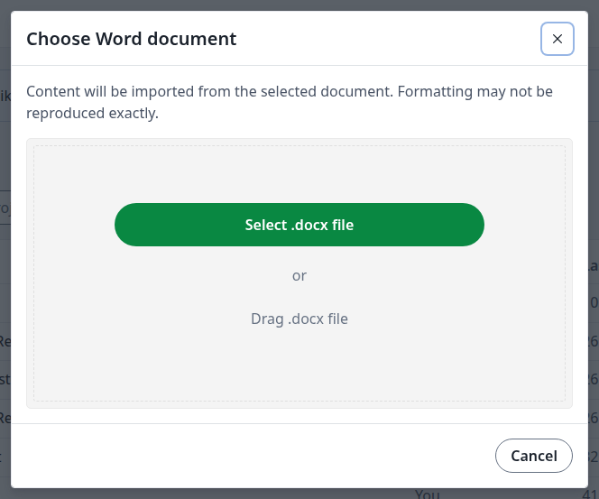

<Info>

Nếu bạn không thấy các tùy chọn này, hãy đề nghị quản trị viên bật [Pandoc Import and Export](/vi/on-premises/configuration/overleaf-toolkit/pandoc-import-and-export).

</Info>

## Nhập tài liệu {#import-a-document}

Thao tác này tạo một dự án LaTeX mới từ tài liệu Word (`.docx`) hoặc tệp Markdown (`.md`). Tên dự án lấy từ tên tệp.

<Steps>
<Step title="Mở hộp thoại nhập">
Trên trang dự án, nhấp **New project**. Trong **Import**, nhấp **Word document** hoặc **Markdown document**.

<Frame caption="Menu New project">
  
</Frame>
</Step>

<Step title="Chọn tệp">
Nhấp **Select .docx file**, hoặc kéo tệp vào hộp thoại. Với Markdown, nút là **Select .md file**. Quá trình nhập bắt đầu ngay.

<Frame caption="Chọn tài liệu Word">
  
</Frame>
</Step>

<Step title="Bắt đầu chỉnh sửa">
Dự án mới mở ra với thông báo **Document ready for editing**. Nhấp **Start editing**.

<Frame caption="Đã nhập xong">
  
</Frame>
</Step>

<Step title="Kiểm tra kết quả">
Tài liệu giờ nằm trong `main.tex`, với các tiêu đề hiển thị trong dàn ý tệp. Nhấp **Recompile** để xem PDF. Hãy kiểm tra định dạng, đặc biệt là bảng, hình và trích dẫn, vì chúng có thể cần chỉnh sửa.

<Frame caption="Dự án đã nhập">
  
</Frame>
</Step>
</Steps>

### Nếu nhập thất bại {#if-the-import-fails}

Nếu không thể chuyển đổi tệp, hộp thoại hiển thị **Your document couldn't be imported**. Mở rộng **Conversion error details** để xem lý do. Không có dự án nào được tạo.

<Frame caption="Một tài liệu không thể nhập">
  
</Frame>

Hộp thoại chỉ nhận loại bạn đã chọn. Một tệp `.md` trong hộp thoại Word sẽ hiển thị **You can only upload: .docx**.

## Xuất dự án {#export-a-project}

Mở dự án, rồi nhấp vào tên dự án ở đầu trình soạn thảo. Nhấp một trong các tùy chọn sau:

| Tùy chọn                              | Bạn nhận được                                       |
| ----------------------------------- | --------------------------------------------- |
| <strong>Export as Word document (.docx)</strong> | Một tệp `.docx` đặt theo tên dự án        |
| <strong>Export as Markdown (.md)</strong>        | Một tệp `.zip` chứa `main.md`                  |
| <strong>Export as HTML (.html)</strong>          | Một tệp `.zip` chứa `main.html`                |

Quá trình tải xuống tự bắt đầu. Việc chuyển đổi không thể tái tạo mọi định dạng LaTeX, vì vậy hãy kiểm tra kết quả.

<Frame caption="Các tùy chọn xuất">
  
</Frame>
