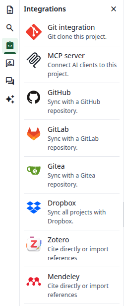
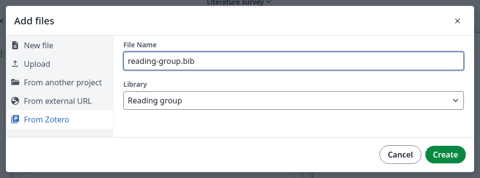

Nhập thư viện Zotero vào dự án dưới dạng tệp `.bib`, rồi trích dẫn từ tệp đó như bình thường. Tệp này là một bản sao: tệp chỉ thay đổi khi bạn nhấp vào **Refresh**.

<Info>

Nếu bạn không thấy tùy chọn Zotero trong **Account settings**, hãy đề nghị quản trị viên bật [tích hợp Zotero](/vi/on-premises/configuration/overleaf-toolkit/integrations/zotero-integration).

</Info>

## Liên kết tài khoản Zotero {#link-your-zotero-account}

Bạn chỉ làm việc này một lần.

<Steps>
<Step title="Mở cài đặt tài khoản">
Nhấp vào **Account**, rồi **Account settings**. Trong **Reference managers**, tìm **Zotero** và nhấp vào **Link to Zotero**.

<Frame caption="Zotero trong cài đặt tài khoản">
  
</Frame>

Thẻ **Zotero** trong bảng **Integrations** của trình soạn thảo đưa bạn đến cùng vị trí, trong cùng thẻ trình duyệt.

<Frame caption="Bảng Integrations">
  
</Frame>
</Step>

<Step title="Cấp quyền trên Zotero">
Zotero mở ra. Đăng nhập nếu được yêu cầu, rồi cấp quyền cho ứng dụng. Ứng dụng chỉ yêu cầu đọc thư viện và nhóm của bạn, nên không thể thay đổi gì trong Zotero.
</Step>

<Step title="Kiểm tra liên kết">
Bạn quay lại cài đặt tài khoản. Một thông báo màu xanh lá cho biết **Reference manager linked**, và nút giờ hiển thị **Unlink**.

<Frame caption="Tài khoản Zotero của bạn đã được liên kết">
  
</Frame>
</Step>
</Steps>

Nếu bạn không cho phép truy cập trên Zotero, cùng mục đó sẽ hiển thị **Sorry, something went wrong**. Nhấp vào **Link to Zotero** để thử lại.

## Tạo tệp từ thư viện {#create-a-file-from-your-library}

<Steps>
<Step title="Mở hộp thoại Add files">
Mở một dự án. Trong cây tệp, nhấp vào **New file**, rồi **From Zotero**. Mục này chỉ xuất hiện khi tài khoản của bạn đã được liên kết.
</Step>

<Step title="Chọn tên tệp và thư viện">
**File Name** mặc định là `zotero.bib`. Hãy giữ đuôi `.bib`: nếu không, bạn sẽ không có bản xem trước, và cả `\cite` lẫn `\bibliography` đều không tìm thấy các mục.

**Library** mặc định là **My Library** và cũng liệt kê các thư viện nhóm của bạn. Mỗi tệp chứa một thư viện.

<Frame caption="Tệp từ thư viện cá nhân">
  
</Frame>
</Step>

<Step title="Nhấp vào Create">
Hộp thoại đóng lại và tệp xuất hiện trong cây tệp. Nhấp vào tệp: tệp hiển thị thời điểm được nhập và các mục của nó. Bạn không thể chỉnh sửa tệp trong trình soạn thảo.

<Frame caption="Tệp đã nhập">
  
</Frame>

Nếu **Create** dường như không làm gì, đã có một tệp trùng tên. Hãy chọn tên khác.
</Step>
</Steps>

### Nhập thư viện nhóm {#import-a-group-library}

Làm lại các bước với một tên tệp riêng và chọn nhóm trong **Library**. Một dự án có thể có nhiều tệp như vậy.

<Frame caption="Tệp từ thư viện nhóm">
  
</Frame>

## Trích dẫn từ tệp {#cite-from-the-file}

<Steps>
<Step title="Bắt đầu trích dẫn">
Trong tệp `.tex`, gõ `\cite{`. Danh sách hiển thị các mục của mọi tệp `.bib` trong dự án. Nhấp vào một mục để chèn.

<Frame caption="Các mục của tệp đã nhập">
  
</Frame>
</Step>

<Step title="Hoặc tìm theo tiêu đề hay tác giả">
Nhấp vào **Search** bên dưới danh sách, hoặc nhấn Ctrl+Space bên trong cặp ngoặc nhọn. Gõ để lọc, nhấp vào một hoặc nhiều mục, rồi nhấp vào **Insert**.

<Frame caption="Tìm kiếm tài liệu tham khảo">
  
</Frame>
</Step>

<Step title="Thêm danh mục tài liệu tham khảo">
Thêm các dòng sau trước `\end{document}`, dùng tên các tệp của bạn không có `.bib`, phân tách bằng dấu phẩy:

```latex
\bibliographystyle{plain}
\bibliography{reading-group,zotero}
```

Nhấp vào **Recompile**. Tài liệu tham khảo xuất hiện trong PDF.

<Frame caption="Tài liệu tham khảo đã biên dịch">
  
</Frame>
</Step>
</Steps>

Các tệp đã nhập không được đề xuất trong **Settings** ở **References**, **Main bibliography file for this project**, vì vậy danh sách vẫn trống nếu dự án không có tệp `.bib` nào khác. Bạn vẫn có thể trích dẫn từ chúng.

<Frame caption="Danh sách trống là bình thường">
  
</Frame>

## Làm mới tệp {#refresh-the-file}

Các thay đổi trong thư viện Zotero không tự đến dự án, và biên dịch cũng không lấy chúng về.

<Steps>
<Step title="Mở tệp">
Trong cây tệp, nhấp vào tệp đã nhập.
</Step>

<Step title="Nhấp vào Refresh">
Toàn bộ tệp được nhập lại từ thư viện bạn đã chọn khi tạo tệp: mục mới xuất hiện và mục đã xóa biến mất. Thời gian ở trên cùng thay đổi.

<Frame caption="Tệp đã làm mới">
  
</Frame>
</Step>

<Step title="Biên dịch lại">
Các mục mới có ngay trong danh sách `\cite{`. Nhấp vào **Recompile** để cập nhật PDF.
</Step>
</Steps>

Mỗi tệp được làm mới riêng: hãy làm mới tệp của nhóm bạn riêng biệt. Để biết ai có thể làm mới tệp trong dự án được chia sẻ, xem [ghi chú dành cho quản trị viên](/on-premises/configuration/overleaf-toolkit/integrations/zotero-integration#notes).

## Hủy liên kết tài khoản Zotero {#unlink-your-zotero-account}

Trong **Account settings**, ở mục **Zotero**, nhấp vào **Unlink**, rồi nhấp lại **Unlink** trong hộp thoại. Nút lại hiển thị **Link to Zotero**.

<Frame caption="Hủy liên kết tài khoản">
  
</Frame>

Các tệp bạn đã nhập vẫn ở trong dự án và vẫn biên dịch được. **From Zotero** biến mất khỏi hộp thoại **Add files**, và **Refresh** hiển thị lỗi cho đến khi bạn liên kết lại tài khoản.

<Frame caption="Làm mới khi chưa liên kết tài khoản">
  
</Frame>

Sau khi liên kết lại, **Refresh** hoạt động trên chính các tệp đó.

## Nếu có sự cố {#if-something-goes-wrong}

**Could not load references from Zotero, please re-link your account and try again** hoặc **There was an error accessing your Zotero data** trong hộp thoại **Add files**: Overleaf không còn đọc được thư viện của bạn, chẳng hạn vì bạn đã thu hồi quyền truy cập của nó trên Zotero. Trong **Account settings**, nhấp vào **Unlink**, rồi **Link to Zotero**. Cho đến lúc đó, **Create** cũng thất bại với thông báo **The project that contains this file is not shared with you**, ngay cả trong dự án của chính bạn.

<Frame caption="Overleaf không còn đọc được thư viện của bạn">
  
</Frame>

**The remote service produced an error** khi bạn nhấp vào **Refresh**: yêu cầu gửi đến Zotero đã thất bại. Tệp giữ nguyên nội dung. Hãy nhấp lại **Refresh** sau.
