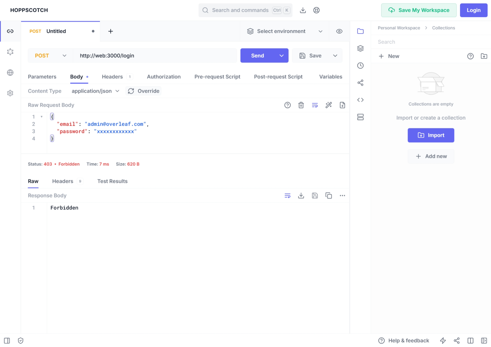

## 推荐的开发工具 {#develop-tools-recommended}

这些可选服务不是运行 Overleaf 所必需的，但在开发、调试和查看数据时非常有用。它们都是开发环境的一部分，因此无需向 `docker-compose.yml` 添加任何内容。登录网站后，导航栏中的 **Dev tools** 菜单会链接到网站在自身路径上提供的工具。

| 工具 | 地址 | 定义位置 |
| --- | --- | --- |
| **Grafana**, 所有服务的状态、指标和日志 | [http://localhost/grafana/](http://localhost/grafana/) | `develop/grafana/docker-compose.yml`, 在 `develop/dev.rc` 中 `GRAFANA_ENABLED=true` 时开启（默认） |
| **Mailpit**, 网站发送的每封邮件的收件箱 | [http://localhost/mailpit/](http://localhost/mailpit/) | `develop/mail/docker-compose.yml`, `MAILPIT_ENABLED=true` 时开启（默认） |
| **Mongo Express**, MongoDB 的 UI | [http://localhost/mongo-express/](http://localhost/mongo-express/) | `develop/docker-compose.yml`, 始终开启 |
| **RedisInsight**, Redis 数据的 UI | [http://localhost/redis-insight/](http://localhost/redis-insight/) | `develop/docker-compose.yml`, 始终开启 |
| **Hoppscotch**, 类似 Postman 的基于浏览器的 API 客户端 | [http://localhost:9170](http://localhost:9170/) (`HOPPSCOTCH_PORT`) | `develop/hoppscotch/docker-compose.yml`, `HOPPSCOTCH_ENABLED=true` 时开启（默认） |

<Warning>

这些工具都没有登录：Grafana 的匿名用户就是其管理员，Mongo Express 可以修改任何文档。网站、Hoppscotch、Mongo Express（8081）和 RedisInsight（5540）只监听主机的 `127.0.0.1`，因此其他主机无法访问它们。

</Warning>

### Grafana {#grafana}

Grafana 由网站通过 webpack-dev-server 在 `/grafana/` 上提供，因此不需要单独的端口。它的 **Overleaf Develop** 文件夹中有以下仪表板：

| 仪表板 | 显示内容 |
| --- | --- |
| All services (主页) | 每个服务的状态、主机指标、负载和日志。点击某个服务可打开其仪表板 |
| Server | 主机的 CPU、负载、内存、磁盘和网络，以及 clsi 的编译 |
| Errors | 错误日志、5xx 和 4xx 响应、最常见的错误信息和失败的路由 |
| Data flow | 一次编辑的路径：document-updater 和 Redis、project-history、history-v1、Mongo、对象存储 |
| Containers | 每个容器的状态、CPU、内存、网络和磁盘，包括沙箱编译 |
| 每个服务一个 | Node.js 服务、git-bridge（JVM）、mongo 和 redis |

<Columns cols={2}>
<Column>

<Frame caption="All services：每个服务的状态、主机以及每个服务使用的资源">
  
</Frame>

</Column>

<Column>

<Frame caption="Data flow：一次编辑从 document-updater 经 project-history 到 history-v1 和 Mongo 的过程">
  
</Frame>

</Column>
</Columns>

Prometheus 抓取各服务的 `/metrics`，以及 `mongodb-exporter`、`redis-exporter`、`cadvisor` 和 `node-exporter`；Alloy 将项目中每个容器的日志发送到 Loki，仪表板中的 **Log search**、**Service** 和 **Log level** 筛选器从那里读取。这些数据只存在于容器中，因此重新创建容器会将其清空。cAdvisor 以特权模式运行，以只读方式读取主机的 `/`、`/sys`、Docker 数据和 containerd 套接字；node-exporter 读取主机的 `/`。

仪表板是生成的：请修改 `develop/grafana/make-dashboards` 并运行它，而不要直接编辑 JSON 文件。

### Mailpit {#mailpit}

设置 `MAILPIT_ENABLED=true` 后，`web` 会把每封邮件发送到 Mailpit 而不是真实的邮件服务器，并且邮箱确认处于开启状态（`EMAIL_CONFIRMATION_DISABLED=false`）。这样就可以从收件箱中打开激活链接、项目邀请、密码重置和确认码。

<Frame caption="Mailpit 中的激活邮件、项目邀请、确认码和密码重置">
  
</Frame>

Mailpit 没有卷：重新创建其容器会清空收件箱。

### Mongo Express {#mongo-express}

Mongo Express 显示 `sharelatex` 数据库中的集合，并可以查看、编辑、导入和导出其中的文档。

<Frame caption="Mongo Express 中 sharelatex 数据库的集合">
  
</Frame>

### RedisInsight {#redisinsight}

RedisInsight 将其连接保存在 `develop/data/redis-insight` 中。首次使用时，选择 **Connect existing database**，并输入主机 `redis` 和端口 `6379`。

<Frame caption="已连接到 redis 服务的 RedisInsight">
  
</Frame>

### 设置 Hoppscotch {#setup-hoppscotch}

#### 代理 API 请求 {#proxy-api-request}

Hoppscotch 从浏览器发送请求，而浏览器无法通过 Docker 名称访问各服务。它的代理 Proxyscotch 运行在 Docker 网络内部，并在 Hoppscotch 地址的 `/proxy` 上提供。打开 [http://localhost:9170](http://localhost:9170/)，进入 Settings → Interceptor，选择 **Proxy**，并将 Proxy URL 设置为 `http://localhost:9170/proxy`。该设置会保存在浏览器中。

<Frame caption="Interceptor 设置。截图来自旧的配置：请使用 `http://localhost:9170/proxy` 作为 Proxy URL。">
  
</Frame>

现在你可以使用 [http://web:3000/status](http://web:3000/status) 来测试 web 服务是否正常运行：

<Frame>
  
</Frame>

#### 导入服务 API {#import-the-service-apis}

`develop/hoppscotch/openapi/` 中为每个服务的内部 API 提供了一个 OpenAPI 文件。在 Hoppscotch 中打开 Collections → Import → Import from File，并一次选择所有文件。每个文件都会成为一个集合，其请求发送到该服务的 Docker 地址。相同的文件也展示在 [服务 API](/zh-CN/dev/service-api/overview) 部分中。

#### CSRF 问题 {#csrf-problems}

<Warning>

如果你使用 Postman 或其他调试工具发起 **POST** 请求，可能会发现登录被**禁止**，原因是 403 错误。这是因为 Overleaf 受到 **CSRF** 验证保护。

</Warning>

<Frame>
  
</Frame>

在控制台中，你可能会看到：

<Frame>
  
</Frame>

要在 Overleaf 开发中解决此问题，你需要设置 CSRF 令牌。以下是详细教程。

<Steps>
<Step title="添加预请求脚本">
将以下代码添加到 Pre-Request 中

<Frame>
  
</Frame>

脚本如下：

```js wrap
pm.sendRequest("http://web:3000/dev/csrf", function (err, res) {
    if (err) {
        console.log(err);
        return;
    }

    // 1) Save CSRF token (/dev/csrf)
    const token = res.text().trim();
    pw.env.set("csrftoken", token);
    console.log("csrftoken =", token);

    const setCookieHeader = (res.headers || []).find(h => h.key?.toLowerCase() === "set-cookie")?.value;
    console.log("set-cookie =", setCookieHeader);

    if (!setCookieHeader) return;

    const cookiePair = setCookieHeader.split(";")[0].trim(); // overleaf.sid=...
    pw.env.set("cookie_header", cookiePair);
    console.log("cookie_header =", cookiePair);
});
```
</Step>

<Step title="添加请求头">
你需要添加以下请求头：

| 请求头名称   | 请求头值            |
| ------------ | ------------------- |
| Content-Type | `application/json`  |
| X-Csrf-Token | `<<csrftoken>>`     |
| Cookie       | `<<cookie_header>>` |

<Frame>
  
</Frame>
</Step>

<Step title="使用 API 工具登录">
现在你可以使用用户名和密码登录。

```json5
{
  "_csrf": "<<csrftoken>>",
  "email": "admin@overleaf.com",
  "password": "xxxxxx"
}
```

以下是输入错误的用户名或密码时的响应。

<Frame>
  
</Frame>
</Step>
</Steps>
