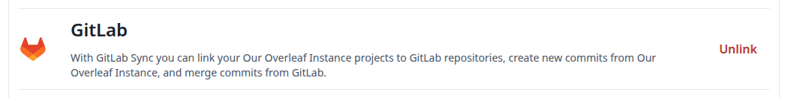
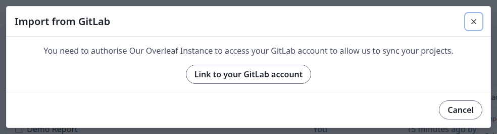

将项目连接到 GitLab 仓库。更改双向同步，并且只在你点击 **Sync** 时进行：不会自动同步任何内容。

<Info>

管理员需要先启用 [GitLab 同步](/zh-CN/on-premises/configuration/overleaf-toolkit/integrations/gitlab-synchronisation)。

</Info>

## 关联你的 GitLab 账户 {#link-your-gitlab-account}

这只需要做一次。

<Steps>
<Step title="打开账户设置">
点击 **Account**，然后点击 **Account settings**。在 **Project synchronisation** 下找到 **GitLab**，点击 **Link**。

<Frame caption="账户设置中的 GitLab">
  
</Frame>
</Step>

<Step title="在 GitLab 上授权">
GitLab 会打开。如有要求请登录，然后授权该应用。
</Step>

<Step title="检查关联">
你会回到账户设置。一条绿色消息提示你的 GitLab 账户已关联，按钮现在显示为 **Unlink**。

<Frame caption="你的 GitLab 账户已关联">
  
</Frame>
</Step>
</Steps>

如果你的账户尚未关联，**Import from GitLab** 和编辑器中的 **GitLab** 卡片会先要求你关联账户。点击 **Link to your GitLab account**。你同样会进入账户设置，如果是从编辑器开始的，则会在新标签页中打开。然后返回并重新开始。

<Frame caption="账户未关联时的提示">
  
</Frame>

## 导入仓库 {#import-a-repository}

这会从 GitLab 仓库创建一个新项目，并且已与该仓库关联。

<Steps>
<Step title="打开导入对话框">
在项目页面中，点击 **New project**，然后点击 **Import from GitLab**。

<Frame caption="New project 菜单">
  
</Frame>
</Step>

<Step title="选择仓库">
点击仓库旁边的 **Import to Overleaf**。列表包含你的仓库以及你所在群组的仓库。

<Frame caption="你的 GitLab 仓库">
  
</Frame>
</Step>

<Step title="检查项目">
新项目会打开，并包含仓库中的文件。

<Frame caption="导入的项目">
  
</Frame>
</Step>
</Steps>

## 将项目导出到新仓库 {#export-a-project-to-a-new-repository}

这会从项目创建一个仓库，并将两者关联。项目只能通过这种方式或导入来关联：你无法将它关联到已存在的仓库。

<Steps>
<Step title="在编辑器中打开 GitLab">
打开项目。在左侧栏中点击 **Integrations**，然后点击 **GitLab**。

<Frame caption="Integrations 面板">
  
</Frame>
</Step>

<Step title="填写仓库信息">
选择 **Owner**，可以是你自己，也可以是你所在的某个群组。选择群组时，该字段名为 **Organization**。**Repository Name** 默认为项目名称。描述是可选的，**Private** 默认处于选中状态。点击 **Create a GitLab repository**。

<Frame caption="Export Project to GitLab">
  
</Frame>

如果名称已被占用，对话框会显示 <strong>Please check that the repository name is valid, and that you have permission to create the repository.</strong> 请修改名称，然后再次点击按钮。
</Step>

<Step title="检查关联">
对话框现在显示 **This project is linked to** 以及仓库名称。

<Frame caption="项目已关联">
  
</Frame>
</Step>
</Steps>

## 同步 {#sync}

<Steps>
<Step title="打开同步对话框">
打开已关联的项目。在左侧栏中点击 **Integrations**，然后点击 **GitLab**。

**Recent commits in GitLab** 列出了将要进入项目的内容。

<Frame caption="GitLab 中有一个新提交在等待">
  
</Frame>
</Step>

<Step title="描述你的更改">
如果你在项目中做了更改，会出现提交信息输入框。它是可选的：如果留空，提交名称为 `Updates from Overleaf`。

<Frame caption="你的更改的提交信息">
  
</Frame>
</Step>

<Step title="点击 Sync">
点击 **Sync**。来自 GitLab 的新提交会进入项目，你的更改会推送到仓库的默认分支。如果两边修改了不同的内容，系统会为你合并。
</Step>

<Step title="检查结果">
对话框显示 <strong>No new commits in GitLab since last merge.</strong>，提交信息输入框也消失了。编辑器中的文件和 GitLab 上的提交都已是最新状态。

<Frame caption="一切已同步">
  
</Frame>
</Step>
</Steps>

### 如果两边修改了相同的行 {#if-the-same-lines-changed-on-both-sides}

对话框会提示无法合并更改，并给出一个新分支 `overleaf-YYYY-MM-DD-HHMMSS`，其中保存了你的更改。Overleaf 还会在 GitLab 上从该分支创建一个合并请求。

<Frame caption="冲突">
  
</Frame>

1. 在 GitLab 上或使用 Git 将该分支合并到默认分支。在此期间你可以关闭对话框：再次打开时它会显示相同的消息。
2. 点击 **I have manually merged. Continue**。合并后的结果会进入项目。如果在分支合并之前点击，对话框会保持不变。
3. 该分支会保留在 GitLab 上，除非你在合并时删除了它。不再需要时请将其删除。

当仓库的合并规则阻止合并请求时（例如需要审批），即使没有冲突的行，也会出现同样的对话框。一旦规则允许，请在 GitLab 上合并该合并请求，然后点击 **I have manually merged. Continue**。请参阅[与 GitLab 同步的工作原理](/zh-CN/on-premises/configuration/overleaf-toolkit/integrations/gitlab-synchronisation#how-syncing-works-with-gitlab)。

## 取消项目关联 {#unlink-a-project}

当你不再希望项目同步时执行此操作。

<Steps>
<Step title="点击 Unlink">
在同步对话框中，点击 **Unlink**。
</Step>

<Step title="确认">
点击 **Confirm**。这只会移除关联：警告中提到的连接到你拥有的仓库，是你之后可以选择的操作，而不是现在就会发生的事情。

<Frame caption="确认取消关联">
  
</Frame>
</Step>

<Step title="检查结果">
对话框现在显示 **Export Project to GitLab**。项目和仓库都会保留各自的内容。要再次同步，请将项目导出到新仓库，或将仓库导入到新项目。
</Step>
</Steps>

## 取消关联你的 GitLab 账户 {#unlink-your-gitlab-account}

在 **Account settings** 的 **GitLab** 下，点击 **Unlink**，然后在对话框中再次点击 **Unlink**。

<Frame caption="取消关联你的账户">
  
</Frame>

你的项目仍与各自的仓库保持关联。在你再次关联账户之前，无法同步它们。

<Info>

关于共享项目中谁可以做什么，请参阅[谁可以关联和同步](/zh-CN/on-premises/configuration/overleaf-toolkit/integrations/gitlab-synchronisation#who-can-link-and-sync)。

</Info>
