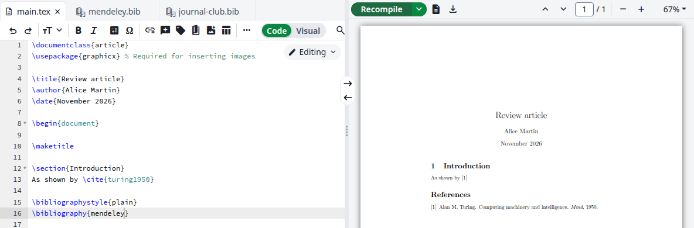

将 Mendeley 文献库以 `.bib` 文件的形式导入项目，然后像平常一样从中引用。该文件是一份副本：只有在你点击 **Refresh** 时才会变化。

<Info>

如果你在 **Account settings** 中看不到 Mendeley 选项，请让管理员开启 [Mendeley 集成](/zh-CN/on-premises/configuration/overleaf-toolkit/integrations/mendeley-integration)。

</Info>

## 关联你的 Mendeley 账户 {#link-your-mendeley-account}

此操作只需做一次。

<Steps>
<Step title="打开账户设置">
点击 **Account**，然后点击 **Account settings**。在 **Reference managers** 下找到 **Mendeley**，点击 **Link to Mendeley**。

<Frame caption="账户设置中的 Mendeley">
  
</Frame>

编辑器 **Integrations** 面板中的 **Mendeley** 卡片会在同一标签页中带你到同一位置。

<Frame caption="Integrations 面板">
  
</Frame>
</Step>

<Step title="在 Mendeley 上授权">
Mendeley 页面会打开。如有提示请先登录，然后授权该应用。
</Step>

<Step title="检查关联">
你会回到账户设置。一条绿色消息显示 **Reference manager linked**，按钮变为 **Unlink**。

<Frame caption="你的 Mendeley 账户已关联">
  
</Frame>
</Step>
</Steps>

如果你没有在 Mendeley 上允许访问，同一部分会显示 **Sorry, something went wrong**。点击 **Link to Mendeley** 重试。

## 从文献库创建文件 {#create-a-file-from-your-library}

<Steps>
<Step title="打开 Add files 对话框">
打开一个项目。在文件树中点击 **New file**，然后点击 **From Mendeley**。只有在账户关联后才会出现此项。
</Step>

<Step title="选择文件名和文献库">
**File Name** 默认为 `mendeley.bib`。请保留 `.bib` 扩展名：否则你将看不到预览，`\cite` 和 `\bibliography` 也都找不到其中的条目。

**Library** 默认为 **My Library**，同时还会列出你的群组。一个文件对应一个文献库。

<Frame caption="来自个人文献库的文件">
  
</Frame>
</Step>

<Step title="点击 Create">
对话框关闭，文件出现在文件树中。点击它：会显示导入时间及其条目。你无法在编辑器中编辑它。

<Frame caption="导入的文件">
  
</Frame>

如果点击 **Create** 似乎没有反应，说明已存在同名文件。请换一个名称。
</Step>
</Steps>

### 导入群组 {#import-a-group}

再操作一次，使用单独的文件名，并在 **Library** 下选择该群组。一个项目可以有多个这样的文件。

<Frame caption="来自群组的文件">
  
</Frame>

## 从文件中引用 {#cite-from-the-file}

<Steps>
<Step title="开始引用">
在 `.tex` 文件中输入 `\cite{`。列表会显示项目中所有 `.bib` 文件的条目。点击某一条即可插入。

<Frame caption="已导入文件的条目">
  
</Frame>
</Step>

<Step title="或按标题或作者搜索">
点击列表下方的 **Search**，或在花括号内按 Ctrl+Space。输入内容进行筛选，点击一个或多个条目，然后点击 **Insert**。

<Frame caption="文献搜索">
  
</Frame>
</Step>

<Step title="添加参考文献列表">
在 `\end{document}` 之前添加以下几行，使用不带 `.bib` 的文件名。如有多个文件，用逗号分隔文件名。

```latex
\bibliographystyle{plain}
\bibliography{mendeley}
```

点击 **Recompile**。参考文献会出现在 PDF 中。

<Frame caption="编译后的参考文献">
  
</Frame>
</Step>
</Steps>

导入的文件不会出现在 **Settings** 的 **References**、**Main bibliography file for this project** 中，因此如果项目没有其他 `.bib` 文件，该列表会保持为空。你仍然可以从中引用。

<Frame caption="列表为空是正常的">
  
</Frame>

## 刷新文件 {#refresh-the-file}

Mendeley 文献库中的更改不会自动同步到项目。

<Steps>
<Step title="打开文件">
在文件树中点击已导入的文件。
</Step>

<Step title="点击 Refresh">
整个文件会从你创建时选择的文献库重新导入：新条目出现，已删除的条目消失。顶部的时间会随之改变。

<Frame caption="刷新后的文件">
  
</Frame>
</Step>

<Step title="重新编译">
点击 **Recompile** 更新 PDF。
</Step>
</Steps>

每个文件单独刷新：请另行刷新群组的文件。关于在共享项目中谁可以刷新文件，请参阅[管理员说明](/on-premises/configuration/overleaf-toolkit/integrations/mendeley-integration#notes)。

## 取消关联 Mendeley 账户 {#unlink-your-mendeley-account}

在 **Account settings** 的 **Mendeley** 下点击 **Unlink**，然后在对话框中再次点击 **Unlink**。按钮会重新显示 **Link to Mendeley**。

<Frame caption="取消关联账户">
  
</Frame>

你导入的文件会保留在项目中，并且仍可编译。**From Mendeley** 会从 **Add files** 对话框中消失，在你重新关联账户之前，**Refresh** 会显示错误。

<Frame caption="未关联账户时刷新">
  
</Frame>

重新关联后，**Refresh** 可以在相同的文件上正常使用。

## 如果出现问题 {#if-something-goes-wrong}

在 **Add files** 对话框中出现 **Could not load references from Mendeley, please re-link your account and try again** 或 **There was an error accessing your Mendeley data**：Overleaf 无法再读取你的文献库，例如你在 Mendeley 上撤销了它的访问权限。在 **Account settings** 中点击 **Unlink**，然后点击 **Link to Mendeley**。在此之前，**Create** 也会失败，并显示 **The project that contains this file is not shared with you**，即使是在你自己的项目中。

<Frame caption="Overleaf 无法再读取你的文献库">
  
</Frame>

点击 **Refresh** 时出现 **The remote service produced an error**：对 Mendeley 的请求失败。文件内容保持不变。请稍后再次点击 **Refresh**。
