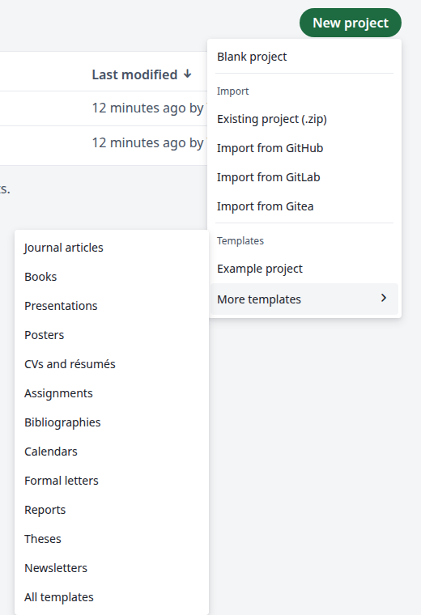
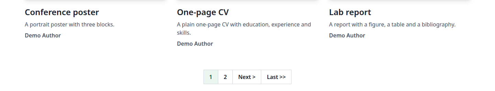

模板是管理员发布的项目。打开一个模板会为你创建一个属于自己的新项目。

<Info>

如果你看不到 **Templates** 链接，请让管理员开启[模板库](/zh-CN/on-premises/configuration/overleaf-toolkit/templates)。

</Info>

## 打开模板库 {#open-the-gallery}

在项目页面上，点击右上角的 **Templates**。

<Frame caption="Templates 链接">
  
</Frame>

**All templates** 页面随即打开，最近更新的模板排在最前面。

<Frame caption="所有模板">
  
</Frame>

如果你还没有项目，请在欢迎页面上点击 **Browse templates**。

<Frame caption="欢迎页面">
  
</Frame>

如果你已有项目，也可以点击 **New project**，然后点击 **More templates**，再选择一个分类。

<Frame caption="More templates">
  
</Frame>

默认情况下，模板库需要登录：如果有人给你发送了模板链接而你尚未登录，你会先进入登录页面，然后再进入该模板。

## 查找模板 {#find-a-template}

在框中**搜索**。列表会随着你的输入更新，并匹配标题、作者和描述。如果没有匹配项，页面会显示 <strong>No Templates.</strong>

<Frame caption="搜索 slides">
  
</Frame>

使用列表右上方的 **Last Updated** 或 **Title** 进行**排序**。再次点击当前使用的排序方式可反转顺序。

在列表下方**翻页**。每页显示九个模板。

<Frame caption="翻页按钮">
  
</Frame>

<strong>按分类浏览：</strong>在 **All templates** 页面点击 **Template Gallery**。模板库页面为每个分类显示一张卡片，所有模板列在卡片下方。

<Frame caption="分类">
  
</Frame>

点击卡片即可查看该分类的模板。你在这里同样可以搜索和排序，点击 **All templates** 可返回。

<Frame caption="分类页面">
  
</Frame>

## 将模板作为新项目打开 {#open-a-template-as-a-new-project}

<Steps>
<Step title="打开模板">
点击一个模板。你会看到其第一页的预览、作者、最后更新时间、许可证和摘要。

<Frame caption="模板页面">
  
</Frame>

**View PDF** 会打开完整的 PDF。旁边的按钮会将文件下载为 zip。
</Step>

<Step title="点击 Open as Template">
经过短暂的加载画面后，编辑器会打开你的新项目。

<Frame caption="你的新项目">
  
</Frame>
</Step>

<Step title="检查项目">
项目使用模板的名称和文件，以及相同的编译器和主文档。它在打开时会自动编译，在项目列表中你是它的所有者。

再次打开同一个模板会创建另一个项目，例如 `Journal article (1)`。

<Frame caption="每次打开都会创建一个项目">
  
</Frame>
</Step>
</Steps>

你的项目不依赖于模板：模板更新或删除时，你的项目保持不变。

<Info>

普通账户无法发布或修改模板：**File** 菜单中没有 **Manage Template**，模板页面上也没有 **Edit** 或 **Delete**。要将模板添加到模板库，请联系管理员。

</Info>
