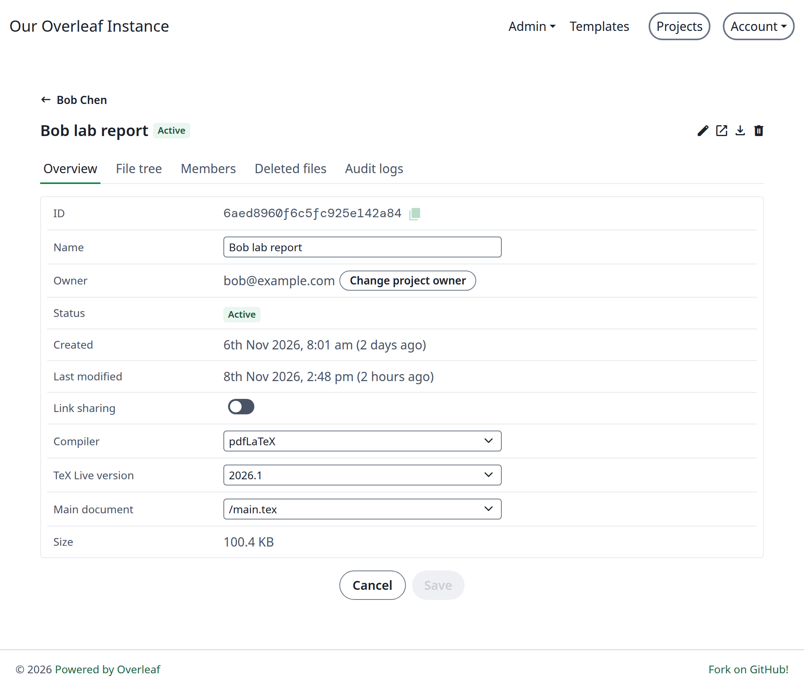

为实验室或院系运行 Overleaf 实例，每周都会遇到同样的问题。这位学生为什么无法登录？谁还在使用服务器？是谁给那个账户授予了管理员权限？去年的那篇论文去哪了？我们重建了管理面板，让你无需打开数据库 shell 就能回答这些问题。

新面板沿用 Overleaf 6.3 的外观，并已翻译成界面支持的所有语言。它提供一个包含所有用户的列表、一个包含所有项目的列表、每个用户和项目各自的页面、一个管理模板的地方，以及审计日志。

<Info>

新管理面板已合并到我们的主分支，并将在 v6.4.0 中正式发布。本文中的所有截图均来自一个填充了虚构账户的测试实例。

</Info>

### 包含哪些内容 {#what’s-in-it}

* **用户列表**：搜索、按登录方式、角色和状态筛选，以及批量操作。
* **用户页面**：一个人的账户、项目、功能、集成、审计日志和会话。
* **项目列表**：实例上的所有项目，可按名称、ID、所有者或共享链接搜索。
* **项目页面**：一个项目的设置、文件、成员、已删除文件和审计日志。
* **模板管理**：将项目发布为模板、更新模板，并让模板库保持整洁。
* **审计日志**：谁在什么时间、从哪个 IP 地址做了什么。

## 一个列表涵盖所有用户 {#one-list-for-every-user}

点击 **Admin**，然后点击 **Manage Users**。每个账户占一行，显示其登录方式、角色和状态。

<Frame caption="用户列表">
  
</Frame>

可按姓名、邮箱或 ID 搜索。**Login**、**Role** 和 **Status** 表头都是筛选器，每个选项都会显示它将返回多少个账户。你可以一眼看出有多少人通过 SAML 登录，而每个 OIDC 提供商都以你为它设定的名称显示。

<Frame caption="按登录方式筛选">
  
</Frame>

每个账户恰好有一个状态，四种状态加起来等于总数。

| 状态         | 含义                                       |
| ------------ | ------------------------------------------ |
| **Active**   | 在过去 12 个月内登录过或打开过项目。       |
| **Pending**  | 从未登录过。                               |
| **Inactive** | 以前登录过，但在过去 12 个月内没有登录。   |
| **Disabled** | 管理员已禁止该账户登录。                   |

已删除的账户放在单独的筛选器中，不会碍事。如果搜索结果也匹配到已删除的账户，表格上方会有一行提示，并提供显示它的选项。

<Frame caption="按状态筛选">
  
</Frame>

搜索、排序和分页都在服务器端运行，因此列表不再只显示前 1,000 行。

### 有无邮件都能添加用户 {#bring-people-in-with-or-without-email}

**Create account** 会添加一个用户，并给你对方所需的链接。如果没有配置[邮件发送](/zh-Hans/on-premises/configuration/overleaf-toolkit/email-delivery  "mention")，对话框会明确说明，并让你复制链接，因此即使是小型实例也能为新用户开通账户。

<Frame caption="新账户的激活链接">
  
</Frame>

面板会为每个账户提供合适的链接：对从未登录过的账户提供 **Send activation email**，有效期 7 天；对已经登录过的账户提供 **Send reset link**，有效期 1 小时。通过 SSO 登录的账户没有本地密码，因此两者都不会提供。

### 一次修改多个账户 {#change-many-accounts-at-once}

勾选一些账户后，工具栏会提供 **Send activation email**、**Transfer this user's projects**、**Disable**、**Enable**、**Make admin**、**Remove admin** 和 **Delete account**。在你确认之前，对话框会列出这些账户。如果其中一些失败，它会告诉你是哪些，而已经成功的操作保持完成。

<Frame caption="批量操作">
  
</Frame>

### 不容易出错 {#hard-to-get-wrong}

* 你自己的账户标有 **You**，其操作呈灰色，因此你无法禁用、删除或降级自己。
* 每个操作都需要在一个注明账户的对话框中确认。
* **Delete account** 可以先把该用户的项目转交给其他人。
* 已删除的账户可以恢复，连同随它一起删除的项目。只有 **Delete permanently** 是不可逆的，并且会提醒你。

## 关于一个人的一切 {#everything-about-one-person}

点击姓名即可打开该用户的页面。页面有六个选项卡，以及与列表相同的操作图标。

### 账户 {#account}

账户的详细信息，从 ID 和邮箱到最后一次登录及其 IP 地址。点击铅笔图标可以修改邮箱、姓名或密码，或者打开或关闭 **Admin**。

<Frame caption="编辑账户">
  
</Frame>

### 项目 {#projects}

此人拥有的项目，带有独立的搜索、状态筛选和操作。

<Frame caption="用户的项目">
  
</Frame>

### 功能 {#features}

该账户启用了哪些功能，例如每个项目的协作者数量、编译超时、集成和 AI，以及该账户的 AI 用量和一个重置用量的按钮。

<Frame caption="用户的功能">
  
</Frame>

### 集成 {#integrations}

此人的 Git 访问令牌以及已关联的服务。

<Frame caption="用户的集成">
  
</Frame>

### 会话 {#sessions}

此人在哪些地方登录。**Clear sessions** 会让其在所有地方登出，笔记本电脑丢失时首先要做的就是这件事。

<Frame caption="用户的会话">
  
</Frame>

## 实例上的所有项目 {#every-project-on-the-instance}

点击 **Admin**，然后点击 **Project/Object Lookup**。列表显示所有用户的项目及其所有者和状态。搜索框可以输入项目名称、项目 ID、所有者或链接。粘贴一个共享链接，就能找到它背后的项目。

<Frame caption="所有项目">
  
</Frame>

**Status** 筛选器区分 **Active**、**Archived**、**Trashed** 和 **Deleted** 项目。勾选多个项目，可以将它们下载为一个 `.zip` 文件、更改所有者或删除它们。在 **Deleted** 视图中，按钮为 **Restore** 和 **Delete permanently**。

<Frame caption="按状态筛选项目">
  
</Frame>

## 关于一个项目的一切 {#everything-about-one-project}

点击项目标题即可打开其页面。

### 概览 {#overview}

修改名称、链接共享、编译器、TeX Live 版本和主文档。**Change project owner** 会把项目交给另一个用户，当有人离开实验室而其论文需要保留时，这非常有用。

<Frame caption="编辑项目">
  
</Frame>

### 文件树 {#file-tree}

项目的文件和文件夹，只读。

<Frame caption="项目的文件">
  
</Frame>

### 成员 {#members}

所有者、协作者和待处理的邀请。你可以更改协作者的角色、移除其访问权限，或者重新发送或撤销邀请。

<Frame caption="更改项目的成员">
  
</Frame>

### 已删除文件 {#deleted-files}

从项目中移除的文件。**Restore file** 会在项目根文件夹中放入一份副本，该行会显示副本的名称。

<Frame caption="已恢复的文件">
  
</Frame>

## 模板管理 {#template-management}

模板最初就是一个普通项目。你从编辑器中发布它，然后在模板库中它的页面上或在管理面板中管理它。

### 一张表格涵盖所有模板 {#all-templates-in-one-table}

点击 **Admin**，然后点击 **Project/Object Lookup**，再点击 **Templates** 选项卡。它列出所有已发布的模板及其作者、所有者和最后修改时间，并且可以搜索。点击标题可打开模板，点击所有者可打开该用户的页面，点击垃圾桶图标可删除模板。删除操作会记录在[你自己的审计日志](#when-there-is-no-log-left)中。

<Frame caption="管理面板中的所有模板">
  
</Frame>

### 从编辑器发布 {#publish-from-the-editor}

打开一个项目并编译，直到 PDF 看起来正确，因为模板库显示的是最后一次成功编译的 PDF。然后点击 **File**，再点击 **Manage Template**，填写标题、作者、类别、Markdown 格式的描述和许可证。项目的编译器和主文档会随模板一起保存，因此从模板打开的项目也使用相同的设置。

<Frame caption="将项目发布为模板">
  
</Frame>

### 更新模板 {#update-a-template}

要更改模板的文件和 PDF，请以相同标题再次发布该项目。对话框会提示该标题已存在，按钮会变为 **Overwrite**。已经有人从该模板打开的项目不会改变。

<Frame caption="以相同标题发布">
  
</Frame>

### 模板页面 {#the-template-page}

所有人都可以使用 **Open as Template**、**View PDF** 和下载按钮。管理员还可以使用 **Admin: Source Project**、**Edit** 和 **Delete**。

<Frame caption="模板的页面">
  
</Frame>

**Edit** 用于更改模板库中显示的模板信息：标题、作者、类别、描述和许可证，以及从模板打开的项目的拼写检查语言。它不会改动文件或 PDF。模板保留自己的一份文件副本，因此删除源项目不会连带删除模板。

<Frame caption="编辑模板的详细信息">
  
</Frame>

### 面向用户的模板库 {#a-gallery-for-your-users}

模板库打开时会为每个类别显示一张卡片，每个类别都有自己的页面。类别来自你的[模板](/zh-Hans/on-premises/configuration/overleaf-toolkit/templates  "mention")配置，你还可以在那里允许非管理员用户发布模板。

<Frame caption="模板库">
  
</Frame>

**All templates** 页面会显示每个模板及其首页预览，用户可以搜索，并按标题或日期排序。

<Frame caption="所有模板">
  
</Frame>

## 审计日志：谁在什么时候做了什么 {#audit-logs-who-did-what-and-when}

这是我们最满意的部分。现在每个账户和每个项目都有自己的审计日志，站点管理员可以直接在面板中查看。

在用户页面上打开 **Audit logs** 选项卡。最新的条目排在最前面。

<Frame caption="账户的审计日志">
  
</Frame>

从下往上读，这一页讲述了一个故事。Lena 登录了。一位管理员把她的编译超时提高到 300 秒，关闭了她的 AI 访问权限，给她发送了密码重置链接，把她设为管理员后又撤销，然后禁用并重新启用了该账户。Lena 再次登录，管理员清除了她的会话。

| 列             | 告诉你什么                                                         |
| -------------- | ------------------------------------------------------------------ |
| **Date**       | 发生的时间。                                                       |
| **Operation**  | 发生了什么。                                                       |
| **Initiator**  | 谁做的。管理员对账户进行的操作显示的是管理员，而不是该用户。       |
| **IP Address** | 请求来自哪里。                                                     |
| **Info**       | 详细信息，例如新的编译超时，或者邮件是否真的已发出。               |

### 找到你需要的条目 {#find-the-entry-you-need}

可按操作或 IP 地址搜索。**Operation** 表头是一个筛选器，列出此日志中的每种操作及其发生次数。

<Frame caption="按操作筛选">
  
</Frame>

### 每个项目都有日志 {#a-log-for-every-project}

项目页面也有同样的选项卡。它显示谁被邀请、谁加入了、谁的角色发生了变化、谁下载了项目以及谁接手了项目。

<Frame caption="项目的审计日志">
  
</Frame>

### 会记录哪些内容 {#what-gets-recorded}

以下是每种日志中的主要操作，名称与你在面板中看到的一致。

| 日志 | 范围           | 操作                                                                                                                                                                                                                                        |
| ---- | -------------- | ------------------------------------------------------------------------------------------------------------------------------------------------------------------------------------------------------------------------------------------- |
| 账户 | 登录和密码     | Login, Logout, Failed password match, Update password, Reset password                                                                                                                                                                       |
| 账户 | 邮箱和 SSO     | Add email, Remove email, Change primary email, Link SSO, Unlink SSO                                                                                                                                                                         |
| 账户 | 集成           | Link GitHub, Unlink GitHub, Link Dropbox, Unlink Dropbox, Integration account linked, Integration account unlinked, Create Git token, Delete Git token                                                                                      |
| 账户 | 管理员操作     | Create account, Send activation email, Send password reset email, Change name, Change admin access, Change features, Change AI features, Reset AI usage, Account suspension, Account reactivation, Clear sessions, Transfer projects, Delete account, Restore account |
| 项目 | 共享           | Send invite, Resend invite, Revoke invite, Accept invite, Join via token, Accept via link sharing, Remove collaborator, Leave project, Project role changed, Toggle access level, Transfer ownership                                       |
| 项目 | 文件           | Project downloaded, Project exported docx, Project exported markdown, Project exported html, Restore deleted doc                                                                                                                            |
| 项目 | 管理员操作     | Project deleted, Project restored                                                                                                                                                                                                           |
| 项目 | Git 同步       | Integration repo linked, Integration repo unlinked                                                                                                                                                                                          |

### 当日志已不复存在时 {#when-there-is-no-log-left}

**Delete permanently** 会将账户或项目连同其日志一起删除，而模板本来就没有日志。因此，这些操作会写入执行操作的管理员自己的日志，并附上被删除对象的邮箱或 ID。

<Frame caption="记录在管理员自己日志中的永久删除">
  
</Frame>

### 须知 {#good-to-know}

* 条目保留两年半，之后 MongoDB 会自动删除它们。
* 在反向代理之后，请设置 [`OVERLEAF_TRUSTED_PROXY_IPS`](/zh-Hans/on-premises/configuration/overleaf-toolkit/environment-variables  "mention")，使日志显示访问者的地址，而不是代理的地址。
* 目前并非所有操作都会被记录。Git clone 和 push、对项目设置（如名称或编译器）的修改，以及所有者创建、归档、移入回收站或删除的项目，都不会出现在项目日志中。

## 试一试 {#try-it}

新面板随 Ayakaleaf Pro v6.4.0 一起发布。分步指南已经上线：

* [用户管理](/zh-Hans/on-premises/user-guide/administrators/user-management  "mention")
* [项目管理](/zh-Hans/on-premises/user-guide/administrators/project-management  "mention")
* [模板管理](/on-premises/user-guide/administrators/template-management  "mention")

如果有遗漏，或者某些功能与你的预期不符，请在 [GitHub](https://github.com/ayaka-notes/ayakaleaf-pro/issues) 上告诉我们。
