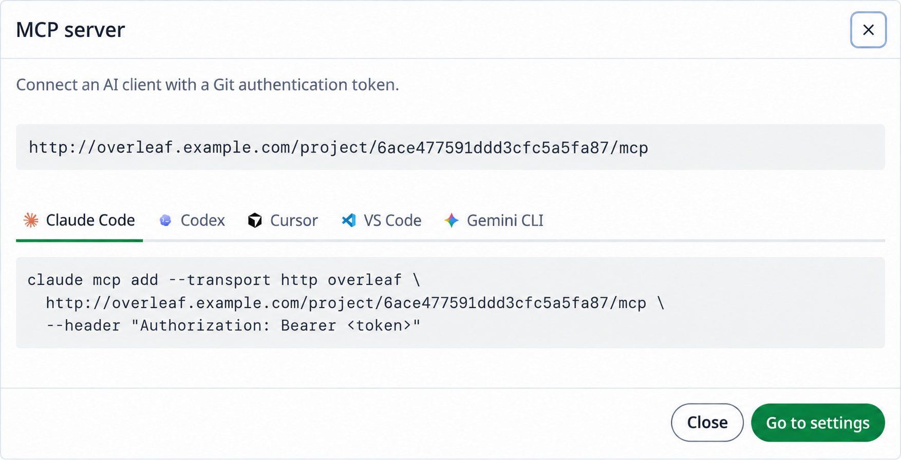

每个项目都有一个 MCP 服务器，因此 Claude Code、Codex、Cursor、VS Code 或 Gemini CLI 等 AI 客户端可以处理该项目：读取和编辑其文件、编译项目、读取 LaTeX 日志、下载 PDF 以及回复评论。 从 v6.3.3 起，它们还可以浏览历史记录并恢复版本、审阅修订、添加评论、使用项目聊天以及移动文件。

<Info>

此功能由 [ayaka-notes/ayakaleaf-pro](https://github.com/ayaka-notes/ayakaleaf-pro) 开发。它自 v6.3.1 起引入。 历史记录、修订、项目聊天、新评论和移动文件的工具从 v6.3.3 起提供，参见 [v6.3.3 新增功能](/zh-Hans/on-premises/user-guide/users/mcp-server#new-in-v6.3.3)。

</Info>

<Columns cols={2}>
<Column>

<Frame>
  
</Frame>

</Column>

<Column>

<Frame>
  
</Frame>

</Column>
</Columns>

### 设置 {#setup}

MCP 服务器随 Git 集成一起提供：启用 [git-bridge](/zh-Hans/on-premises/configuration/overleaf-toolkit/integrations/git-integration) 后，MCP 服务器也随之可用。无需其他配置。

### 连接 AI 客户端 {#connect-an-ai-client}

1. 在 **Account Settings** 中生成一个 Git 身份验证令牌。MCP 服务器和 Git 使用同一个令牌。
2. 在编辑器中打开 **Integrations**，然后点击 **MCP server**。它会显示项目 MCP 服务器的地址 `https://<your-overleaf>/project/<project_id>/mcp`，以及如何将其添加到各个 AI 客户端：复制命令，并将 `<token>` 替换为你的令牌。

令牌以 HTTP 请求头 `Authorization: Bearer <token>` 的形式发送。例如，Claude Code 的命令为：

```bash
claude mcp add --transport http overleaf \
  https://<your-overleaf>/project/<project_id>/mcp \
  --header "Authorization: Bearer <token>"
```

### 使用 {#usage}

连接完成后，用自然语言向 AI 客户端提出请求即可。例如：

| 你的请求 | AI 客户端使用的工具 |
| --- | --- |
| _修正引言中的拼写错误。_ | `read_file`、`edit_file`：编辑会实时显示在编辑器中 |
| _编译项目并修复 LaTeX 错误。_ | `compile`、`get_compile_log`、`edit_file` |
| _回复未解决的评论，然后将其标记为已解决。_ | `list_comments`、`reply_to_comment`、`resolve_comment` |
| _切换到 XeLaTeX 并下载 PDF。_ | `update_settings`、`compile`、`get_output_file_link` |
| _以修订方式重写摘要。_ | `read_file`、带 `trackChanges` 的 `edit_file`（v6.3.3） |
| _自提交的版本以来有哪些变化？_ | `list_versions`、`list_changes`、`diff`（v6.3.3） |
| _把各章移到名为 chapters 的文件夹中。_ | `move_file`（v6.3.3） |

### 工具 {#tools}

| 分组 | 工具 |
| --- | --- |
| 项目 | `get_clone_info`, `get_settings`, `update_settings` |
| 文件 | `list_files`, `read_file`, `edit_file`, `write_file`, `delete_file`, `move_file`, `create_folder` |
| 编译 | `compile`, `get_compile_log`, `get_output_file_link`, `word_count` |
| 评论 | `list_comments`, `reply_to_comment`, `resolve_comment`, `reopen_comment`, `add_comment`, `edit_comment_message`, `delete_comment_message` |
| 修订 | `list_tracked_changes`, `accept_tracked_changes`, `reject_tracked_changes` |
| 历史记录 | `list_versions`, `list_changes`, `diff`, `create_version`, `delete_version`, `restore_file`, `restore_project` |
| 聊天 | `list_chat_messages`, `send_chat_message` |

v6.3.3 有 33 个工具；设置 `OVERLEAF_DISABLE_CHAT=true` 会移除聊天工具，剩下 31 个。v6.3.1 和 v6.3.2 有另外 17 个：即上表中除 `move_file`、`create_folder`、`add_comment`、`edit_comment_message`、`delete_comment_message`、修订工具、聊天工具以及 `list_versions` 以外的历史记录工具之外的全部工具。在 v6.3.3 中，`read_file` 还能读取历史记录中某个版本的文件，`edit_file` 和 `write_file` 支持 `trackChanges`，`update_settings` 还能设置拼写检查语言。

通过 `edit_file`、`write_file` 和 `move_file` 进行的编辑会实时显示在编辑器中，并与协作者的编辑合并。若要一次处理大量文件或二进制文件，AI 客户端也可以用 Git 克隆项目并推送。

使用 `trackChanges` 时，对现有文件的编辑会成为令牌所属用户的修订，即使项目中关闭了修订功能也是如此；新文件永远不会成为修订。不使用 `trackChanges` 时，编辑遵循项目的修订设置。

### 权限 {#permissions}

与 Git 一样，MCP 服务器遵循项目的共享设置：

* 所有能查看项目的人都可以读取项目、编译项目并下载其输出。
* 只有所有者和编辑者可以更改其文件和设置、恢复版本，以及接受或拒绝修订。
* 审阅者还可以添加评论并回复评论，解决、重新打开或删除自己发起的评论，以及保存版本。他们不能编辑文件，即使以修订方式也不行。
* 每个人只能编辑自己的评论消息，审阅者也只能删除自己的消息。
* 只有所有者可以删除他人保存的版本。
* 通过链接加入的查看者看不到评论、修订、历史记录和聊天，与编辑器中一致。受邀的查看者可以看到这些内容并使用聊天。
* 如果项目所有者没有 **Full project history**，历史记录工具只显示最近 24 小时的更改，与历史记录面板相同。管理员可以看到全部。

用户指南中有一张表，列出了每个角色可以做什么，参见 [谁可以做什么](/zh-Hans/on-premises/user-guide/users/mcp-server#who-may-do-what)。

### 问答 {#q&a}

<Accordion title="编辑器中看不到 Integrations 或 MCP server">

<strong>回答：</strong>MCP 服务器没有自己专用的环境变量。它通过 `config/overleaf.rc` 中的 `GIT_BRIDGE_ENABLED=true` 启用，参见 [Git 集成](/zh-Hans/on-premises/configuration/overleaf-toolkit/integrations/git-integration)。修改后，请运行 `bin/up -d`。如果没有 git-bridge，编辑器的左侧栏中不会显示 **Integrations** 选项卡。

</Accordion>

<Accordion title="AI 客户端提示“Track changes is off for this project”">

<strong>回答：</strong> 客户端请求了修订，但项目所有者的账户没有修订功能。依次点击 **Admin** 和 **Manage Users**，打开该所有者，在 **Features** 标签页中开启 **Track changes**，参见 [Features](/zh-Hans/on-premises/user-guide/administrators/user-management#features)。不带 `trackChanges` 的编辑仍可正常使用。

</Accordion>

<Accordion title="AI 客户端只能看到最近 24 小时的更改">

<strong>回答：</strong> 项目所有者的账户没有完整的项目历史记录，因此历史记录工具显示的内容与历史记录面板相同：最近 24 小时的更改。依次点击 **Admin** 和 **Manage Users**，打开该所有者，在 **Features** 标签页中开启 **Full project history**，参见 [Features](/zh-Hans/on-premises/user-guide/administrators/user-management#features)。

</Accordion>
