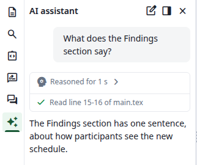
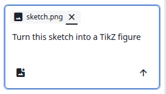

助手基于你当前打开的项目工作。它会阅读你的文档并建议修改，由你逐一应用或拒绝。截图中的回答仅为示例：你得到的回答取决于你的站点所使用的模型。

<Info>

如果左侧栏中没有 **AI assistant**，请让管理员参阅 [AI 集成](/zh-Hans/on-premises/configuration/overleaf-toolkit/integrations/ai-integration)。

</Info>

## 开始对话 {#start-a-chat}

<Steps>
<Step title="打开助手">
在编辑器左侧栏中点击 **AI assistant**。面板会在编辑器旁打开。
</Step>

<Step title="接受条款">
第一次使用时，面板会显示 AI 功能的条款。点击 **Accept and continue**。此操作只需一次，并且同样适用于[错误助手](/zh-Hans/on-premises/user-guide/users/error-assistant)。

<Frame caption="条款只显示一次">
  
</Frame>
</Step>

<Step title="提问">
在 <strong>What would you like to do?</strong> 中输入内容并按回车，或点击箭头。你也可以点击 **Start a chat** 下的建议。每次对话的建议都会变化；如果上次编译有错误，还会出现 **Fix the compile errors**。

<Frame caption="空白对话">
  
</Frame>
</Step>

<Step title="阅读回答">
助手执行的操作会以行的形式显示在一个框中，例如 **Read line 15-16 of main.tex**，步骤完成后会带有勾号。随后是回答。如果模型分享了推理过程，点击 **Reasoned for 1 s** 即可查看。

<Frame caption="一个问题及其回答">
  
</Frame>
</Step>
</Steps>

## 针对选中的行提问 {#ask-about-selected-lines}

在编辑器中选中若干行。消息框上方会出现类似 `main.tex: 16` 的标签，选中的文本会随消息一起发送。在空白对话中，建议会针对所选内容，例如 **Make it shorter**。

<Frame caption="选中的一行">
  
</Frame>

## 审阅建议的修改 {#review-a-suggested-edit}

在你应用之前，修改不会进入文档。

<Steps>
<Step title="阅读建议">
名为 **Edit line 16** 的框会显示原因、行号和修改内容：旧文本带删除线，新文本高亮显示。此时文档尚未改变。**Show result** 只显示新文本，**Show diff** 则切换回来。

<Frame caption="等待你决定的修改">
  
</Frame>
</Step>

<Step title="应用">
点击 **Apply**。修改会出现在编辑器中，框上出现勾号，助手继续工作。如果修改位于另一个文档，该文档会被打开。

<Frame caption="修改已应用">
  
</Frame>
</Step>

<Step title="改变主意时撤回">
**Undo** 会将修改从文档中撤回，**Apply** 会重新应用。助手不会得知这两种操作。
</Step>
</Steps>

### 拒绝修改 {#reject-an-edit}

点击 **Reject**。文档保持不变，框中显示 <strong>The user declined this edit.</strong>，助手会在知道你已拒绝的情况下继续工作。按钮会消失，因此如需找回该修改，请重新提问。

如果你没有做出决定而是发送了新消息，该修改不会被应用，框中会注明这一点。

<Frame caption="一个被拒绝的修改和一个未决定的修改">
  
</Frame>

## 助手在项目中能做什么 {#what-the-assistant-can-do-in-a-project}

只有修改需要等待你的决定。其他步骤在助手执行时会立即运行。

| 对话中的行 | 作用 |
| -------------------- | ------------ |
| **Read line 15-16 of main.tex** | 读取文档中的若干行 |
| **Find “schedule” in main.tex** | 在文档中查找文本 |
| **List the project files** | 列出项目文件 |
| **Create appendix.tex** | 创建一个空文档并打开 |
| **Edit line 16** | 建议一处修改，见上文 |
| **Compile** | 编译项目 |
| **Check the compile log** | 读取上次编译的错误和警告 |
| **Look at PDF page 1** | 在对话中显示 PDF 的某一页 |
| **Read the PDF structure** | 读取 PDF 的结构 |
| **Switch to xelatex** | 更改项目的编译器，与 **Settings** 中相同 |
| <strong>Search the web for “...”</strong> | 搜索网络 |
| <strong>Search the help pages for “...”</strong> | 搜索帮助页面 |

<Frame caption="一个新文件，然后是另一个文档中的修改">
  
</Frame>

<Frame caption="一次编译和 PDF 的一页">
  
</Frame>

搜索行会显示找到的结果数。点击它即可列出结果。搜索是否可用取决于你的站点，参见[可选搜索服务](/zh-Hans/on-premises/configuration/overleaf-toolkit/integrations/ai-integration#optional-search-services)。

<Frame caption="搜索结果">
  
</Frame>

**Fix the compile errors** 建议会让助手检查日志并修复发现的问题。它的修复会以修改的形式交给你审阅。

## 附加图片或 PDF {#attach-an-image-or-a-pdf}

在消息框中点击图片图标 **Attach image or PDF**，然后选择文件。文件名会显示在你的文本上方。写好消息后发送。

<Frame caption="附加到消息的文件">
  
</Frame>

面板会以 <strong>Only images and PDF files can be attached.</strong> 拒绝其他文件，并以 <strong>Files must be smaller than 2 MB.</strong> 拒绝过大的文件。

## 停止助手 {#stop-the-assistant}

助手工作时，消息框中的箭头会变成 **Stop** 按钮。点击它。正在运行的步骤会以 <strong>Stopped by the user.</strong> 结束，在你再次发送消息之前不会发生其他操作。

<Frame caption="Stop 按钮">
  
</Frame>

## 如果助手自行停止 {#if-the-assistant-stops-by-itself}

助手针对一条消息能执行的步骤数是有限的。达到上限时，面板会显示 <strong>The assistant used all the steps it may take for one message. Reply to let it carry on.</strong> 回复一下，例如 `Go on`，它就会继续。

<Frame caption="步骤上限">
  
</Frame>

如果面板显示 **Something’s gone wrong**，说明请求失败。请重新发送消息，或点击 **Start new chat**。

## 移动面板与重新开始 {#move-the-panel-and-start-over}

面板顶部有以下按钮：

* **Start new chat** 会清空面板。没有历史对话列表。重新加载页面也会清空对话。
* **Move to the right** 会把面板移到 PDF 右侧，在你使用文件树时它会保持打开。**Move to the left** 会将其移回。对话会保留。
* **Close** 会隐藏面板。点击左侧栏中的 **AI assistant** 即可重新打开，对话仍在。

<Frame caption="位于右侧的面板">
  
</Frame>

## Token 用量 {#token-usage}

助手不会显示你已使用多少 token。如果你的站点设置了限额并且你已达到，下一条消息将不会得到回答。面板会显示 **Usage limit reached** 以及距离可以再次对话还需多久，消息框会变灰。

<Frame caption="已达到限额">
  
</Frame>

新对话会显示同样的通知。重新加载后消息框看起来恢复正常，但下一条消息同样会收到该通知。[错误助手](/zh-Hans/on-premises/user-guide/users/error-assistant)与其共用同一限额，并会在日志条目中显示 **Usage limit reached**。

限额由管理员设置，参见[用量与重置](/zh-Hans/on-premises/configuration/overleaf-toolkit/integrations/ai-integration#usage-and-reset)。
