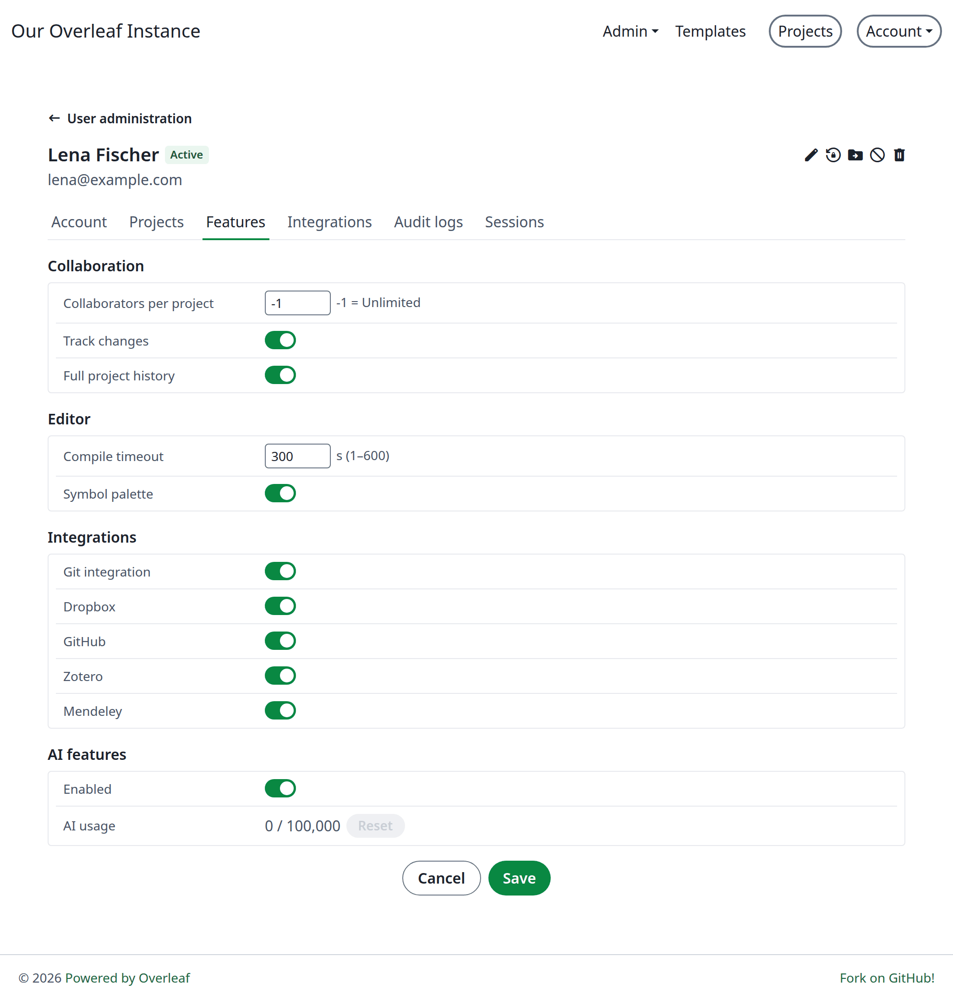
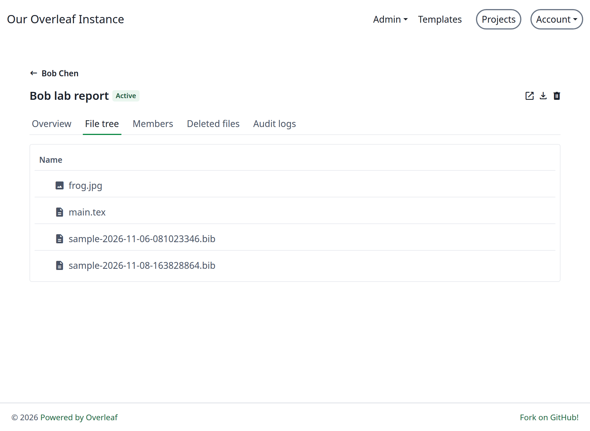
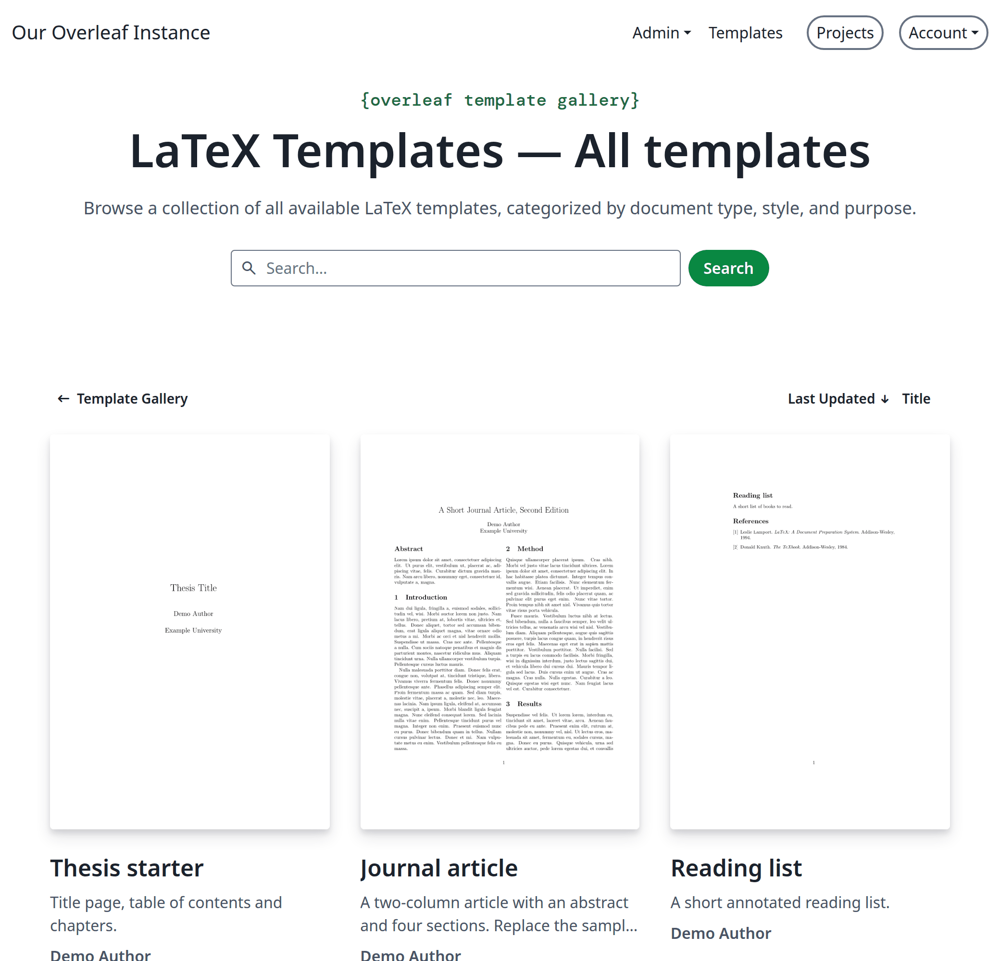

為實驗室或系所營運 Overleaf 執行個體，每週都會遇到同樣的問題。這位學生為什麼無法登入？誰還在使用伺服器？是誰給了那個帳戶管理員權限？去年的那篇論文到哪裡去了？我們重新打造了管理面板，讓你不必開啟資料庫 shell 就能回答這些問題。

新面板沿用 Overleaf 6.3 的外觀，並已翻譯成介面支援的所有語言。它提供一份包含所有使用者的清單、一份包含所有專案的清單、每位使用者和每個專案各自的頁面、一個管理範本的地方，以及稽核日誌。

<Info>

新管理面板已合併到我們的主分支，並將於 v6.4.0 正式發布。本文中的所有截圖都來自一個填滿虛構帳戶的測試執行個體。

</Info>

### 包含哪些內容 {#what’s-in-it}

* **使用者清單**：搜尋、依登入方式、角色和狀態篩選，以及批次操作。
* **使用者頁面**：一個人的帳戶、專案、功能、整合、稽核日誌和工作階段。
* **專案清單**：執行個體上的所有專案，可依名稱、ID、擁有者或分享連結搜尋。
* **專案頁面**：一個專案的設定、檔案、成員、已刪除檔案和稽核日誌。
* **範本管理**：將專案發布為範本、更新範本，並讓範本庫保持井然有序。
* **稽核日誌**：誰在何時、從哪個 IP 位址做了什麼。

## 一份清單涵蓋所有使用者 {#one-list-for-every-user}

點選 **Admin**，然後點選 **Manage Users**。每個帳戶占一列，顯示其登入方式、角色和狀態。

<Frame caption="使用者清單">
  
</Frame>

可依姓名、電子郵件或 ID 搜尋。**Login**、**Role** 和 **Status** 欄位標題都是篩選器，每個選項都會顯示它將傳回多少個帳戶。你可以一眼看出有多少人透過 SAML 登入，而每個 OIDC 提供者都會以你為它設定的名稱顯示。

<Frame caption="依登入方式篩選">
  
</Frame>

每個帳戶恰好有一種狀態，四種狀態加起來就是總數。

| 狀態         | 意義                                         |
| ------------ | -------------------------------------------- |
| **Active**   | 在過去 12 個月內登入過或開啟過專案。         |
| **Pending**  | 從未登入過。                                 |
| **Inactive** | 以前登入過，但過去 12 個月內沒有登入。       |
| **Disabled** | 管理員已禁止此帳戶登入。                     |

已刪除的帳戶放在獨立的篩選器中，不會礙事。如果搜尋結果也符合某個已刪除的帳戶，表格上方會有一行提示，並提供顯示它的選項。

<Frame caption="依狀態篩選">
  
</Frame>

搜尋、排序和分頁都在伺服器端執行，因此清單不再只顯示前 1,000 列。

### 不論有無電子郵件都能加入使用者 {#bring-people-in-with-or-without-email}

**Create account** 會新增一位使用者，並提供對方所需的連結。若尚未設定[電子郵件傳送](/zh-Hant/on-premises/configuration/overleaf-toolkit/email-delivery  "mention")，對話方塊會清楚說明，並讓你複製連結，因此即使是小型執行個體也能為新使用者開通帳戶。

<Frame caption="新帳戶的啟用連結">
  
</Frame>

面板會為每個帳戶提供合適的連結：對從未登入的帳戶提供 **Send activation email**，有效期 7 天；對已登入過的帳戶提供 **Send reset link**，有效期 1 小時。透過 SSO 登入的帳戶沒有本機密碼，因此兩者都不會提供。

### 一次變更多個帳戶 {#change-many-accounts-at-once}

勾選一些帳戶後，工具列會提供 **Send activation email**、**Transfer this user's projects**、**Disable**、**Enable**、**Make admin**、**Remove admin** 和 **Delete account**。在你確認之前，對話方塊會列出這些帳戶。如果其中一些失敗，它會告訴你是哪些，而已經成功的操作會維持完成。

<Frame caption="批次操作">
  
</Frame>

### 不容易出錯 {#hard-to-get-wrong}

* 你自己的帳戶標示為 **You**，其操作呈灰色，因此你無法停用、刪除或降級自己。
* 每個操作都需要在一個註明帳戶的對話方塊中確認。
* **Delete account** 可以先把該使用者的專案交給其他人。
* 已刪除的帳戶可以還原，連同隨它一起刪除的專案。只有 **Delete permanently** 是無法復原的，而且會提醒你。

## 關於一個人的一切 {#everything-about-one-person}

點選姓名即可開啟該使用者的頁面。頁面有六個分頁，以及與清單相同的操作圖示。

### 帳戶 {#account}

帳戶的詳細資料，從 ID 和電子郵件到最後一次登入及其 IP 位址。點選鉛筆圖示即可變更電子郵件、姓名或密碼，或開啟或關閉 **Admin**。

<Frame caption="編輯帳戶">
  
</Frame>

### 專案 {#projects}

此人擁有的專案，具有獨立的搜尋、狀態篩選和操作。

<Frame caption="使用者的專案">
  
</Frame>

### 功能 {#features}

此帳戶啟用了哪些功能，例如每個專案的協作者數量、編譯逾時、整合和 AI，以及該帳戶的 AI 用量和重設用量的按鈕。

<Frame caption="使用者的功能">
  
</Frame>

### 整合 {#integrations}

此人的 Git 存取權杖以及已連結的服務。

<Frame caption="使用者的整合">
  
</Frame>

### 工作階段 {#sessions}

此人在哪些地方登入。**Clear sessions** 會讓其在所有地方登出，這是筆電遺失時首先要做的事。

<Frame caption="使用者的工作階段">
  
</Frame>

## 執行個體上的所有專案 {#every-project-on-the-instance}

點選 **Admin**，然後點選 **Project/Object Lookup**。清單會顯示所有使用者的專案及其擁有者和狀態。搜尋框可輸入專案名稱、專案 ID、擁有者或連結。貼上一個分享連結，就能找到它背後的專案。

<Frame caption="所有專案">
  
</Frame>

**Status** 篩選器區分 **Active**、**Archived**、**Trashed** 和 **Deleted** 專案。勾選多個專案，即可將它們下載為一個 `.zip` 檔案、變更擁有者或刪除它們。在 **Deleted** 檢視中，按鈕為 **Restore** 和 **Delete permanently**。

<Frame caption="依狀態篩選專案">
  
</Frame>

## 關於一個專案的一切 {#everything-about-one-project}

點選專案標題即可開啟其頁面。

### 概觀 {#overview}

變更名稱、連結分享、編譯器、TeX Live 版本和主文件。**Change project owner** 會把專案交給另一位使用者，當有人離開實驗室而其論文必須保留時，這非常實用。

<Frame caption="編輯專案">
  
</Frame>

### 檔案樹 {#file-tree}

專案的檔案和資料夾，唯讀。

<Frame caption="專案的檔案">
  
</Frame>

### 成員 {#members}

擁有者、協作者和待處理的邀請。你可以變更協作者的角色、移除其存取權，或重新傳送或撤銷邀請。

<Frame caption="變更專案的成員">
  
</Frame>

### 已刪除檔案 {#deleted-files}

從專案中移除的檔案。**Restore file** 會在專案根資料夾中放入一份副本，該列會顯示副本的名稱。

<Frame caption="已還原的檔案">
  
</Frame>

## 範本管理 {#template-management}

範本一開始只是個普通專案。你從編輯器發布它，然後在範本庫中它的頁面上或在管理面板中管理它。

### 一張表格涵蓋所有範本 {#all-templates-in-one-table}

點選 **Admin**，然後點選 **Project/Object Lookup**，再點選 **Templates** 分頁。它會列出所有已發布的範本及其作者、擁有者和最後修改時間，並且可以搜尋。點選標題可開啟範本，點選擁有者可開啟該使用者的頁面，點選垃圾桶圖示可刪除範本。刪除操作會記錄在[你自己的稽核日誌](#when-there-is-no-log-left)中。

<Frame caption="管理面板中的所有範本">
  
</Frame>

### 從編輯器發布 {#publish-from-the-editor}

開啟一個專案並編譯，直到 PDF 看起來正確，因為範本庫顯示的是最後一次成功編譯的 PDF。接著點選 **File**，再點選 **Manage Template**，填寫標題、作者、類別、Markdown 格式的說明和授權條款。專案的編譯器和主文件會隨範本一起保存，因此從範本開啟的專案也會使用相同的設定。

<Frame caption="將專案發布為範本">
  
</Frame>

### 更新範本 {#update-a-template}

若要變更範本的檔案和 PDF，請以相同標題再次發布該專案。對話方塊會告訴你此標題已存在，按鈕會變成 **Overwrite**。已經有人從該範本開啟的專案不會改變。

<Frame caption="以相同標題發布">
  
</Frame>

### 範本頁面 {#the-template-page}

所有人都可以使用 **Open as Template**、**View PDF** 和下載按鈕。管理員另外還有 **Admin: Source Project**、**Edit** 和 **Delete**。

<Frame caption="範本的頁面">
  
</Frame>

**Edit** 用於變更範本庫中顯示的範本資訊：標題、作者、類別、說明和授權條款，以及從範本開啟的專案的拼字檢查語言。它不會更動檔案或 PDF。範本會保留自己的一份檔案副本，因此刪除來源專案不會連帶刪除範本。

<Frame caption="編輯範本的詳細資料">
  
</Frame>

### 為使用者準備的範本庫 {#a-gallery-for-your-users}

範本庫開啟時會為每個類別顯示一張卡片，每個類別都有自己的頁面。類別來自你的[範本](/zh-Hant/on-premises/configuration/overleaf-toolkit/templates  "mention")設定，你也可以在那裡允許非管理員的使用者發布範本。

<Frame caption="範本庫">
  
</Frame>

**All templates** 頁面會顯示每個範本及其首頁預覽，使用者可以搜尋，並依標題或日期排序。

<Frame caption="所有範本">
  
</Frame>

## 稽核日誌：誰在何時做了什麼 {#audit-logs-who-did-what-and-when}

這是我們最滿意的部分。現在每個帳戶和每個專案都有自己的稽核日誌，網站管理員可以直接在面板中閱讀。

在使用者頁面上開啟 **Audit logs** 分頁。最新的項目排在最前面。

<Frame caption="帳戶的稽核日誌">
  
</Frame>

由下往上讀，這一頁講述了一個故事。Lena 登入了。一位管理員把她的編譯逾時提高到 300 秒，關閉了她的 AI 存取權，寄給她密碼重設連結，把她設為管理員後又撤銷，接著停用並重新啟用了該帳戶。Lena 再次登入，管理員清除了她的工作階段。

| 欄位           | 告訴你什麼                                                           |
| -------------- | -------------------------------------------------------------------- |
| **Date**       | 發生的時間。                                                         |
| **Operation**  | 發生了什麼。                                                         |
| **Initiator**  | 誰做的。管理員對帳戶進行的操作會顯示管理員，而不是該使用者。         |
| **IP Address** | 請求來自哪裡。                                                       |
| **Info**       | 詳細資料，例如新的編譯逾時，或電子郵件是否真的已寄出。               |

### 找到你需要的項目 {#find-the-entry-you-need}

可依操作或 IP 位址搜尋。**Operation** 欄位標題是一個篩選器，列出此日誌中的每種操作及其發生次數。

<Frame caption="依操作篩選">
  
</Frame>

### 每個專案都有日誌 {#a-log-for-every-project}

專案頁面也有相同的分頁。它顯示誰被邀請、誰加入了、誰的角色變更了、誰下載了專案，以及誰接手了專案。

<Frame caption="專案的稽核日誌">
  
</Frame>

### 會記錄哪些內容 {#what-gets-recorded}

以下是每種日誌中的主要操作，名稱與你在面板中看到的相同。

| 日誌 | 範圍           | 操作                                                                                                                                                                                                                                        |
| ---- | -------------- | ------------------------------------------------------------------------------------------------------------------------------------------------------------------------------------------------------------------------------------------- |
| 帳戶 | 登入和密碼     | Login, Logout, Failed password match, Update password, Reset password                                                                                                                                                                       |
| 帳戶 | 電子郵件和 SSO | Add email, Remove email, Change primary email, Link SSO, Unlink SSO                                                                                                                                                                         |
| 帳戶 | 整合           | Link GitHub, Unlink GitHub, Link Dropbox, Unlink Dropbox, Integration account linked, Integration account unlinked, Create Git token, Delete Git token                                                                                      |
| 帳戶 | 管理員操作     | Create account, Send activation email, Send password reset email, Change name, Change admin access, Change features, Change AI features, Reset AI usage, Account suspension, Account reactivation, Clear sessions, Transfer projects, Delete account, Restore account |
| 專案 | 分享           | Send invite, Resend invite, Revoke invite, Accept invite, Join via token, Accept via link sharing, Remove collaborator, Leave project, Project role changed, Toggle access level, Transfer ownership                                       |
| 專案 | 檔案           | Project downloaded, Project exported docx, Project exported markdown, Project exported html, Restore deleted doc                                                                                                                            |
| 專案 | 管理員操作     | Project deleted, Project restored                                                                                                                                                                                                           |
| 專案 | Git 同步       | Integration repo linked, Integration repo unlinked                                                                                                                                                                                          |

### 當日誌已不存在時 {#when-there-is-no-log-left}

**Delete permanently** 會將帳戶或專案連同其日誌一起刪除，而範本本來就沒有日誌。因此，這些操作會寫入執行操作的管理員自己的日誌，並附上被刪除對象的電子郵件或 ID。

<Frame caption="記錄在管理員自己日誌中的永久刪除">
  
</Frame>

### 須知 {#good-to-know}

* 項目會保留兩年半，之後 MongoDB 會自動將其刪除。
* 在反向代理之後，請設定 [`OVERLEAF_TRUSTED_PROXY_IPS`](/zh-Hant/on-premises/configuration/overleaf-toolkit/environment-variables  "mention")，讓日誌顯示訪客的位址，而不是代理的位址。
* 目前並非所有操作都會被記錄。Git clone 和 push、專案設定（例如名稱或編譯器）的變更，以及擁有者建立、封存、移至垃圾桶或刪除的專案，都不會出現在專案日誌中。

## 試試看 {#try-it}

新面板隨 Ayakaleaf Pro v6.4.0 一起推出。逐步指南已經上線：

* [使用者管理](/zh-Hant/on-premises/user-guide/administrators/user-management  "mention")
* [專案管理](/zh-Hant/on-premises/user-guide/administrators/project-management  "mention")
* [範本管理](/on-premises/user-guide/administrators/template-management  "mention")

如果有遺漏，或某些功能與你的預期不符，請在 [GitHub](https://github.com/ayaka-notes/ayakaleaf-pro/issues) 上告訴我們。
