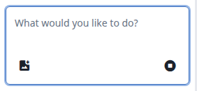

助理會以你目前開啟的專案為對象。它會閱讀你的文件並建議修改，由你逐一套用或拒絕。截圖中的回答僅為範例：你得到的回答取決於你的站台所使用的模型。

<Info>

如果左側欄中沒有 **AI assistant**，請管理員參閱 [AI 整合](/zh-Hant/on-premises/configuration/overleaf-toolkit/integrations/ai-integration)。

</Info>

## 開始對話 {#start-a-chat}

<Steps>
<Step title="開啟助理">
在編輯器左側欄中點擊 **AI assistant**。面板會在編輯器旁開啟。
</Step>

<Step title="接受條款">
第一次使用時，面板會顯示 AI 功能的條款。點擊 **Accept and continue**。此操作只需一次，且同樣適用於[錯誤助理](/zh-Hant/on-premises/user-guide/users/error-assistant)。

<Frame caption="條款只顯示一次">
  
</Frame>
</Step>

<Step title="提問">
在 <strong>What would you like to do?</strong> 中輸入內容並按 Enter，或點擊箭頭。你也可以點擊 **Start a chat** 下的建議。每次對話的建議都會不同；如果上次編譯有錯誤，還會出現 **Fix the compile errors**。

<Frame caption="空白對話">
  
</Frame>
</Step>

<Step title="閱讀回答">
助理執行的動作會以行的形式顯示在一個框中，例如 **Read line 15-16 of main.tex**，步驟完成後會帶有勾號。接著是回答。如果模型分享了推理過程，點擊 **Reasoned for 1 s** 即可查看。

<Frame caption="一個問題及其回答">
  
</Frame>
</Step>
</Steps>

## 針對選取的行提問 {#ask-about-selected-lines}

在編輯器中選取若干行。訊息框上方會出現類似 `main.tex: 16` 的標籤，選取的文字會隨訊息一起送出。在空白對話中，建議會針對選取內容，例如 **Make it shorter**。

<Frame caption="選取的一行">
  
</Frame>

## 審閱建議的修改 {#review-a-suggested-edit}

在你套用之前，修改不會進入文件。

<Steps>
<Step title="閱讀建議">
名為 **Edit line 16** 的框會顯示原因、行號與修改內容：舊文字帶刪除線，新文字醒目標示。此時文件尚未改變。**Show result** 只顯示新文字，**Show diff** 則切換回來。

<Frame caption="等待你決定的修改">
  
</Frame>
</Step>

<Step title="套用">
點擊 **Apply**。修改會出現在編輯器中，框上出現勾號，助理繼續工作。如果修改位於另一份文件，該文件會被開啟。

<Frame caption="修改已套用">
  
</Frame>
</Step>

<Step title="改變主意時復原">
**Undo** 會將修改從文件中撤回，**Apply** 會重新套用。助理不會得知這兩種操作。
</Step>
</Steps>

### 拒絕修改 {#reject-an-edit}

點擊 **Reject**。文件保持不變，框中顯示 <strong>The user declined this edit.</strong>，助理會在知道你已拒絕的情況下繼續工作。按鈕會消失，因此若要取回該修改，請重新提問。

如果你沒有做出決定而是送出新訊息，該修改不會被套用，框中會註明這一點。

<Frame caption="一個被拒絕的修改與一個未決定的修改">
  
</Frame>

## 助理在專案中能做什麼 {#what-the-assistant-can-do-in-a-project}

只有修改需要等待你的決定。其他步驟在助理執行時會立即執行。

| 對話中的行 | 作用 |
| -------------------- | ------------ |
| **Read line 15-16 of main.tex** | 讀取文件中的若干行 |
| **Find “schedule” in main.tex** | 在文件中尋找文字 |
| **List the project files** | 列出專案檔案 |
| **Create appendix.tex** | 建立空白文件並開啟 |
| **Edit line 16** | 建議一處修改，見上文 |
| **Compile** | 編譯專案 |
| **Check the compile log** | 讀取上次編譯的錯誤與警告 |
| **Look at PDF page 1** | 在對話中顯示 PDF 的某一頁 |
| **Read the PDF structure** | 讀取 PDF 的結構 |
| **Switch to xelatex** | 變更專案的編譯器，與 **Settings** 中相同 |
| <strong>Search the web for “...”</strong> | 搜尋網路 |
| <strong>Search the help pages for “...”</strong> | 搜尋說明頁面 |

<Frame caption="一個新檔案，然後是另一份文件中的修改">
  
</Frame>

<Frame caption="一次編譯與 PDF 的一頁">
  
</Frame>

搜尋行會顯示找到的結果數。點擊它即可列出結果。搜尋是否可用取決於你的站台，請參閱[選用搜尋服務](/zh-Hant/on-premises/configuration/overleaf-toolkit/integrations/ai-integration#optional-search-services)。

<Frame caption="搜尋結果">
  
</Frame>

**Fix the compile errors** 建議會請助理檢查記錄並修正找到的問題。它的修正會以修改的形式交給你審閱。

## 附加圖片或 PDF {#attach-an-image-or-a-pdf}

在訊息框中點擊圖片圖示 **Attach image or PDF**，然後選擇檔案。檔案名稱會顯示在你的文字上方。寫好訊息後送出。

<Frame caption="附加到訊息的檔案">
  
</Frame>

面板會以 <strong>Only images and PDF files can be attached.</strong> 拒絕其他檔案，並以 <strong>Files must be smaller than 2 MB.</strong> 拒絕過大的檔案。

## 停止助理 {#stop-the-assistant}

助理工作時，訊息框中的箭頭會變成 **Stop** 按鈕。點擊它。正在執行的步驟會以 <strong>Stopped by the user.</strong> 結束，在你再次送出訊息之前不會發生其他動作。

<Frame caption="Stop 按鈕">
  
</Frame>

## 如果助理自行停止 {#if-the-assistant-stops-by-itself}

助理針對一則訊息能執行的步驟數是有限的。達到上限時，面板會顯示 <strong>The assistant used all the steps it may take for one message. Reply to let it carry on.</strong> 回覆一下，例如 `Go on`，它就會繼續。

<Frame caption="步驟上限">
  
</Frame>

如果面板顯示 **Something’s gone wrong**，表示請求失敗。請重新送出訊息，或點擊 **Start new chat**。

## 移動面板與重新開始 {#move-the-panel-and-start-over}

面板頂部有以下按鈕：

* **Start new chat** 會清空面板。沒有先前對話的清單。重新載入頁面也會清空對話。
* **Move to the right** 會把面板移到 PDF 右側，在你使用檔案樹時它會保持開啟。**Move to the left** 會將其移回。對話會保留。
* **Close** 會隱藏面板。點擊左側欄中的 **AI assistant** 即可重新開啟，對話仍在。

<Frame caption="位於右側的面板">
  
</Frame>

## Token 用量 {#token-usage}

助理不會顯示你已使用多少 token。如果你的站台設定了限額且你已達到，下一則訊息將不會得到回答。面板會顯示 **Usage limit reached** 以及距離可以再次對話還需多久，訊息框會變灰。

<Frame caption="已達到限額">
  
</Frame>

新對話會顯示同樣的通知。重新載入後訊息框看起來恢復正常，但下一則訊息同樣會收到該通知。[錯誤助理](/zh-Hant/on-premises/user-guide/users/error-assistant)與其共用同一限額，並會在記錄條目中顯示 **Usage limit reached**。

限額由管理員設定，請參閱[用量與重設](/zh-Hant/on-premises/configuration/overleaf-toolkit/integrations/ai-integration#usage-and-reset)。
