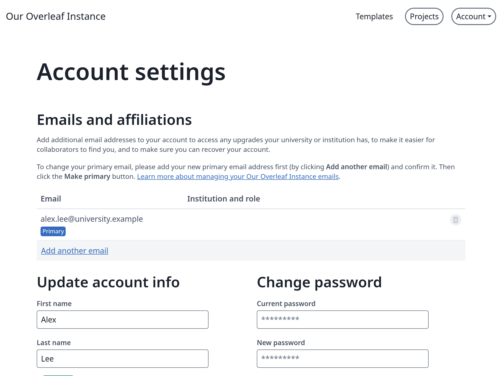
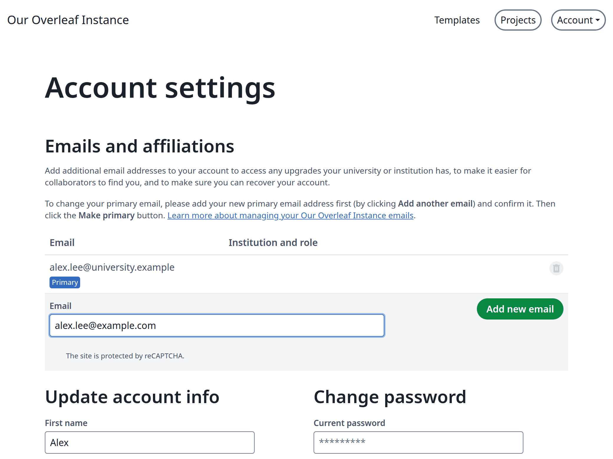
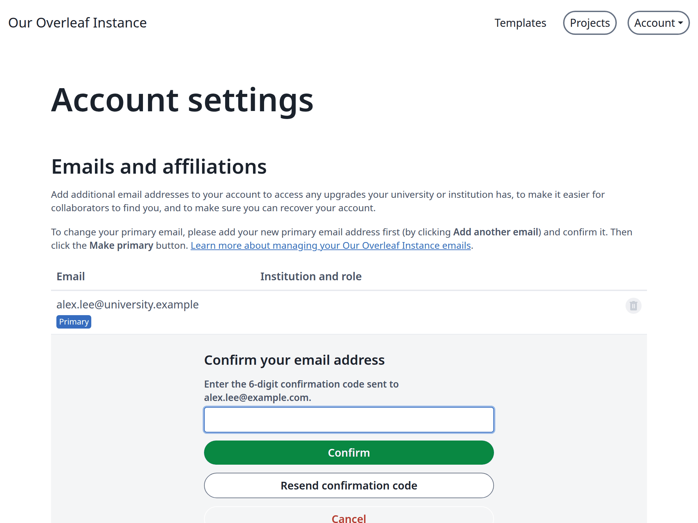
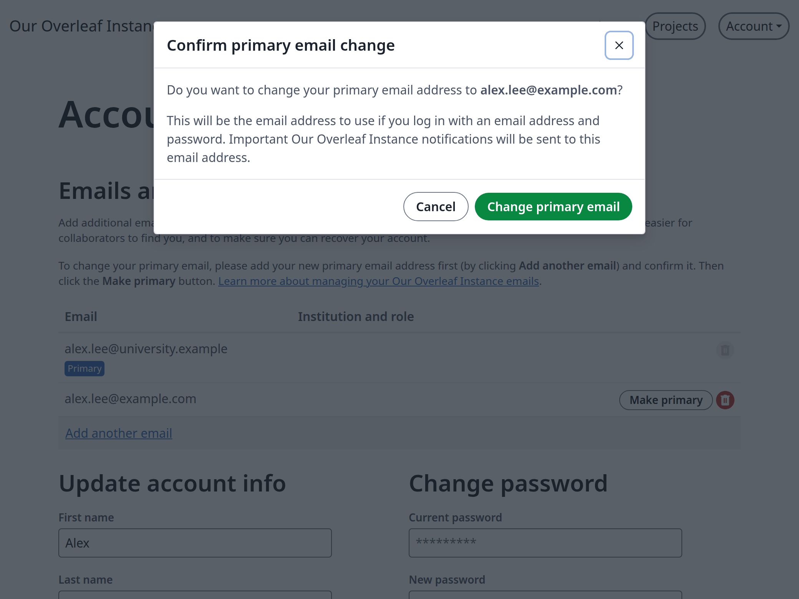
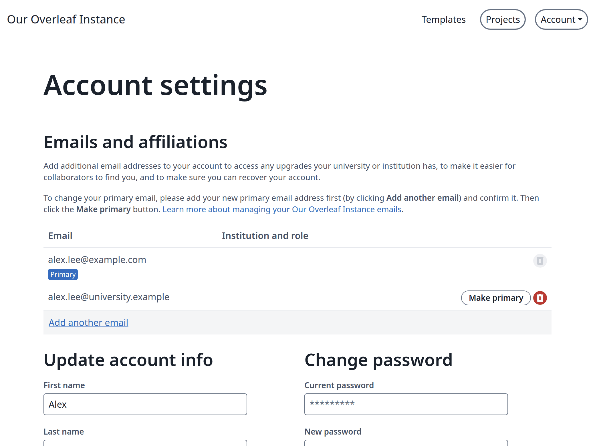

<Info>

此功能由 [ayaka-notes/ayakaleaf-pro](https://github.com/ayaka-notes/ayakaleaf-pro) 開發，自 v6.4.0 起提供。

</Info>

一個帳號可以有多個電子郵件。當某個地址即將被收回時（例如畢業後的學校信箱），新增一個電子郵件，就能保留你的帳號與專案。

當你的執行個體可以寄送電子郵件時，會顯示電子郵件清單。否則，設定頁面只有一個電子郵件欄位。

<Steps>
<Step title="開啟你的電子郵件">
點選 **Account**，再點選 **Account settings**。你的電子郵件位於 **Emails and affiliations** 下。

<Frame caption="你的電子郵件">
  
</Frame>
</Step>

<Step title="新增電子郵件">
點選 **Add another email**，輸入地址並點選 **Add new email**。

<Frame caption="新增電子郵件">
  
</Frame>
</Step>

<Step title="輸入驗證碼">
系統會寄送 6 位數驗證碼到新地址。輸入驗證碼並點選 **Confirm**。如果沒有收到，請點選 **Resend confirmation code**。

<Frame caption="確認新電子郵件">
  
</Frame>

該電子郵件現在已出現在你的清單中，你的主要電子郵件會收到已新增該電子郵件的通知。

<Frame caption="清單中的新電子郵件">
  
</Frame>
</Step>

<Step title="設為主要電子郵件">
點選新電子郵件旁的 **Make primary**，再點選 **Change primary email**。

<Frame caption="確認變更">
  
</Frame>

從現在起，請使用新電子郵件登入。舊電子郵件仍保留在清單中。

<Frame caption="新的主要電子郵件">
  
</Frame>
</Step>
</Steps>

## 每個電子郵件能做什麼 {#what-each-email-can-do}

* 只有主要電子郵件可以登入並接收密碼重設郵件。次要電子郵件兩者都不行，因此之後被分配給他人的地址無法接管你的帳號。
* 請在舊信箱關閉前點選 **Make primary**。之後只有管理員可以變更你的電子郵件。
* 你已驗證的舊主要電子郵件會保留為次要電子郵件。從未驗證過的電子郵件會在其他電子郵件成為主要電子郵件時被移除。
* 若要移除次要電子郵件，請點選其垃圾桶圖示。之後其他帳號就可以新增該地址。
* 屬於其他帳號的地址無法新增。
* 在使用 LDAP 或 SAML 登入的執行個體上，你可以新增電子郵件，但 **Make primary** 會被拒絕，因為你將無法再以新電子郵件登入。
