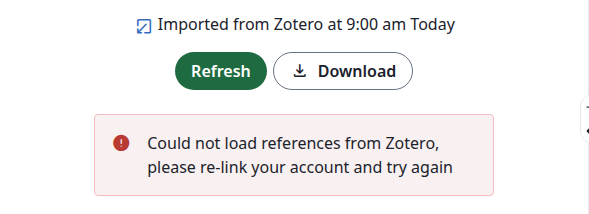

將 Zotero 文獻庫以 `.bib` 檔案的形式匯入專案，然後像平常一樣從中引用。這個檔案是一份副本：只有在你點擊 **Refresh** 時才會變更。

<Info>

如果你在 **Account settings** 中看不到 Zotero 選項，請管理員開啟 [Zotero 整合](/zh-Hant/on-premises/configuration/overleaf-toolkit/integrations/zotero-integration)。

</Info>

## 連結你的 Zotero 帳號 {#link-your-zotero-account}

此操作只需做一次。

<Steps>
<Step title="開啟帳號設定">
點擊 **Account**，然後點擊 **Account settings**。在 **Reference managers** 下找到 **Zotero**，點擊 **Link to Zotero**。

<Frame caption="帳號設定中的 Zotero">
  
</Frame>

編輯器 **Integrations** 面板中的 **Zotero** 卡片會在同一分頁中帶你到相同位置。

<Frame caption="Integrations 面板">
  
</Frame>
</Step>

<Step title="在 Zotero 上授權">
Zotero 頁面會開啟。如有提示請先登入，然後授權該應用程式。它只要求讀取你的文獻庫與群組，因此無法變更 Zotero 中的任何內容。
</Step>

<Step title="檢查連結">
你會回到帳號設定。一則綠色訊息顯示 **Reference manager linked**，按鈕變為 **Unlink**。

<Frame caption="你的 Zotero 帳號已連結">
  
</Frame>
</Step>
</Steps>

如果你沒有在 Zotero 上允許存取，同一區段會顯示 **Sorry, something went wrong**。點擊 **Link to Zotero** 重試。

## 從文獻庫建立檔案 {#create-a-file-from-your-library}

<Steps>
<Step title="開啟 Add files 對話框">
開啟一個專案。在檔案樹中點擊 **New file**，然後點擊 **From Zotero**。只有在帳號連結後才會出現此項目。
</Step>

<Step title="選擇檔案名稱與文獻庫">
**File Name** 預設為 `zotero.bib`。請保留 `.bib` 副檔名：否則你將看不到預覽，`\cite` 與 `\bibliography` 也都找不到其中的條目。

**Library** 預設為 **My Library**，同時也會列出你的群組文獻庫。一個檔案對應一個文獻庫。

<Frame caption="來自個人文獻庫的檔案">
  
</Frame>
</Step>

<Step title="點擊 Create">
對話框關閉，檔案出現在檔案樹中。點擊它：會顯示匯入時間及其條目。你無法在編輯器中編輯它。

<Frame caption="匯入的檔案">
  
</Frame>

如果點擊 **Create** 似乎沒有反應，表示已有同名檔案。請換一個名稱。
</Step>
</Steps>

### 匯入群組文獻庫 {#import-a-group-library}

再操作一次，使用另一個檔案名稱，並在 **Library** 下選擇該群組。一個專案可以有多個這樣的檔案。

<Frame caption="來自群組文獻庫的檔案">
  
</Frame>

## 從檔案中引用 {#cite-from-the-file}

<Steps>
<Step title="開始引用">
在 `.tex` 檔案中輸入 `\cite{`。清單會顯示專案中所有 `.bib` 檔案的條目。點擊其中一筆即可插入。

<Frame caption="已匯入檔案的條目">
  
</Frame>
</Step>

<Step title="或依標題或作者搜尋">
點擊清單下方的 **Search**，或在大括號內按 Ctrl+Space。輸入內容進行篩選，點擊一或多筆條目，然後點擊 **Insert**。

<Frame caption="文獻搜尋">
  
</Frame>
</Step>

<Step title="加入參考文獻列表">
在 `\end{document}` 之前加入以下幾行，使用不含 `.bib` 的檔案名稱，並以逗號分隔：

```latex
\bibliographystyle{plain}
\bibliography{reading-group,zotero}
```

點擊 **Recompile**。參考文獻會出現在 PDF 中。

<Frame caption="編譯後的參考文獻">
  
</Frame>
</Step>
</Steps>

匯入的檔案不會出現在 **Settings** 的 **References**、**Main bibliography file for this project** 中，因此如果專案沒有其他 `.bib` 檔案，該清單會保持空白。你仍然可以從中引用。

<Frame caption="清單空白是正常的">
  
</Frame>

## 重新整理檔案 {#refresh-the-file}

Zotero 文獻庫中的變更不會自動進入專案，編譯也不會擷取它們。

<Steps>
<Step title="開啟檔案">
在檔案樹中點擊已匯入的檔案。
</Step>

<Step title="點擊 Refresh">
整個檔案會從你建立時選擇的文獻庫重新匯入：新條目出現，已刪除的條目消失。頂部的時間會隨之改變。

<Frame caption="重新整理後的檔案">
  
</Frame>
</Step>

<Step title="重新編譯">
新條目會立即出現在 `\cite{` 清單中。點擊 **Recompile** 更新 PDF。
</Step>
</Steps>

每個檔案各自重新整理：請另外重新整理群組的檔案。關於在共用專案中誰可以重新整理檔案，請參閱[管理員說明](/on-premises/configuration/overleaf-toolkit/integrations/zotero-integration#notes)。

## 取消連結你的 Zotero 帳號 {#unlink-your-zotero-account}

在 **Account settings** 的 **Zotero** 下點擊 **Unlink**，然後在對話框中再次點擊 **Unlink**。按鈕會重新顯示 **Link to Zotero**。

<Frame caption="取消連結帳號">
  
</Frame>

你匯入的檔案會保留在專案中，並且仍可編譯。**From Zotero** 會從 **Add files** 對話框中消失，在你重新連結帳號之前，**Refresh** 會顯示錯誤。

<Frame caption="未連結帳號時重新整理">
  
</Frame>

重新連結後，**Refresh** 可在相同的檔案上正常運作。

## 如果發生問題 {#if-something-goes-wrong}

在 **Add files** 對話框中出現 **Could not load references from Zotero, please re-link your account and try again** 或 **There was an error accessing your Zotero data**：Overleaf 無法再讀取你的文獻庫，例如你在 Zotero 上撤銷了它的存取權。在 **Account settings** 中點擊 **Unlink**，然後點擊 **Link to Zotero**。在此之前，**Create** 也會失敗，並顯示 **The project that contains this file is not shared with you**，即使是在你自己的專案中。

<Frame caption="Overleaf 無法再讀取你的文獻庫">
  
</Frame>

點擊 **Refresh** 時出現 **The remote service produced an error**：對 Zotero 的請求失敗。檔案內容保持不變。請稍後再次點擊 **Refresh**。
