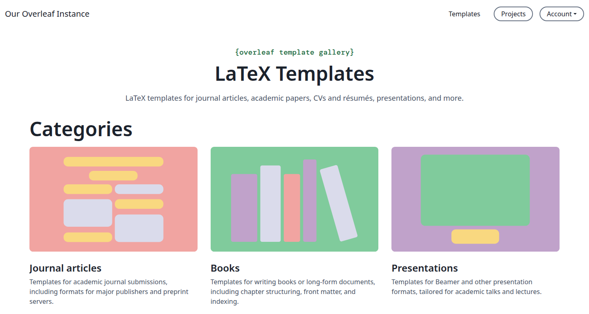

範本是管理員發佈的專案。開啟一個範本會為你建立一個屬於自己的新專案。

<Info>

如果你看不到 **Templates** 連結，請管理員開啟[範本庫](/zh-TW/on-premises/configuration/overleaf-toolkit/templates)。

</Info>

## 開啟範本庫 {#open-the-gallery}

在專案頁面上，點擊右上角的 **Templates**。

<Frame caption="Templates 連結">
  
</Frame>

**All templates** 頁面隨即開啟，最近更新的範本排在最前面。

<Frame caption="所有範本">
  
</Frame>

如果你還沒有專案，請在歡迎頁面上點擊 **Browse templates**。

<Frame caption="歡迎頁面">
  
</Frame>

如果你已有專案，也可以點擊 **New project**，然後點擊 **More templates**，再選擇一個分類。

<Frame caption="More templates">
  
</Frame>

預設情況下，範本庫需要登入：如果有人傳給你範本連結而你尚未登入，你會先進入登入頁面，然後再進入該範本。

## 尋找範本 {#find-a-template}

在框中**搜尋**。清單會隨著你的輸入更新，並比對標題、作者和描述。如果沒有相符項目，頁面會顯示 <strong>No Templates.</strong>

<Frame caption="搜尋 slides">
  
</Frame>

使用清單右上方的 **Last Updated** 或 **Title** 進行**排序**。再次點擊目前使用的排序方式可反轉順序。

在清單下方**換頁**。每頁顯示九個範本。

<Frame caption="換頁按鈕">
  
</Frame>

<strong>依分類瀏覽：</strong>在 **All templates** 頁面點擊 **Template Gallery**。範本庫頁面為每個分類顯示一張卡片，所有範本列在卡片下方。

<Frame caption="分類">
  
</Frame>

點擊卡片即可查看該分類的範本。你在這裡同樣可以搜尋和排序，點擊 **All templates** 可返回。

<Frame caption="分類頁面">
  
</Frame>

## 將範本作為新專案開啟 {#open-a-template-as-a-new-project}

<Steps>
<Step title="開啟範本">
點擊一個範本。你會看到其第一頁的預覽、作者、最後更新時間、授權條款和摘要。

<Frame caption="範本頁面">
  
</Frame>

**View PDF** 會開啟完整的 PDF。旁邊的按鈕會將檔案下載為 zip。
</Step>

<Step title="點擊 Open as Template">
經過短暫的載入畫面後，編輯器會開啟你的新專案。

<Frame caption="你的新專案">
  
</Frame>
</Step>

<Step title="檢查專案">
專案使用範本的名稱和檔案，以及相同的編譯器和主文件。它在開啟時會自動編譯，在專案清單中你是它的擁有者。

再次開啟同一個範本會建立另一個專案，例如 `Journal article (1)`。

<Frame caption="每次開啟都會建立一個專案">
  
</Frame>
</Step>
</Steps>

你的專案不依賴於範本：範本更新或刪除時，你的專案保持不變。

<Info>

一般帳號無法發佈或修改範本：**File** 選單中沒有 **Manage Template**，範本頁面上也沒有 **Edit** 或 **Delete**。要將範本加入範本庫，請聯絡管理員。

</Info>
